# 05 — Consolidated ERD (first cut)

This is the ERD you attach to the submission email. It stitches together every model touched by the five MVP workflows.

## Design principles baked in

1. **Money is stored in minor units (cents) as `BIGINT`.** Never float, never decimal-string. Always paired with a `currency` column even though MVP is AUD-only.
2. **Everything is UUIDv7** — sortable, unique across services.
3. **Every mutation is an event.** Ledger uses an `outbox` table + Debezium; every service writes an audit line for state changes worth auditing.
4. **Balances are a projection.** The source of truth for a balance is `SUM(postings)` for that `ledger_account`. `LEDGER_ACCOUNT.available_balance_cents` is a maintained cache with a daily reconciliation check.
5. **All customer-visible accounts are one class of a broader `LEDGER_ACCOUNT`.** Control accounts (sponsor pool, suspense, interest expense, unmatched credits) sit in the same table with a different `account_class` — this is what makes double-entry natural.
6. **Idempotency at the transaction level** via `TRANSACTION.idempotency_key UNIQUE`. Every producer (webhook, DE ingest, transfer, interest) constructs a deterministic key.
7. **Audit surfaces** (application decisions, ops actions, rate versions) capture actor + timestamp + reason; append-only.
8. **PII is columnar and encryptable.** `CUSTOMER` PII fields are candidates for column-level encryption via KMS (pgcrypto or Aurora encryption features).

## Full ERD (Mermaid)

```mermaid
erDiagram
    CUSTOMER ||--o{ CUSTOMER_ADDRESS : "has"
    CUSTOMER ||--o{ CUSTOMER_CONSENT : "grants"
    CUSTOMER ||--o{ APPLICATION : "submits"
    APPLICATION ||--o{ APPLICATION_DOCUMENT : "has"
    APPLICATION ||--o{ APPLICATION_DECISION : "has"
    CUSTOMER ||--o{ ACCOUNT : "owns"
    ACCOUNT ||--|| PRODUCT : "of type"
    ACCOUNT ||--o{ LEDGER_ACCOUNT : "has ledger position(s)"
    ACCOUNT ||--o{ PAYID_REGISTRATION : "aliases"
    ACCOUNT ||--o{ INTEREST_ACCRUAL : "accrues"
    ACCOUNT ||--o{ PAYEE : "is target of"
    CUSTOMER ||--o{ PAYEE : "saves"

    PRODUCT ||--o{ RATE_VERSION : "priced by"
    RATE_VERSION ||--o{ INTEREST_ACCRUAL : "priced by"
    LEDGER_ACCOUNT ||--o{ POSTING : "has"
    TRANSACTION ||--|{ POSTING : "composed of"
    TRANSACTION ||--o{ OUTBOX_EVENT : "emits"
    TRANSACTION ||--o| TRANSACTION : "reverses"
    PAYMENT_INSTRUCTION ||--o| TRANSACTION : "posts as"
    INBOUND_FILE ||--o{ PAYMENT_INSTRUCTION : "contains (DE)"
    INBOUND_MESSAGE ||--|| PAYMENT_INSTRUCTION : "is (NPP)"
    INTEREST_ACCRUAL ||--o| TRANSACTION : "capitalised by"
    RECON_RUN ||--o{ RECON_BREAK : "produces"

    OPS_USER ||--o{ APPLICATION_DECISION : "made by"
    OPS_USER ||--o{ RATE_VERSION : "approved by"
    OPS_USER ||--o{ RECON_BREAK : "proposed / confirmed"
    OPS_USER ||--o{ AUDIT_LOG : "acted"

    CUSTOMER {
        uuid id PK
        string cognito_sub UK
        string email UK
        string mobile UK
        string full_name
        date dob
        string occupation
        string kyc_status "NONE|PENDING|VERIFIED|REJECTED"
        string aml_status "CLEAR|WATCH|HOLD"
        timestamp created_at
        timestamp updated_at
    }

    CUSTOMER_ADDRESS {
        uuid id PK
        uuid customer_id FK
        string line1
        string line2
        string suburb
        string state
        string postcode
        string country "AU"
        boolean current
        timestamp valid_from
        timestamp valid_to
    }

    CUSTOMER_CONSENT {
        uuid id PK
        uuid customer_id FK
        string consent_type "TCS|PRIVACY|MARKETING|CDR"
        string version
        timestamp granted_at
        timestamp revoked_at
    }

    APPLICATION {
        uuid id PK
        uuid customer_id FK
        string status "DRAFT|PENDING_REVIEW|INFO_REQUESTED|APPROVED|REJECTED|EXPIRED"
        jsonb submitted_snapshot
        timestamp created_at
        timestamp decided_at
    }

    APPLICATION_DOCUMENT {
        uuid id PK
        uuid application_id FK
        string doc_type "DL_FRONT|DL_BACK|PASSPORT|SELFIE|MEDICARE"
        string s3_key
        string sha256
        string kms_key_id
        timestamp uploaded_at
    }

    APPLICATION_DECISION {
        uuid id PK
        uuid application_id FK
        string decision "APPROVE|REJECT|RFI"
        string reason_code
        text notes
        uuid reviewer_ops_user_id FK
        boolean is_confirmation
        timestamp decided_at
    }

    PRODUCT {
        string code PK "TXN"
        string name
        string currency "AUD"
        string description
    }

    RATE_VERSION {
        uuid id PK
        string product_code FK
        numeric rate_pa
        string day_count "ACT_365"
        date effective_from
        date effective_to
        uuid proposed_by_ops_user_id
        uuid approved_by_ops_user_id
        timestamp approved_at
    }

    ACCOUNT {
        uuid id PK
        uuid customer_id FK
        string product_code FK
        string bsb
        string account_number UK
        string status "ACTIVE|FROZEN|CLOSED"
        timestamp opened_at
        timestamp closed_at
    }

    LEDGER_ACCOUNT {
        uuid id PK
        uuid account_id FK "nullable for control accounts"
        string account_class "CUSTOMER_AVAILABLE|CUSTOMER_HELD_AML|CUSTOMER_PENDING|SPONSOR_POOL|SUSPENSE|INTEREST_EXPENSE|ATO_WITHHOLDING_PAYABLE|UNMATCHED_CREDITS"
        string currency "AUD"
        bigint available_balance_cents
        bigint pending_balance_cents
        timestamp last_posted_at
    }

    TRANSACTION {
        uuid id PK
        string type "DE_INBOUND|NPP_INBOUND|INTERNAL_TRANSFER|INTEREST|REVERSAL"
        string status "PENDING|POSTED|REVERSED|FAILED"
        string idempotency_key UK
        uuid reversed_by_tx_id FK "self-ref, nullable"
        uuid payment_instruction_id FK "nullable"
        text note
        jsonb device_context
        timestamp created_at
        timestamp posted_at
    }

    POSTING {
        uuid id PK
        uuid transaction_id FK
        uuid ledger_account_id FK
        string dr_cr "DR|CR"
        bigint amount_cents
        string currency
        timestamp posted_at
    }

    OUTBOX_EVENT {
        uuid id PK
        uuid transaction_id FK "nullable, generic outbox"
        string topic
        jsonb payload
        string status "PENDING|SENT"
        timestamp created_at
        timestamp sent_at
    }

    PAYMENT_INSTRUCTION {
        uuid id PK
        uuid inbound_file_id FK "nullable for NPP"
        uuid inbound_message_id FK "nullable for DE"
        string direction "INBOUND"
        string rail "NPP|DE"
        string bsb
        string account_number
        string remitter_name
        string remitter_bsb
        string remitter_account
        string end_to_end_ref
        bigint amount_cents
        string currency
        date value_date
        string status "RECEIVED|MATCHED|UNMATCHED|POSTED|RETURNED|REJECTED"
    }

    INBOUND_FILE {
        uuid id PK
        string source "DE"
        string sponsor_file_id UK
        string s3_key
        string sha256
        int record_count
        bigint total_credits_cents
        string sig_algo "e.g. RSA-PSS-SHA256|ECDSA-P256-SHA256"
        string sig_value "base64 signature bytes from sponsor"
        string sig_key_id "sponsor's key id"
        string sig_version "sponsor's signing scheme version"
        boolean sig_verified
        string status "RECEIVED|PARSED|POSTED|QUARANTINED"
        timestamp received_at
    }

    INBOUND_MESSAGE {
        uuid id PK
        string rail "NPP"
        string sponsor_msg_id UK
        string end_to_end_id
        jsonb raw_payload
        string sig_algo "e.g. RSA-PSS-SHA256|ECDSA-P256-SHA256"
        string sig_value "base64 signature bytes from sponsor"
        string sig_key_id "sponsor's key id"
        string sig_version "sponsor's signing scheme version"
        boolean sig_verified
        string status "RECEIVED|POSTED|REJECTED|REPLAY_QUEUED"
        timestamp received_at
    }

    PAYID_REGISTRATION {
        uuid id PK
        uuid account_id FK
        string alias_type "EMAIL|MOBILE|ABN|ORG_ID"
        string alias_value UK
        string status "PENDING|ACTIVE|SUSPENDED|CLOSED"
        string sponsor_ref
        timestamp registered_at
    }

    INTEREST_ACCRUAL {
        uuid id PK
        uuid account_id FK
        date accrual_date
        uuid rate_version_id FK
        bigint eod_balance_cents
        bigint accrued_cents
        string status "ACCRUED|CAPITALISED|REVERSED"
        uuid capitalisation_tx_id FK
        timestamp created_at
    }

    PAYEE {
        uuid id PK
        uuid customer_id FK "owner"
        uuid payee_account_id FK "if internal"
        string external_bsb "roadmap"
        string external_account "roadmap"
        string alias
        boolean is_internal
        timestamp added_at
    }

    RECON_RUN {
        uuid id PK
        string source "DE|NPP|SPONSOR_POOL"
        date business_date
        bigint sponsor_total_cents
        bigint velo_total_cents
        string status "GREEN|BREAK"
        timestamp ran_at
    }

    RECON_BREAK {
        uuid id PK
        uuid recon_run_id FK
        string type "MISSING|EXTRA|AMOUNT_MISMATCH"
        jsonb details
        string status "OPEN|IN_REVIEW|RESOLVED|ESCALATED"
        string resolution_action "NO_ACTION|ADJUSTMENT_POSTED|ESCALATED_TO_SPONSOR"
        text resolution_notes
        uuid proposed_by_ops_user_id FK
        uuid confirmed_by_ops_user_id FK "4-eyes; must differ from proposed_by"
        timestamp resolved_at
    }

    OPS_USER {
        uuid id PK
        string cognito_sub UK
        string full_name
        string email UK
        string[] roles "OPS_REVIEWER|OPS_APPROVER|OPS_ADMIN|TREASURER"
        boolean active
        timestamp created_at
    }

    AUDIT_LOG {
        uuid id PK
        uuid actor_id "OPS_USER or CUSTOMER"
        string actor_type "OPS|CUSTOMER|SYSTEM"
        string action "e.g. APPLICATION_DECISION|RATE_CHANGE|ACCOUNT_FREEZE"
        jsonb before_state
        jsonb after_state
        string ip
        string user_agent
        timestamp at
    }
```

## Key constraints and indexes to call out

| Constraint | Table | Purpose |
|---|---|---|
| `UNIQUE(idempotency_key)` | `TRANSACTION` | Prevents double posting on retries across every rail |
| `UNIQUE(sponsor_msg_id)` | `INBOUND_MESSAGE` | Sponsor webhook dedup |
| `UNIQUE(sponsor_file_id)` | `INBOUND_FILE` | DE file dedup |
| `UNIQUE(bsb, account_number)` | `ACCOUNT` | Global uniqueness of issued BSB+acct |
| `UNIQUE(alias_type, alias_value)` where status=ACTIVE | `PAYID_REGISTRATION` | Only one PayID per alias globally |
| `UNIQUE(account_id, accrual_date)` | `INTEREST_ACCRUAL` | One accrual per account per day |
| `CHECK (dr_cr IN ('DR','CR'))` and posting sum-per-txn-per-currency = 0 (enforced in app + DB trigger) | `POSTING` | Double-entry integrity |
| Row-level security by `customer_id` | `ACCOUNT`, `TRANSACTION` reads | Multi-tenant safety even from a compromised service |
| Composite index `(ledger_account_id, posted_at DESC)` | `POSTING` | Fast transaction history queries |
| Partial index on `TRANSACTION` where `status='PENDING'` | `TRANSACTION` | Fast retry / reconciliation scans |

## What's deliberately *not* in the ERD (roadmap)

- Cards, PANs, tokenisation.
- Outbound `PAYMENT_INSTRUCTION` (`direction='OUTBOUND'`) — the schema is symmetric; adding it is a value change, not a schema change.
- KYC provider results (`kyc_check_result` table) — reserved column `kyc_provider_ref` in `APPLICATION` for the future.
- Fraud scores (`fraud_assessment` table) — `TRANSACTION.device_context` already captures raw inputs.
- Reg-reporting artifacts (TTR/SMR/IFTI) — downstream consumers of the audit lake.
- CDR consent register — separate bounded context; consumes `CUSTOMER_CONSENT` events.
- **Sponsor signing-key registry.** Key material, rotation, and revocation are the **sponsor's** responsibility, not ours. We just verify what the sponsor sends and store the `sig_key_id` / `sig_version` they claim so the message is auditable end-to-end. If we ever need to independently verify against a pinned copy of the sponsor's public key, we'll add a `SPONSOR_SIGNING_KEY` table then — not before.
