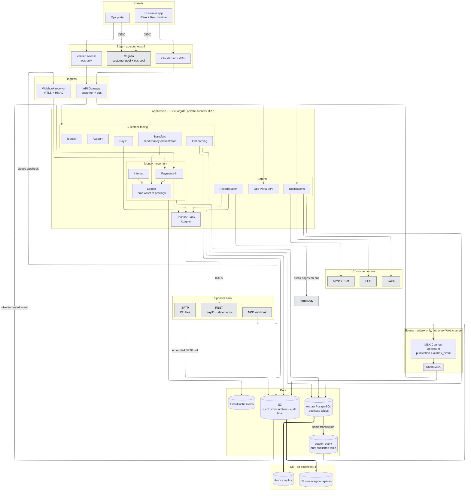

# 06 — High-level Cloud Architecture

AWS placement of the same system drawn in [`docs/09-internal-system-architecture.md`](09-internal-system-architecture.md) Diagram 2. Diagram 2 is the picture to attach for the high-level architecture deliverable — it already shows the services, the sponsor boundary, and the event path. This page is the cloud-posture companion (region, edge, DR) if the panel asks where it runs.

## Guiding principles

1. **Cloud:** AWS in **`ap-southeast-2` (Sydney)** primary, **`ap-southeast-4` (Melbourne)** for DR. Australian data residency for APRA CPS 234 / CPS 231.
2. **Architectural style:** **Modular monolith with service seams** for MVP. Deployed as ~6 independent binaries so a compromise of one cannot mutate another's DB. Service names below double as future microservice boundaries — split lazily when scale or team topology demands it.
3. **All money movement flows through one Ledger service.** No exceptions.
4. **Sponsor bank is the only external money rail.** All BECS/NPP/PayID interactions terminate at an **anti-corruption layer** (`sponsor-adapter`).
5. **Event-driven where useful, synchronous where correctness demands.** Ledger writes are synchronous; downstream notifications are eventual.
6. **Multi-account AWS org.** At minimum: `mgmt`, `security`, `logs-audit`, `prod`, `preprod`, `dev`, `sandbox-sponsor`. Cross-account IAM, no long-lived keys.
7. **Zero-trust ops surface.** Ops portal only reachable via **AWS Verified Access** (or Cloudflare Access); every action four-eyes + audit-logged.

## Architecture diagram

Drawn as one forward pass, top to bottom. Group arrows stand in for the per-service lines (those live in [`docs/09-internal-system-architecture.md`](09-internal-system-architecture.md)). Every box on this page has a completed path; KMS, Secrets Manager, Shield, and multi-AZ are called out underneath rather than drawn as a second web of dotted lines.

**Present on every deployment, omitted from the drawing on purpose** (drawing them adds arrows and no new decision):

- **KMS CMKs** encrypt Aurora, all three S3 buckets, and Secrets Manager. One CMK per data class (`data-kyc`, `data-ledger`, `data-inbound`).
- **Secrets Manager** holds the sponsor mTLS material and HMAC secret. Only the Sponsor-Bank Adapter's task role can read them.
- **Shield + WAF** sit on CloudFront. The WAF box above is that control; there is no second WAF inside the VPC.
- **Multi-AZ** is the default for Aurora, Redis, MSK, and ECS. The Melbourne box is the cross-region copy, not a second AZ.

## Service-by-service

| Service | Owns | Talks to | Sync/Async | Notes |
|---|---|---|---|---|
| **Onboarding Svc** | `applications`, `application_documents`, `application_decisions` | Cognito, S3-KYC, Account Svc, MSK | Sync + async | Emits `customer.onboarded` |
| **Identity Svc** | Cognito facade + session mgmt | Cognito | Sync | MFA, step-up, refresh |
| **Account Svc** | `accounts`, allocation of BSB+acct, freeze/close state | Ledger, Aurora | Sync | Only service allowed to open ledger accounts |
| **Ledger Svc** | `transactions`, `postings`, `ledger_accounts`, `outbox_events` | Aurora, KMS | Sync | Sole writer to the ledger tables; enforces double-entry |
| **Payments-In Svc** | Ingest of DE + NPP; `inbound_files`, `inbound_messages`, `payment_instructions` | Sponsor Adapter, Account Svc, Ledger, MSK, Redis | Sync (NPP webhooks), async (DE files) | Idempotent posting; unmatched queue |
| **Transfers Svc** | Customer send-money orchestrator. No tables of its own | Account (resolve payee), Identity (step-up), Ledger (`postTransaction`), fraud stub | Sync | Owns validation, limits, cool-off, idempotency key. Does **not** write postings and does **not** call Kafka or the sponsor |
| **Interest Svc** | Daily accrual + monthly capitalisation; `interest_accruals`, `rate_versions` | Aurora, Ledger, MSK | Async (scheduled) | Idempotent per (account, date/month) |
| **PayID Svc** | `payid_registrations` | Sponsor Adapter, Aurora | Sync | Registration + de-registration with sponsor |
| **Sponsor-Bank Adapter** | Talks to sponsor's REST + SFTP; hides sponsor schema | Sponsor bank, Secrets Mgr | Both | Anti-corruption layer; only place sponsor SDK lives |
| **Recon Svc** | Daily reconciliation, `recon_runs`, `recon_breaks` | Sponsor Adapter, Ledger, MSK | Async (scheduled) | Pages ops on-call on BREAK |
| **Notifications Svc** | Delivery via SES, Twilio, APNs | SES, Twilio, APNs, MSK | Async | Backed by per-channel SQS for provider isolation |
| **Ops Portal API** | Serves Ops Portal web app; RBAC, four-eyes workflow | Onboarding, Account, Ledger, Recon, S3-KYC | Sync | Only accessible via Verified Access |
| **Ops Portal Web** | Internal React/Next.js app | Ops Portal API | Sync | Never public |
| **Customer App (PWA + native)** | Customer surface | API Gateway | Sync | React Native + Next.js PWA; single codebase for MVP |

## External integrations (the "external integration points" line item)

| External | Direction | Protocol | Purpose |
|---|---|---|---|
| **Sponsor bank — SFTP** | In + Out (roadmap) | SFTP + PGP over VPN/DirectConnect | DE files (in), statements (in), positions (in); DE files (out — roadmap) |
| **Sponsor bank — NPP webhook** | In | HTTPS + mTLS + HMAC | Real-time NPP credits |
| **Sponsor bank — REST APIs** | Out | HTTPS + OAuth2 / mTLS | PayID mgmt, account confirmations, ad-hoc queries |
| **NPP addressing (PayID)** | In (indirect) | via sponsor | Name-resolution during payer flows |
| **Cognito** | In/Out | OIDC | Customer + Ops identity |
| **SES / Twilio / APNs / FCM** | Out | HTTPS | Notifications |
| **PagerDuty** | Out | HTTPS webhook | On-call alerting |
| **CloudFront + WAF + Shield** | In | HTTPS | Edge + DDoS |
| **Datadog / Grafana Cloud** | Out | HTTPS | Observability |
| **APRA/AUSTRAC portals (roadmap)** | Out | Portal / API | Regulatory reporting |

## Data flows through the audit lake

Every domain event on MSK is mirrored via **MSK → S3 sink connector** into the **audit-lake** bucket, which is:
- **SSE-KMS** encrypted with a segregated CMK the Ledger IAM role cannot access to write over.
- **Object Lock in Compliance mode** with a 7-year retention.
- **Cross-region replicated** to `ap-southeast-4`.
- Partitioned by `topic/date/hour`.

This satisfies **AUSTRAC**'s records-retention obligation and gives the roadmap AML/fraud/CDR consumers a durable source.

## CI/CD and testing strategy

**Pipeline:** GitHub → GitHub Actions → OIDC-federated deploy to AWS → CDK / Terraform.

**Environments:** `dev` (auto), `preprod` (auto + integration tests), `prod` (manual approval + change ticket).

**Pipeline stages:**
1. **Static:** lint (ESLint / detekt), type-check, secrets scan (gitleaks), SBOM (syft), SCA (dependabot / trivy), IaC scan (checkov).
2. **Unit tests:** ≥ 80% coverage on ledger/transfers/payments-in/interest. Domain logic is a pure module — no I/O.
3. **Contract tests:** Pact against the sponsor's OpenAPI (both sides). Any change breaks the pipeline.
4. **Integration tests:** Postgres via Testcontainers; Kafka via Testcontainers; a **mock sponsor** stub for SFTP + webhook that runs in `preprod`.
5. **End-to-end tests:** Playwright for customer app + ops portal; synthetic transaction (mock sponsor credit → in-app balance update) runs on every prod deploy as a smoke test.
6. **Load/perf tests:** k6 against ledger + payments-in nightly; assert P99 posting latency < 250 ms.
7. **Security tests:** OWASP ZAP baseline; IAM Access Analyser; quarterly external pentest (compliance-visible).
8. **Deploy:** blue/green on ECS + Aurora migration gates (Flyway); automatic rollback on synthetic-transaction failure or error-rate spike.
9. **Change control:** every prod deploy attaches a JIRA / Linear ticket; on-call approval required for schema changes or ledger service.
10. **Recovery drills:** monthly DR drill in preprod using a snapshot of prod (PII scrubbed).

## Trade-offs, deferrals, and why

| Decision | What we accepted | What we deferred |
|---|---|---|
| Modular monolith | Simpler ops, one repo, fewer moving parts | Independent scaling per service (only Payments-In really needs it) |
| PostgreSQL for the ledger | Boring, hireable, transactional, mature | Purpose-built ledger DBs (TigerBeetle, QLDB) — great fit but riskier at MVP |
| Kafka MSK | Rich fan-out for future consumers | Bigger op burden than SNS/SQS — accepted for the audit lake and roadmap |
| Sponsor via SFTP + webhook | Universally supported | A real-time API to the sponsor — sponsor-side maturity varies |
| Cognito for identity | Fast time-to-value | Full customer-IAM (multi-device, biometrics UX) — Auth0 later if needed |
| PWA + React Native | One codebase | Full native iOS + Android teams |
| Debezium outbox | Exactly-once effect | Simpler dual-write path we deliberately avoided |
| Zero-trust for Ops | Small friction for staff | Public ops portal — never |
| AWS in AU only | Data residency clean | Multi-region active-active — RADI phase does not need it |

## Regulatory alignment map (be ready to name-drop)

| Requirement | Where the architecture answers it |
|---|---|
| **APRA CPS 234** (Information Security) | KMS envelope encryption; mTLS to sponsor; Verified Access for Ops; multi-account AWS; SBOM + SCA in CI; WAF + Shield |
| **APRA CPS 231** (Outsourcing) | AWS as documented material outsource; sponsor-bank as documented material outsource; DR to `ap-southeast-4`; exit strategy = data export via audit lake |
| **APRA CPS 220** (Risk Management) | Change control gates in CI/CD; four-eyes in Ops Portal; risk register externally maintained |
| **AUSTRAC / AML/CTF** | Audit lake with 7-year Object Lock; every money movement is an event; hold/freeze primitives already in Account model |
| **Privacy Act / APPs** | PII minimisation; column-level encryption for `CUSTOMER`; DSAR = SQL by `customer_id`; retention windows enforced by S3 lifecycle |
| **ePayments Code** | Immutable transaction record; mistaken-payment workflow (via Ops Portal); dispute audit trail |
| **FCS** | Deposit balances are computed from the ledger; per-depositor and aggregate reports are queries against `LEDGER_ACCOUNT` |

## What I would ship on Day 1 vs Week 1 vs Month 1 (if asked)

- **Day 1 (soft launch, invite-only, ≤ 100 customers):** Onboarding + internal transfers + inbound NPP; DE via manual sponsor coordination. No public marketing.
- **Week 1:** DE ingest automated + recon live + notifications live + interest accrual live.
- **Month 1:** Ops Portal hardened, on-call rota, first monthly interest capitalisation done, first APRA-facing metrics.
