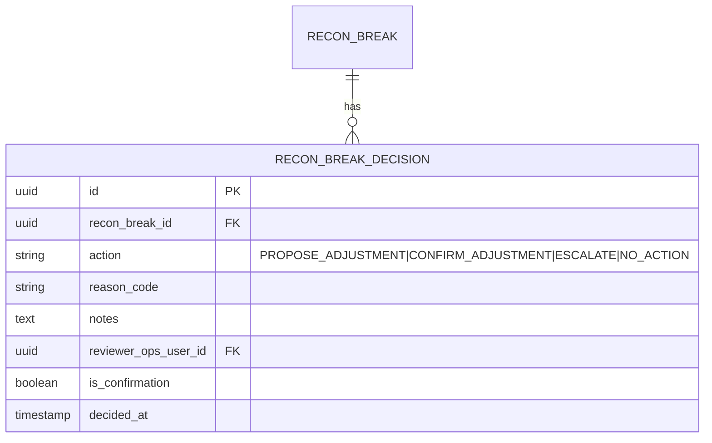

# 08 — Workflow Q&A (follow-ups)

Follow-up clarifications on the 5 workflow docs. Doc bugs surfaced by these questions are called out with a **Doc correction** callout and fixed in a follow-up commit (see the "Doc corrections" section at the bottom).

**Contents**

- [Workflow 01 — Customer Onboarding](#workflow-01--customer-onboarding)
- [Workflow 02 — Inbound Direct Entry (DE / BECS)](#workflow-02--inbound-direct-entry-de--becs)
- [Workflow 03 — Inbound NPP / PayID](#workflow-03--inbound-npp--payid)
- [Workflow 04 — Real-time Internal Transfer](#workflow-04--real-time-internal-transfer)
- [Workflow 05 — Interest Accrual & Capitalisation](#workflow-05--interest-accrual--capitalisation)
- [Doc corrections applied](#doc-corrections-applied)

---

## Workflow 01 — Customer Onboarding

### Q1. How does Cognito work here, and why do we store `cognito_sub`?

**What Cognito actually does for us**

Cognito (the "user pool" flavor) is an OIDC-compliant identity provider. It handles the bits we do **not** want to write ourselves:

- User registration (email + mobile), password hashing, password reset flows.
- MFA enrolment and challenges (TOTP, SMS OTP, WebAuthn/passkeys).
- Session management (issues short-lived JWT `id_token` and `access_token`, plus a rotating `refresh_token`).
- Account lockout, brute-force protection.
- Public JWKS endpoint so any service can verify tokens without calling Cognito on every request.

**The flow, precisely**

```
1. App calls Cognito API: SignUp(email, mobile, password)
   → Cognito creates a user in the pool, generates a stable sub (UUID).
2. Cognito sends OTPs (email + SMS). App confirms them.
3. App enrols MFA (biometric on device, or TOTP fallback).
4. App calls Cognito API: InitiateAuth (SRP or ADMIN_NO_SRP)
   → Cognito returns { id_token, access_token, refresh_token }.
5. App calls Velo Onboarding Svc with the Bearer id_token.
6. Onboarding Svc verifies the JWT signature against Cognito's JWKS,
   extracts { sub, email, cognito:groups, exp, aud, iss }.
7. Onboarding Svc: SELECT * FROM customer WHERE cognito_sub = <sub>
   → if none, INSERT (this is the first authenticated request).
8. From now on, sub is our foreign key into the customer's identity.
```

**Why we store `cognito_sub` on `CUSTOMER`**

- `sub` is Cognito's **stable, opaque, immutable identifier**. It never changes even if the user changes their email or mobile. Email/mobile are not safe as primary identifiers because users update them.
- Storing it lets any Velo service **resolve "who is this JWT?"** with one indexed lookup, without extra Cognito API calls.
- It's the join column between Cognito's world (authentication) and our world (customer, accounts, ledger).
- We never store the user's password. Cognito owns credentials; Velo owns the identity-linked application state. Clean separation of concerns and a much smaller PCI/security surface for us.
- If we ever migrate off Cognito, `cognito_sub` is the single column we replace with the new IdP's user id — an isolated blast radius.

**Ops-user variant**: same pattern, different Cognito user pool (separate pool for staff, with mandatory hardware-key MFA). `OPS_USER.cognito_sub` links to that pool.

---

### Q2. Does 4-eyes work by `is_confirmation=false` for the first reviewer, then `true` for the second?

Yes, exactly.

```
INSERT INTO application_decision (id, application_id, decision,
    reason_code, notes, reviewer_ops_user_id, is_confirmation, decided_at)
VALUES
  (uuid(), :app_id, 'APPROVE', NULL, 'Licence verified', :alice_id, false, now()),
  (uuid(), :app_id, 'APPROVE', NULL, 'Confirmed',        :bob_id,   true,  now());
```

**Enforcement**

- **DB check**: at most one row per `application_id` with `is_confirmation = true`.
- **DB check**: at most one row per `application_id` with `is_confirmation = false` (the proposal).
- **App check**: the two `reviewer_ops_user_id` values **must differ** (Alice cannot confirm her own proposal). Trigger or app-layer guard.
- **State transition**: `APPLICATION.status` only moves to `APPROVED`/`REJECTED` after the `is_confirmation = true` row is inserted. This is the transactional guard.

**Disagreement path**

- Bob opens the case and disagrees with Alice's `APPROVE` proposal.
- He does not simply insert a `is_confirmation=true` with `decision=REJECT` — that's confusing (was Alice wrong? was Bob wrong?).
- Better model: Bob inserts a **new proposal** row (`is_confirmation=false`, `decision=REJECT`), which invalidates Alice's proposal. A third reviewer (Charlie) then confirms Bob's. This gives us an explicit "escalation" trail.
- Alternative: `is_confirmation=true` with different decision, and the app's final status equals the confirmed decision. Simpler, but loses the story of the disagreement.

**We prefer the first (explicit re-proposal) model** because a disagreement between reviewers is a compliance signal worth capturing, not a footnote.

---

### Q3. What is a KMS CMK, exactly?

Already covered in depth in [`docs/07-explainers.md § 7`](07-explainers.md#7-security-terms). Short version restricted to the KYC-upload context:

- **KMS** = AWS Key Management Service — a managed **hardware security module (HSM)** service.
- **CMK** = **Customer-Managed Key** — a key **you** create and control (as opposed to `aws/s3`, which AWS creates on your behalf and manages centrally).
- With a CMK you own:
  - The **key policy** (who can call `Encrypt` / `Decrypt` / `GenerateDataKey`).
  - The **rotation schedule** (annual automatic, or manual).
  - The **deletion** (pending window; deleting bricks all data encrypted under it — extremely powerful, extremely dangerous).
  - The **grants** to specific IAM principals for specific actions.
- **Envelope encryption** (how it actually works when you upload a KYC doc):

  ```
  1. Onboarding Svc calls KMS.GenerateDataKey(cmk=kms/velo/data-kyc)
     → returns { plaintext_data_key, encrypted_data_key }
  2. Onboarding Svc encrypts the KYC PDF locally with plaintext_data_key (AES-256-GCM)
  3. Onboarding Svc PUTs to S3: object body = encrypted PDF,
     object metadata = encrypted_data_key
  4. Plaintext data key is discarded from memory
  ```

  When Ops reads it back:

  ```
  1. Ops Portal API GETs the object from S3.
  2. Reads encrypted_data_key from metadata.
  3. Calls KMS.Decrypt(encrypted_data_key, cmk=kms/velo/data-kyc)
     → returns plaintext_data_key (only if IAM policy allows this role).
  4. Decrypts the PDF locally with plaintext_data_key.
  5. Presents to Ops user via short-lived signed URL.
  ```

- **Why CMK instead of the default `aws/s3` key?** Fine-grained IAM: only the Onboarding + Ops Portal service roles have `Decrypt` on `kms/velo/data-kyc`. A compromised Ledger or Notifications service **cannot read a KYC doc even if it can list the bucket**, because it lacks the KMS permission. That is the compartmentalisation regulators want to see.
- **S3 side**: the bucket has `SSE-KMS` with our CMK as the default (`bucket-key-enabled=true` to reduce KMS calls at scale), plus **Object Lock in compliance mode** for retention. `Object Lock` prevents deletion or overwriting (even by root) for the retention period.

---

### Q4. What does the audit S3 bucket actually hold? What's the format?

**Not a log file** — it's the **immutable domain-event stream**. Every business event that mutates state is captured as a structured JSON document. The audit lake is the durable, append-only, long-retention store of that stream.

**Pipeline**

```
Service commit → outbox row → Debezium (MSK Connect) → Kafka topic → S3 sink connector → audit-lake bucket
```

**Bucket layout**

Partitioned by topic and time, so a query engine (Athena, Trino) can scan cheaply.

```
s3://velo-audit-lake/
  topic=customer.onboarded/
    year=2026/month=09/day=27/hour=13/
      000123-000456.jsonl.gz
  topic=money.credited/
    year=2026/month=09/day=27/hour=13/
      000789-001234.jsonl.gz
  topic=application.decided/
    ...
```

**File format**: **NDJSON** (one JSON object per line), gzip-compressed, one file per Kafka partition per hour (rolled on either size or time).

**Event schema** (one line, pretty-printed for readability):

```json
{
  "event_id": "01H8Z9V1EXAMPLE01",
  "event_type": "money.credited",
  "event_version": 1,
  "occurred_at": "2026-09-27T13:04:07.221Z",
  "producer": "payments-in-svc@v1.4.2",
  "correlation_id": "01H8Z9V0PARENT01",
  "causation_id": "sponsor_msg_id:NPP-123-456",
  "aggregate_id": "customer_ledger_account:uuid-of-david",
  "payload": {
    "transaction_id": "uuid-of-transaction",
    "amount_cents": 245000,
    "currency": "AUD",
    "rail": "DE",
    "external_ref": "PAYROLL W38",
    "remitter_name": "Acme Pty Ltd",
    "remitter_bsb": "013-006",
    "remitter_account": "12345678"
  },
  "envelope": {
    "actor_type": "SYSTEM",
    "trace_id": "otel-trace-id-here"
  }
}
```

**What's on the bucket**

- All `money.*` events (credited, debited, moved, held, released).
- All `customer.*` events (registered, verified, updated).
- All `application.*` events (submitted, decided, escalated).
- All `payid.*` events.
- All `interest.*` events (accrued day-closed, capitalised).
- All `recon.*` events (closed, break, resolved).
- All `ops.*` events (rate change, freeze, unfreeze, reversal — with `actor_type = OPS_USER` and `actor_id`).
- The raw sponsor artifacts (inbound DE files, NPP payloads, statement files) also land in Object-Locked S3, but in a **separate bucket** (`velo-sponsor-artifacts`) — same retention, different retention key policy.

**Why not "just a log file"?**

- Structured events are queryable by Athena/Trino for compliance forensics ("show me every posting to David between date X and Y with the operator who did it").
- Application logs (info/warn/error strings from services) go to CloudWatch and are lower-fidelity/shorter-retention. They help debug bugs. They do not satisfy AUSTRAC's records-retention requirement.
- The audit lake is the **legal record**; application logs are engineering tooling.

**Retention**: 7 years via S3 Object Lock (compliance mode, not governance mode — even root cannot delete during retention). Cross-region replicated to `ap-southeast-4`.

---

## Workflow 02 — Inbound Direct Entry (DE / BECS)

### Q5. "Account frozen (AML hold) → posted to a hold sub-account owned by the customer" — does that mean the customer has 2 accounts, contradicting "1 customer, 1 account, 1 ledger"?

Great catch — this is a real ambiguity in the doc.

**The refined model:** one `CUSTOMER` has one `ACCOUNT` (the product-facing thing they see: "Velo Transaction Account, BSB 802-985, Acct 100 234 567"), but that `ACCOUNT` **can back multiple `LEDGER_ACCOUNT` rows** — one for available funds, one for AML-held funds, one for pending, etc. This is standard in bank ledgers.

**Corrected cardinality**

```
CUSTOMER ||--o{ ACCOUNT : "owns"          (1..N; MVP = exactly 1)
ACCOUNT  ||--o{ LEDGER_ACCOUNT : "has ledger position(s)"
```

Not `||--||` (as the original ERD said). The customer sees one "account"; behind it, our ledger has 1..N positions.

**What ledger positions can exist for one `ACCOUNT`**

| `LEDGER_ACCOUNT.account_class` | Meaning | Customer-visible? |
|---|---|---|
| `CUSTOMER_AVAILABLE` | Money the customer can spend | Yes (this is "the balance") |
| `CUSTOMER_HELD_AML` | Funds held under an AML/CTF hold | Shown as "on hold" |
| `CUSTOMER_HELD_DISPUTE` | Funds held under a dispute (roadmap) | Shown as "on hold — dispute" |
| `CUSTOMER_PENDING` | Provisional credit not yet cleared (rare in AU rails; roadmap) | Shown as "pending" |

**How a "held credit" posts**

For a frozen account receiving $2,450:

| DR / CR | Ledger account | Amount |
|---|---|---|
| DR | `SPONSOR_POOL` (asset) | $2,450 |
| CR | `CUSTOMER_HELD_AML` for David | $2,450 |

Double-entry holds ✓, the customer's "available balance" does not change, the sponsor pool did move (real money did arrive), and the balance sheet is still coherent.

**Release** (Ops approves after review):

| DR / CR | Ledger account | Amount |
|---|---|---|
| DR | `CUSTOMER_HELD_AML` for David | $2,450 |
| CR | `CUSTOMER_AVAILABLE` for David | $2,450 |

Now available goes up; held goes down; sponsor pool unchanged (money didn't leave the sponsor, it just moved between two of David's positions on Velo's books).

**"The balance"** the customer sees in-app is `CUSTOMER_AVAILABLE.available_balance_cents`. The "total on the books" shown in Ops portal is `SUM(all my ledger positions)`.

> **Doc correction (applied in the follow-up commit)**: relax `ACCOUNT ||--|| LEDGER_ACCOUNT` to `ACCOUNT ||--o{ LEDGER_ACCOUNT` in both `docs/05-erd-consolidated.md` and `docs/workflows/01-customer-onboarding.md`, and add `CUSTOMER_HELD_AML` to the `account_class` enum.

---

### Q6. Why store a `TRANSACTION` with idempotency key? Why not just put status on `PAYMENT_INSTRUCTION`? Also, walk through `PAYMENT_INSTRUCTION` fields.

**Two different concepts, deliberately kept apart:**

| | `PAYMENT_INSTRUCTION` | `TRANSACTION` |
|---|---|---|
| **What it represents** | An *intent* to move money that arrived from outside | An actual *ledger commit* (money now moved on our books) |
| **Origin** | External (sponsor message / DE file record) | Internal (created after we decide to post) |
| **Lifecycle** | `RECEIVED → MATCHED → POSTED` (or `UNMATCHED → RETURNED / REJECTED`) | `PENDING → POSTED → REVERSED` (or `FAILED`) |
| **May exist without the other?** | Yes — an unmatched instruction has no transaction | Yes — an internal transfer or interest capitalisation has **no payment instruction**; it originates inside Velo |
| **Idempotency scope** | Dedup at the *external message* level | Dedup at the *ledger commit* level |
| **Contains** | Raw external context (BSB, remitter, ref) | Ledger context (double-entry postings, control accounts) |

**Why keep them separate**

1. **Different origin surfaces**. An internal transfer (workflow 04) has a `TRANSACTION` but no `PAYMENT_INSTRUCTION` — nothing arrived from outside. Interest capitalisation is the same. If idempotency lived on `PAYMENT_INSTRUCTION`, we'd have no uniform dedup story across all sources.
2. **Different failure modes**. A `PAYMENT_INSTRUCTION` can be `UNMATCHED` (we received a credit for an account number we cannot resolve). It sits in a queue; there's no ledger row yet. Only if/when Ops matches it does a `TRANSACTION` get created and postings written.
3. **Auditability**. `PAYMENT_INSTRUCTION` preserves the raw external context forever; `TRANSACTION` preserves the ledger effect forever. Investigators query either side.
4. **Deterministic idempotency keys**. `TRANSACTION.idempotency_key` for DE would be constructed as `"DE|" + sponsor_file_id + "|" + record_seq_within_file`. Same for NPP: `"NPP|" + sponsor_msg_id`. This is *derived from* the payment instruction, so re-processing the same instruction is a natural dedup at the `TRANSACTION` layer.

**"Isn't `PAYMENT_INSTRUCTION.status = POSTED` sufficient?"** — Only for external-origin flows. And even for those, the source of truth for "did we actually move the money" must be the ledger's unique constraint on `TRANSACTION.idempotency_key`, because that's what enforces exactly-once *at commit time* in a serialisable transaction. `PAYMENT_INSTRUCTION.status` is a projection of that fact for the Ops-facing view.

**`PAYMENT_INSTRUCTION` fields, walked through**

| Field | Purpose |
|---|---|
| `id` | Our internal UUID for the instruction. |
| `inbound_file_id` (nullable) | FK to `INBOUND_FILE` if this came from a DE file. |
| `inbound_message_id` (nullable) | FK to `INBOUND_MESSAGE` if this came from an NPP webhook. Exactly one of these two is set. |
| `direction` | `INBOUND` (MVP). `OUTBOUND` is roadmap; kept in the enum so future schema is symmetric. |
| `rail` | `DE` or `NPP`. Drives downstream routing, reporting, and reconciliation source. |
| `bsb` + `account_number` | The **beneficiary** account address as received from the sponsor. We use these to resolve the customer. |
| `remitter_name` | The payer's name as stated in the message. Used for display in the customer's transaction history and for AML analysis. Not verified. |
| `remitter_bsb`, `remitter_account` | The payer's account (may be masked or absent for some overseas-originated messages). Used for AML pattern matching. |
| `end_to_end_ref` | The reference the payer typed (e.g. "PAYROLL W38"). Shown to the customer verbatim. |
| `amount_cents` + `currency` | The amount. `BIGINT` in minor units. `currency` is always `AUD` in MVP but the column exists. |
| `value_date` | The *business date* the money is valued for. Important for BECS (batch has an effective date that may differ from receipt date). |
| `status` | `RECEIVED → MATCHED → POSTED` (or `UNMATCHED → RETURNED / REJECTED`). |

**Concretely**: on DE arrival, we parse the file, `INSERT INTO payment_instruction (..., status='RECEIVED')`. We then try to resolve `bsb+account_number` to a `LEDGER_ACCOUNT`. On success, `UPDATE status='MATCHED'` and call `LedgerSvc.postTransaction(idempotency_key='DE|'+file_id+'|'+seq, ...)`. On the ledger's OK, `UPDATE status='POSTED'`. On failure (account not found), `UPDATE status='UNMATCHED'` and the row appears in the Ops queue.

---

### Q7. In the reconciliation job, how exactly does Velo compute its side? Do we sum every ledger balance?

There are actually **three complementary reconciliations** we can run, and they all target the same invariant from different angles:

**Recon A — Velo vs sponsor, per business day (activity)**

- Velo side: `SUM(POSTING.amount_cents WHERE ledger_account_id = <SPONSOR_POOL_LEDGER_ID> AND DATE(posted_at) = today)`. This is the net movement in our SPONSOR_POOL control account today.
- Sponsor side: parse the sponsor's daily statement file → extract net movement to the Velo Pool Account for the same date.
- **Must match.** This is the primary recon in the workflow.

**Recon B — Velo vs sponsor, per position (EOD)**

- Velo side: `SPONSOR_POOL.available_balance_cents` at EOD (which is a maintained cache column) **and** the ground-truth `SUM(POSTING WHERE ledger_account_id = SPONSOR_POOL_LEDGER_ID)`. Both should be equal.
- Sponsor side: EOD balance on Velo Pool Account from the statement.
- **Must match.** Catches slow drift that Recon A wouldn't (e.g. a historical missed posting).

**Recon C — Internal ledger self-check**

- Velo only: `SUM(all CUSTOMER_AVAILABLE + CUSTOMER_HELD_AML balances) == -SPONSOR_POOL.balance` (with sign conventions for asset vs liability). By double-entry, if every posting is balanced, this **must** hold at all times. If it doesn't, we have a code bug or someone bypassed the ledger.
- Same test using `SUM(POSTING)` — recomputes balances from postings and compares to the maintained balance column.

**Do we sum every customer balance?** Recon A/B avoid it — we sum against the control account (`SPONSOR_POOL`), which is O(one row) instead of O(millions). Recon C does the full sum, but it's a cheap analytical query on a partitioned/indexed `posting` table and runs off-hours.

**Which one is "the" recon?** All three run daily. Recon A is the customer-and-money-facing one; a break there is a **compliance event**. Recon B and C catch second-order drift.

**Pseudocode for Recon A**

```sql
-- Velo side
SELECT SUM(CASE WHEN dr_cr='DR' THEN amount_cents ELSE -amount_cents END)
  AS velo_pool_net_movement
FROM   posting p
JOIN   ledger_account la ON la.id = p.ledger_account_id
WHERE  la.account_class = 'SPONSOR_POOL'
  AND  p.posted_at::date = :business_date;

-- Sponsor side (from statement file)
-- parsed to: sponsor_pool_net_movement

-- Compare
INSERT INTO recon_run(source, business_date, velo_total_cents, sponsor_total_cents, status)
VALUES ('SPONSOR_POOL', :business_date, :velo, :sponsor,
        CASE WHEN :velo = :sponsor THEN 'GREEN' ELSE 'BREAK' END);
```

---

### Q8. Explain the SFTP 1-minute loop + statement file → does the scheduled job stream to S3 per transaction, and what's the file format in S3?

**The loop**

```
EventBridge cron (every 1 min, business hours; every 15 min overnight)
  → invokes ECS Scheduled Task "sponsor-sftp-puller"
  → SSH into sponsor's SFTP endpoint (over VPN or Direct Connect)
  → LIST /incoming/*        (get filenames not yet ingested)
  → for each new file:
      SFTP GET file → /tmp/local
      Verify PGP signature against sponsor's public key
      Compute SHA-256
      PutObject to S3: s3://velo-inbound-files/source=DE/date=YYYY-MM-DD/<sponsor_file_id>.dat
      PutObject metadata: original filename, SHA-256, signature status, received-at
      INSERT INTO inbound_file (source, sponsor_file_id, s3_key, sha256, status='RECEIVED', received_at)
      SFTP MV file /incoming → /archive          (or delete, per sponsor contract)
```

The scheduler does **not** stream row-by-row into S3. It uploads the file **whole**. Streaming per-record into thousands of S3 objects would be an anti-pattern (small-object cost, harder to prove file integrity, harder to reconcile).

**S3 file format = exactly what the sponsor sent, byte-for-byte.** This is deliberate. Any downstream re-ingest, forensic re-parse, or sponsor query is answered from the original artifact.

**File formats you'll actually see**

| Purpose | Format | Notes |
|---|---|---|
| **DE credit file (inbound to Velo)** | **CEMTEX** — an AusPayNet fixed-width flat file | 120-byte records, one header + N detail + trailer. Records look like `1013-00612345678 0000024500PAYROLL W38...` (contrived). |
| **NPP inbound message** | **ISO 20022 XML** (`pacs.008.001.xx`) | Wrapped in the sponsor's proprietary JSON when delivered via webhook; the XML `pacs.008` is inside a `raw_payload` field. |
| **Daily statement** | **CAMT.053** (ISO 20022 XML) or **MT940** (SWIFT text) | Sponsor-dependent. Modern sponsors ship CAMT.053; older ones still send MT940. |
| **Daily position** | Often a proprietary CSV/JSON | Sponsor-specific; the Sponsor-Bank Adapter normalises it. |

**Parsing pipeline (after S3 landing)**

```
S3 PutObject event
   → S3 Event Notification → SQS "inbound-file-ready"
   → Payments-In Svc consumes:
       - Loads file from S3
       - Parses each record → INSERT payment_instruction (status='RECEIVED')
       - Publishes MSK event "de.file.parsed"
   → Then, per instruction, the same service resolves account + calls Ledger Svc.
```

**Where do the parsed instructions live?** In Aurora (`payment_instruction` table). The **file itself** stays in S3 for retention/evidence. We never delete a file post-parse; we just move it "logically" (add a marker) so we know it's done.

**What if we need to re-parse?** We flip a marker or delete the corresponding `payment_instruction`/`transaction` rows (via an Ops procedure) and re-invoke the parser pointing at the same S3 object. Idempotency in the ledger prevents double-posting.

---

### Q9. What's the MSK downstream fan-out for, and why prefer it over SQS here?

Covered in `07-explainers.md § 5` at the general level. For workflow 02 specifically, the fan-out looks like:

```
Payments-In Svc publishes "money.credited" event on Kafka topic  →

  ├─ Notifications Svc      (own consumer group)  → send push/email/SMS
  ├─ Audit-lake S3 sink     (own consumer group)  → archive event to S3
  ├─ Fraud Svc              (own consumer group)  → score post-hoc (roadmap)
  ├─ AML Svc                (own consumer group)  → check thresholds (roadmap)
  ├─ CDR Svc                (own consumer group)  → prepare for open-banking (roadmap)
  └─ Analytics warehouse    (own consumer group)  → BI (roadmap)
```

**Each consumer has its own offset**. If Notifications crashes for an hour, it resumes from where it left off. If we launch a new consumer in month 6, we can **replay from an earlier offset** to backfill — Kafka retains the log.

**Why not SNS → many SQS queues?** You can do this. It works. But:

- No **replay** — SQS doesn't retain messages past their queue lifetime. If we build the AML consumer 6 months from now, we cannot backfill without re-publishing.
- **Per-consumer queue** — each new subscriber requires provisioning + IAM + policy changes.
- **Ordering** is per-message-group in SQS FIFO; per-partition in Kafka — Kafka's is easier to reason about at scale.

**Where we do use SQS in this workflow**: the *point-to-point* S3-event → Payments-In notification. That's a single producer, single consumer, no replay need — SQS is the right tool.

Rule of thumb: **SQS for point-to-point work queues; Kafka for shared event streams**.

---

### Q10. Recon break vs unmatched credits — should `RECON_BREAK` have `is_confirmation` for 4-eyes?

**They are two different problems, on two different tables:**

| | Unmatched credit | Recon break |
|---|---|---|
| **What went wrong** | One specific inbound record couldn't be resolved to a customer account | The daily totals between Velo and sponsor don't agree |
| **Where the row lives** | `PAYMENT_INSTRUCTION` with `status = UNMATCHED` | `RECON_BREAK` with `status = OPEN` |
| **Typical cause** | Typo in the account number by the remitter; account was closed; wrong BSB | A file wasn't fully processed; a posting was missed; the sponsor sent us a duplicate we deduped but they didn't; sponsor bug |
| **Ops action** | Route to correct customer (if identifiable), or initiate a return to the remitter (via sponsor) | Investigate which posting(s) are missing/extra, decide whether to insert a REVERSAL, escalate |
| **Cardinality** | Many per day (dozens, at scale) | Should be zero most days; each break is a P1 |

Both are Ops-portal queues but with very different SLAs and severity.

**Should `RECON_BREAK` have 4-eyes on resolution? Yes.**

Any manual intervention on the ledger is a segregation-of-duties concern, and closing a recon break involves either (a) accepting the discrepancy and passing an adjustment, or (b) inserting a corrective transaction. Both need dual approval.

> **Doc correction (applied)**: add to `RECON_BREAK`:
> - `resolution_notes TEXT`
> - `resolution_action ENUM(NO_ACTION, ADJUSTMENT_POSTED, ESCALATED_TO_SPONSOR)`
> - `proposed_by_ops_user_id UUID`
> - `confirmed_by_ops_user_id UUID`  ← must differ from `proposed_by_ops_user_id`
> - `resolved_at TIMESTAMP`
>
> The `resolved_by_user_id` field in the existing schema is replaced by the proposer/confirmer pair.

**Should `PAYMENT_INSTRUCTION.status = UNMATCHED → MATCHED` also be 4-eyes?** In MVP, only if the Ops action *creates money* (a return or a rebooking to a different customer). A simple "add a note and let it expire to auto-return in 2 days" doesn't need 4-eyes.

---

### Q11. Explain "backpressure / DR: SQS + MSK give us backpressure … retry indefinitely … Multi-AZ Aurora keeps writes within RTO."

**Backpressure via SQS**

- Payments-In consumes from SQS `de-file-ready`. If Payments-In is slow (or scaled down), messages queue up in SQS. They're **not lost**; SQS holds them for up to 14 days.
- **Visibility timeout**: when Payments-In reads a message, SQS marks it invisible for N seconds. If we fail to `DeleteMessage` in time, SQS makes it visible again — someone else (or a retry) picks it up.
- **Max receive count**: after 5 (configurable) failed attempts, SQS moves the message to a **DLQ** (dead-letter queue). Ops gets paged. This prevents a "poison" message from blocking the queue forever.

**Backpressure via MSK (Kafka)**

- If a consumer group (e.g. Notifications) is slow, its consumer group offset lags. Producers are unaffected (the log grows). We alarm on **consumer lag > N minutes**.
- Kafka retention (default 7 days for us) is a safety net — we can rebuild a consumer within the retention window without data loss.

**"Retry indefinitely" — what that actually means**

- The **sponsor's NPP webhook client** is what retries indefinitely on our behalf for real-time. If we return 5xx, the sponsor retries with exponential backoff. Their retry SLA is contractually N minutes.
- **Our own Payments-In service** retries the internal `LedgerSvc.postTransaction` call with exponential backoff + jitter. If Aurora is down: retry, wait 100ms, retry, wait 200ms, retry, wait 400ms, ... up to a cap (e.g. 30s). If the failure persists beyond a threshold (e.g. 2 minutes), we return 5xx to the sponsor and let them retry from the outside.
- Because idempotency is enforced at the DB level (`UNIQUE(idempotency_key)`), **any number of retries produces at most one posting**. That's the whole point.
- Nothing is *forever* looped. What's guaranteed is: **we do not drop money**. We either post it or we return a failure and someone else (sponsor / our DLQ / an Ops rerun) keeps trying until it's posted or explicitly rejected.

**Aurora Multi-AZ failover**

- Aurora writes to a primary instance in one AZ. A **synchronous** replica sits in another AZ (same region), constantly being kept up-to-date at the storage layer.
- On primary failure, Aurora detects (~10s) and **promotes** the standby to primary. DNS is updated within ~30–60s.
- Application connections through the Aurora endpoint reconnect automatically (with a retry-on-connection-error wrapper — the JDBC driver's built-in reconnect handles this).
- **RTO** (Recovery Time Objective) ≤ 4h: we're comfortably inside that (typical AWS observation ≈ 60–120s for the DB itself; plus a few minutes for app connection pool recovery).
- **RPO** (Recovery Point Objective) ≤ 5min: synchronous replication means RPO is effectively **0** for the ledger (no committed transaction is lost). Cross-region async replica (`ap-southeast-4`) is used for **regional** disaster, with an RPO of a few seconds.

**During failover** (a few seconds of Aurora unavailability):
- Payments-In webhook returns 503 → sponsor retries → succeeds on the next attempt post-failover.
- SQS-driven DE ingest simply pauses; messages queue; when DB comes back, they drain.
- Internal transfers return "please try again" to the customer app; the client's idempotency key means a re-tap posts once.

Nothing corrupts, nothing double-posts, nothing is lost. That is the entire architectural argument.

---

## Workflow 03 — Inbound NPP / PayID

### Q12. Explain the "replay window" in the sponsor-webhook verification step.

A **replay attack** is when an attacker captures a legitimate signed request (say, from a compromised proxy or a leaky log) and replays it later hoping it will be re-processed. If the receiver has no time bound on validity, the request looks perfectly authentic — same body, same signature.

**Defence: signed timestamp + a small validity window.**

The sponsor's webhook client signs the request with HMAC (or mTLS + a JWS), and the signature covers a timestamp header, e.g.:

```
POST /npp/inbound HTTP/1.1
X-Sponsor-Timestamp: 2026-09-27T13:04:07.221Z
X-Sponsor-Signature: sha256=abc123...
Content-Type: application/json

{ ...pacs.008 payload... }
```

**On receipt, we check three things:**

1. **HMAC/JWS signature** verifies against the sponsor's key (rotated quarterly, stored in Secrets Manager).
2. **Timestamp is within the replay window** — typically ±5 minutes of our clock: `abs(now() - X-Sponsor-Timestamp) ≤ 300s`.
3. **`sponsor_msg_id` has not been seen before** — checked against Redis first, then via the DB unique constraint.

If any of these fails, we reject the request (401 for signature, 400 for time skew, 200 with `{accept:true}` cached response for duplicate).

**Why 5 minutes?** It's a balance:
- **Long enough** to survive clock skew between our servers and the sponsor's (should never exceed a few seconds with NTP, but network hiccups, VM live-migration events, TLS handshake delays, etc.).
- **Short enough** that an attacker capturing a request has a narrow window before it's stale.

**Depends on clock sync**: both sides must run NTP (chrony on our ECS tasks; sponsor's problem on their side). If clocks drift beyond the window, legitimate messages start failing — a monitoring signal in its own right.

**With this in place:**
- An attacker who steals a request and replays it within 5 minutes is caught by the `sponsor_msg_id` dedup.
- An attacker who steals it later than 5 minutes fails the time-window check.
- An attacker who tries to forge a new request needs the HMAC key, which lives in Secrets Manager and is rotated quarterly.

---

### Q13. Walk through `INBOUND_MESSAGE` fields.

| Field | Purpose |
|---|---|
| `id` (UUID) | Our internal identifier. |
| `rail` (`NPP` / `DE`) | Kept for future generalisation (though for `DE` we use `INBOUND_FILE`; `INBOUND_MESSAGE` is per-record for NPP). Filters queries per-rail. |
| `sponsor_msg_id` (UNIQUE) | **The primary idempotency key.** This is the ID the sponsor puts on their NPP message; it's globally unique per the NPP scheme. Our unique constraint here catches replayed webhooks even before we hit the ledger. |
| `end_to_end_id` | The end-to-end reference from `pacs.008` — a UUID/string assigned by the *originating* bank that flows all the way through NPP and can be used to trace the payment across banks. Different from `sponsor_msg_id` (which is the sponsor's per-hop message id). |
| `raw_payload` (JSONB) | The **complete, unaltered** sponsor payload (which itself contains the `pacs.008` XML or its JSON encoding). Keeping this in Aurora *and* in the sponsor-artifacts S3 bucket gives us evidentiary defense-in-depth. Slightly increases DB size; well worth it. |
| `sig_verified` (bool) | Result of HMAC/JWS verification. Should always be `true` for rows that reach the table; false rows are for audit if we ever *record* a rejected message. |
| `status` (`RECEIVED / POSTED / REJECTED / REPLAY_QUEUED`) | Lifecycle: RECEIVED at ingestion → POSTED once the ledger commit succeeds → REJECTED if account resolution failed → REPLAY_QUEUED if we returned 503 due to a downstream issue and the sponsor will retry. |
| `received_at` (TIMESTAMP) | Wall-clock time at our end. Used for SLA measurement (P50/P99 processing latency). Not to be confused with `X-Sponsor-Timestamp` (which is captured in `raw_payload`). |

**Optional fields we might add post-MVP**

- `sponsor_msg_ts` — the sponsor-side timestamp (surfaced for easy indexing/audit).
- `sig_algo` — which algorithm was used (`HMAC-SHA256`, `RS256`); useful during rotation windows.
- `processing_latency_ms` — our own end-to-end processing time.
- `outcome_reason_code` — if rejected/queued, why.

---

### Q14. During Postgres downtime, does Redis hold the idempotency key + queue all retries for 24h?

**Not quite** — and understanding *why not* is important.

**What Redis stores here**

- **Key**: `sponsor_msg_id` (per NPP webhook).
- **Value**: the **response body we already returned** (e.g. `{accept: true, our_ref: ...}`).
- **TTL**: 24 hours.
- **When it's populated**: **only after the ledger commit succeeds**.

**Sequence in the good case**

```
1. Sponsor POSTs. We check Redis → miss.
2. We check DB unique constraint (via INSERT ... ON CONFLICT). New row → post postings.
3. DB COMMIT succeeds.
4. We SET Redis[sponsor_msg_id] = {"accept": true, ...}  TTL=24h.
5. We return 200 to sponsor.
```

**Now the scenario you're asking about — Postgres dies at step 3**:

- We caught the DB error. **We never SET Redis** (step 4 is skipped).
- We return 5xx to sponsor.
- Sponsor retries. On our side: Redis is still empty for this `sponsor_msg_id`. We try the DB again. Still failing. Return 5xx again.
- Eventually Postgres recovers.
- Next sponsor retry: Redis still empty; DB `INSERT ... ON CONFLICT` fires; either it's a new row (success — commit, set Redis, return 200) or it's a conflict from an earlier commit that *did* succeed (very rare — see the "half-committed" edge below). Return the same response.

**So the answer to your question:**

- **No, Redis does not accumulate retries while Postgres is down.** Redis is only ever populated *after* a successful commit. During DB downtime, Redis stays empty for that key.
- **The DB unique constraint (`TRANSACTION.idempotency_key`) is the ultimate source of truth for dedup.** Redis is a **speedup** (skip the DB round-trip for known-good replays), not a **safety** mechanism. If we deleted Redis entirely, correctness would be preserved (at the cost of latency).
- **Why 24 h TTL?** After 24 hours, a legitimate retry is vanishingly unlikely; the sponsor's retry policy is much shorter. If someone replayed a captured request after 24h, the replay window check (Q12) would reject on the timestamp anyway, and the DB constraint would catch it regardless.

**The "half-committed" edge case worth naming**

What if the DB committed but we crashed before writing Redis and returning 200 to the sponsor?
- Sponsor retries. Redis empty. DB `INSERT ... ON CONFLICT` returns "conflict" — no new row.
- We load the existing transaction row, construct the "already-processed" response, return 200, and populate Redis for future retries.
- The customer got their money exactly once. Sponsor sees a successful ack on the retry. No double-post.

That's the whole design.

---

## Workflow 04 — Real-time Internal Transfer

### Q15. Explain "serializable isolation avoids phantom-read hazards on `SUM(postings)`".

**Set the stage.** In Postgres, transaction isolation controls what your transaction can see when another transaction commits at (roughly) the same time.

| Level | Prevents |
|---|---|
| `READ COMMITTED` (default) | Dirty reads |
| `REPEATABLE READ` (Postgres calls this snapshot isolation) | Dirty reads, non-repeatable reads |
| `SERIALIZABLE` | Dirty reads, non-repeatable reads, **phantom reads** — and more generally, any anomaly you'd get if transactions were interleaved instead of run one-at-a-time |

**A phantom read** happens when your transaction runs a query like `SELECT SUM(amount) FROM posting WHERE ledger_account_id = X`, then re-runs it later, and gets a **different result** because someone else inserted a matching row in between.

**Worked scenario — why this matters for us**

Suppose Priya's `LEDGER_ACCOUNT` currently balances to $200. Two things happen at the same time:

- **Txn P1** (internal transfer): Priya is sending Alex $150.
- **Txn P2** (concurrent internal transfer): Priya is sending Chi $80. Both requests hit us at the same moment.

If we tried to check "does Priya have enough?" by re-computing from postings inside each txn:

```sql
BEGIN;                                     -- P1                       BEGIN;   -- P2
SELECT SUM(dr_cr='DR' ? -amt : amt) 
  FROM posting                             -- P1 sees $200              SELECT SUM(...)  -- P2 sees $200
  WHERE ledger_account_id = priya;         --                            → both proceed
INSERT INTO posting (…, -150)              -- P1 commits                INSERT INTO posting (…, -80)
COMMIT;                                                                   COMMIT;
```

**Under `READ COMMITTED` or `REPEATABLE READ`, both transactions succeed** — and Priya's balance becomes $200 − 150 − 80 = **−$30**. Overdraft.

**Under `SERIALIZABLE`** (Postgres uses SSI, Serializable Snapshot Isolation), the DB detects that the two transactions' outcomes depend on each other in a way that no serial order would allow, and aborts one with error `40001` (serialization failure). The app catches this and retries — the second attempt sees the first's committed postings and correctly rejects with "insufficient funds".

**The essential property**: with `SERIALIZABLE`, any set of concurrent transactions produces the same result as if they had run one-at-a-time in *some* order. No phantom reads, no half-visible worlds.

**Why we mentioned it specifically for `SUM(postings)`**: if we ever compute the current balance from postings inside a transaction (as an integrity check or as a safety-net when the maintained `available_balance_cents` cache is stale), we need `SERIALIZABLE` to trust the number. Otherwise a concurrent transfer could insert a phantom posting between our SUM and our decision.

**Trade-off**: SERIALIZABLE has more retries under contention. Mitigations:
- Keep the transaction short.
- Use `SELECT ... FOR UPDATE` on the payer's ledger row for the hot single-row-lock case (fewer serialisation aborts than pure SSI).
- Bake retry-on-`40001` into the ledger service (transparent to callers; log at INFO not ERROR).

---

### Q16. Explain "balance projection vs ledger truth."

**The pattern**

Two ways to know Priya's current balance:

1. **Compute from source of truth**:
   ```sql
   SELECT SUM(CASE WHEN dr_cr='DR' THEN -amount_cents ELSE amount_cents END)
     FROM posting WHERE ledger_account_id = :priya;
   ```
   Correct by construction (every posting is a fact). Slow at scale — thousands of rows per active customer over years.

2. **Read a maintained cache**:
   ```sql
   SELECT available_balance_cents FROM ledger_account WHERE id = :priya;
   ```
   Fast (single row lookup). Correct only if the cache has been kept in sync with every posting.

**The design**

- Every `INSERT INTO posting` is paired with an `UPDATE ledger_account SET available_balance_cents = ... WHERE id = ...` **in the same DB transaction**. Impossible to have one without the other.
- Application reads (the customer app, the transfer service) use the fast cache column.
- The **postings are the source of truth**. The cache is a **projection**.

**Why call it a projection?** Because it's a materialised view of `SUM(postings)`. You could drop the column tomorrow and rebuild it from the postings without losing any information.

**What happens if they disagree**

- The postings win. Full stop.
- Repair: `UPDATE ledger_account SET available_balance_cents = (SELECT SUM(...) FROM posting WHERE ledger_account_id = ledger_account.id) WHERE id = X`.
- Root-cause: how did they diverge? Usually one of:
  - A code path wrote a posting without updating the cache (bug — add a DB trigger to prevent).
  - A code path updated the cache without a posting (worse bug — grant only the ledger service `UPDATE` on the column).
  - Someone ran a direct SQL fix. Yell about SoD.

**The daily assertion (Recon C in Q7)** — for every `LEDGER_ACCOUNT`:

```sql
SELECT id,
       available_balance_cents AS cached,
       (SELECT SUM(CASE WHEN dr_cr='DR' THEN -amount_cents ELSE amount_cents END)
          FROM posting WHERE ledger_account_id = ledger_account.id) AS truth
FROM ledger_account
HAVING cached <> truth;
```

Any row returned = a bug to page on. Should always return empty.

**Why maintain a cache at all instead of always computing?** Latency. Customer opens the app; we return their balance in < 50 ms. `SUM(postings)` for a customer with 5 years of activity is a scan we don't want on the hot path.

---

### Q17. What events flow through the outbox table? For what type of event?

**The outbox table's job**: to guarantee that events published downstream (Kafka topics for other services and the audit lake) are *never* out of sync with the DB commits that they describe.

**Rule**: any event whose subscribers must **not** miss a commit — or **not** see a commit that later rolled back — goes through the outbox. In practice, that's every business event.

**The mechanic**

```sql
BEGIN;
INSERT INTO transaction (...);
INSERT INTO posting (...);
INSERT INTO posting (...);
UPDATE ledger_account SET available_balance_cents = ...;
INSERT INTO outbox_event (topic, payload, status) 
  VALUES ('money.moved', :json, 'PENDING');
COMMIT;
```

Either everything commits (including the outbox row) or nothing does. **Then** Debezium (running on MSK Connect) tails the WAL and publishes the outbox row to Kafka; a separate job flips `status='SENT'`.

**Concrete list of what goes through it**

| Producing service | Event topic | When |
|---|---|---|
| Ledger Svc | `money.credited` | Successful inbound credit (DE, NPP, interest) |
| Ledger Svc | `money.debited` | Successful outbound (roadmap) or internal-transfer debit leg |
| Ledger Svc | `money.moved` | Every posted transaction, generic |
| Ledger Svc | `money.held` / `money.released` | AML hold applied / released |
| Ledger Svc | `transaction.reversed` | Reversal posted |
| Account Svc | `account.opened` / `account.closed` / `account.frozen` / `account.unfrozen` | Account state change |
| Onboarding Svc | `customer.registered` / `application.submitted` / `application.decided` / `customer.onboarded` | Onboarding milestones |
| PayID Svc | `payid.registered` / `payid.deregistered` / `payid.suspended` | Alias lifecycle |
| Interest Svc | `interest.accrued.day_closed` / `interest.capitalised.month_closed` | Job completions |
| Recon Svc | `recon.closed` / `recon.break` / `recon.break_resolved` | Daily recon lifecycle |
| Ops Portal API | `ops.action` (with `actor_id`, `action`, `before`, `after`) | Any 4-eyes-approved ops action |
| Rate Registry | `rate.proposed` / `rate.approved` / `rate.effective` | Rate lifecycle |

**Consumers subscribe by topic** (or `topic-prefix.*`). The audit-lake S3 sink subscribes to `#` (all topics) and archives.

**Why not `INSERT INTO outbox` in a *separate* transaction from the business write?** Because then you can have "DB says money moved, no event was emitted" (audit hole) or "event was emitted, DB rolled back" (subscribers act on a phantom). Same DB transaction is what closes both loops.

---

## Workflow 05 — Interest Accrual & Capitalisation

### Q18. Explain "never negate an interest posting; post a REVERSAL and mark original REVERSED."

**The postings table is append-only.** No `UPDATE`, no `DELETE` grants on the `posting` table for any application role. This is enforced at DB permission level so that even a compromised ledger service cannot rewrite history.

**So how do we correct a bad interest posting?**

Suppose we capitalised $8.42 to David but discover it should have been $8.24 (say the rate was applied wrong).

**Wrong approach 1**: `UPDATE posting SET amount_cents = 824 WHERE ...`. Blocked at the permission layer. Even if allowed, it would silently mutate history — no evidence a correction ever happened.

**Wrong approach 2**: `INSERT INTO posting (..., -18)` to "cancel" the extra $0.18. Confusing — negative amounts everywhere break every downstream tool (sum by DR/CR, dashboards, exports, tax reports). Auditors hate it.

**Right approach — post a REVERSAL and re-post correctly**:

```
-- Step 1: reverse the original transaction in full
INSERT INTO transaction (id=T2, type='REVERSAL', reversed_by_tx_id=NULL, ...);
-- Two postings that MIRROR the original T1:
INSERT INTO posting (transaction_id=T2, ledger_account_id=DAVID,           dr_cr='DR', amount_cents=842);
INSERT INTO posting (transaction_id=T2, ledger_account_id=INTEREST_EXPENSE, dr_cr='CR', amount_cents=842);

-- Step 2: mark the original transaction as REVERSED (this IS an UPDATE, on transaction, not posting)
UPDATE transaction SET status='REVERSED', reversed_by_tx_id=T2 WHERE id=T1;

-- Step 3: post the correct amount as a new transaction
INSERT INTO transaction (id=T3, type='INTEREST', ...);
INSERT INTO posting (transaction_id=T3, ledger_account_id=INTEREST_EXPENSE, dr_cr='DR', amount_cents=824);
INSERT INTO posting (transaction_id=T3, ledger_account_id=DAVID,            dr_cr='CR', amount_cents=824);
```

**Why this way**

- **All four original postings + four new postings survive.** The story of "we made a mistake, we fixed it" is explicit and reproducible from data alone.
- **Every posting is positive**. Sums, exports, tax computations, all downstream tooling work unchanged.
- **The `reversed_by_tx_id` self-reference** on the `transaction` table lets you find both halves of a reversal pair.
- **The audit-log entry** shows *who* triggered the reversal and *why*, closing the compliance loop.

**"But you did `UPDATE transaction SET status='REVERSED'` — isn't that a mutation?"** Yes, but only on the `transaction` header — not on the immutable `posting` rows. The financial facts are the postings; the header carries workflow status. We log the header update in `AUDIT_LOG` for full traceability.

**Same pattern applies to any wrongly-posted transaction**: DE credit to the wrong customer, internal transfer with wrong amount, duplicate NPP that snuck past dedup, etc.

---

### Q19. Explain withholding tax (TFN not supplied) and the "split posting" mechanic.

**The Australian rule**

Under Australian tax law, an ADI must **withhold tax on interest paid to depositors** if the depositor has not supplied a valid **Tax File Number (TFN)** or is a non-resident. Currently the withholding rate for TFN-not-supplied residents is **47%** (top marginal plus Medicare). Non-residents have different rates depending on tax treaties.

The bank collects the withheld amount and remits it to the **ATO** (Australian Taxation Office) periodically. The customer's tax return then claims the credit.

**What that means for the ledger**

Instead of a clean 2-posting entry, capitalisation for a TFN-not-supplied customer becomes a **3-posting entry**:

For $8.42 gross interest at 47% WHT:

| DR / CR | Ledger account | Amount | Meaning |
|---|---|---|---|
| DR | `INTEREST_EXPENSE` | $8.42 | Bank pays $8.42 gross (P&L expense) |
| CR | `CUSTOMER_AVAILABLE` for David | $4.46 | Customer receives $4.46 net |
| CR | `ATO_WITHHOLDING_PAYABLE` | $3.96 | Bank owes ATO $3.96 |

Sum: DR $8.42 − CR $4.46 − CR $3.96 = 0. Double-entry still holds; we just used three lines instead of two.

**Later, when we remit to ATO:**

| DR / CR | Ledger account | Amount |
|---|---|---|
| DR | `ATO_WITHHOLDING_PAYABLE` | $3.96 (per customer, aggregated) |
| CR | `CASH_AT_SPONSOR_POOL` | $3.96 |

We now owe ATO less, and our cash position drops by the amount paid. Balance sheet still coherent.

**MVP deferral**

Everything above is real Australian tax law, but implementing it requires:
- Capturing TFN (an additional PII field with tight security).
- Handling non-residents (tax treaty lookup).
- Building an ATO remittance workflow with a `PAYG withholding` monthly/quarterly filing.
- Handling exemptions (e.g. children, some trusts).

The MVP explicitly does not need this because the RADI cap on aggregate deposits (~$100M) puts total interest at a small enough level that the "no WHT" simplification is defensible **temporarily** — but only if either (a) we don't offer interest at MVP launch, or (b) we require TFN at onboarding so everyone gets clean treatment, or (c) we launch to a soft-launch cohort we've briefed on the tax quirk.

**In the interview**, mention this as a compliance corner you know exists and have deliberately deferred with a plan to add via a **third posting** (the model already supports it — no schema change needed, we just add another `LEDGER_ACCOUNT` of class `ATO_WITHHOLDING_PAYABLE`).

---

### Q20. `INTEREST_ACCRUAL` has `rate_version_id` but the ERD shows no relation to `RATE_VERSION`. Intentional?

**No — that's a bug in the ERD.** The FK is in the column definition (`rate_version_id FK`), but I forgot to draw the `RATE_VERSION ||--o{ INTEREST_ACCRUAL` relationship line in the Mermaid diagram. The intent is:

- `RATE_VERSION` is versioned reference data (one row per rate change per product).
- Every `INTEREST_ACCRUAL` row captures which version of the rate produced that day's accrual amount.
- Enables historical reproducibility: "what rate did we use on 15 September for David?" — trace `INTEREST_ACCRUAL` for that day → `RATE_VERSION` → the exact `rate_pa` and its approval history.

> **Doc correction (applied)**: add `RATE_VERSION ||--o{ INTEREST_ACCRUAL : "priced by"` to both `docs/05-erd-consolidated.md` and `docs/workflows/05-interest-accrual.md`.

The same relationship semantics exist for future events (fees, charges) — any monetary calculation driven by versioned reference data should FK to the version.

---

### Q21. Is there a monthly reconciliation task for interest, comparing accruals to the interest-expense GL?

**Yes — and it's important enough to formalise as its own recon job.** Three assertions run at the start of the month, after capitalisation is complete for the previous month.

**Assertion 1 — internal ledger consistency**

For month M:

```
SUM(INTEREST_ACCRUAL.accrued_cents 
    WHERE month=M AND status='CAPITALISED')
==
SUM(POSTING.amount_cents 
    WHERE dr_cr='DR' 
      AND ledger_account.account_class='INTEREST_EXPENSE'
      AND posted_at IN month M)
```

Every dollar we said we accrued must equal every dollar we booked as expense. If not: capitalisation job posted a wrong amount, or an accrual row was left un-capitalised.

**Assertion 2 — GL-level balance-sheet identity (trivial by double-entry, but worth checking)**

```
SUM(POSTING.amount_cents WHERE dr_cr='CR' AND ledger_account.account_class='CUSTOMER_AVAILABLE' 
    AND transaction.type='INTEREST' AND posted_at IN month M)
==
SUM(POSTING.amount_cents WHERE dr_cr='DR' AND ledger_account.account_class='INTEREST_EXPENSE' 
    AND transaction.type='INTEREST' AND posted_at IN month M)
```

(Or with WHT: LHS becomes customer credit + ATO credit; sum of both equals the DR to interest expense.)

If this fails: someone posted a broken interest transaction. Double-entry constraints at write time should make this impossible, but the check is cheap.

**Assertion 3 — per-account correctness spot-check (random sample)**

Pick 20 random accounts. For each:
- Recompute expected interest from raw postings: sum(EOD_balance * rate/365 for each day in month M).
- Compare with the actually posted capitalisation for that account for month M.
- Must match to the cent.

If any diverge: bug in the daily accrual calc or in the rate-version selection.

**Where the run lives**

- `RECON_RUN` with `source = 'INTEREST'`, `business_date = first-of-month`.
- Publishes `interest.recon.closed` or `interest.recon.break` on Kafka.
- On break: pages Treasury on-call; blocks any further rate changes until resolved.

**Also worth cross-checking**

- Every un-capitalised accrual (`status='ACCRUED'` where `accrual_date` is in the closed month) is a red flag. Should be zero after monthly close.
- Every capitalisation transaction should have exactly one `INTEREST_ACCRUAL.capitalisation_tx_id` pointing back to it — verify the two-way link.

---

---

## Second-round follow-ups (Q22–Q30)

### Q22. `RECON_BREAK` uses columns for 4-eyes; `APPLICATION_DECISION` uses a child table. Why different?

Two legitimate patterns; we picked different ones for different workflows.

**Pattern A — child table with row-per-decision** (`APPLICATION_DECISION`)
- Parent row (`APPLICATION`) has many child decision rows.
- Each decision is its own row with `is_confirmation`, `reviewer_ops_user_id`, `notes`, `decided_at`.
- **Good for:** multi-step workflows (RFI → resubmit → re-review → APPROVE → confirm), where a single application can accumulate many decisions over time, some of which are proposals that later get overridden.

**Pattern B — columns on the parent** (current `RECON_BREAK`)
- One row for the break, with columns `proposed_by_ops_user_id`, `confirmed_by_ops_user_id`, `resolution_action`, `resolved_at`.
- **Good for:** simple two-step workflows (propose → confirm → done) with no need for history of rejected proposals.

**Why we split them:**
- Onboarding genuinely has multi-step decisions (RFI is common; each RFI cycle produces its own decision rows). Child table is a better fit.
- Recon breaks are typically resolve-or-escalate. Rejected proposals are rare. Columns on the parent are simpler.

**But — honest reflection:** if the panel asks about consistency, the *correct* long-term answer is to standardise on Pattern A everywhere. Uniform pattern = fewer surprises for new engineers, easier to audit ("look for four-eyes evidence in the `*_DECISION` child table"), and future-proof for when a workflow you thought was simple turns out to need multi-step history.

**Suggested refactor** (post-MVP):


Same pattern reused across `APPLICATION`, `RECON_BREAK`, `ACCOUNT_HOLD`, `RATE_CHANGE`, `REVERSAL_REQUEST`, etc.

For the interview: name the trade-off explicitly. "We shipped RECON_BREAK with Pattern B for MVP simplicity, but the strategic answer is Pattern A everywhere. We'd refactor in Sprint 2 before we build a second 4-eyes workflow."

---

### Q23. Does `PAYMENT_INSTRUCTION` have its own idempotency? What happens if we replay a whole file that's already produced transactions?

Yes — idempotency is defence-in-depth across **three independent levels**, each with its own unique key and its own DB constraint. Losing any one level is safe because the next level catches duplicates.

| Level | Entity | Unique key | Prevents |
|---|---|---|---|
| 1 | `INBOUND_FILE` | `sponsor_file_id` | Same file re-ingested end-to-end |
| 2 | `PAYMENT_INSTRUCTION` | `(inbound_file_id, record_seq)` for DE; `sponsor_msg_id` for NPP | Partial re-ingest of a file (crash mid-way, restart from record 0) |
| 3 | `TRANSACTION` | `idempotency_key = "DE|<file_id>|<seq>|<amount>"` (deterministic) | Double posting to the ledger itself |

**Scenario: sponsor sends the same file twice.**

```
1. First file arrives, SFTP puller downloads → INSERT INTO inbound_file (sponsor_file_id='F123', ...) → OK.
2. Payments-In parses; for each record, INSERT INTO payment_instruction (file_id, seq=N, ...) → OK.
3. For each PI, call Ledger.post(idempotency_key="DE|F123|N|amt") → OK.
4. Second copy of the same file arrives.
5. SFTP puller tries INSERT INTO inbound_file (sponsor_file_id='F123', ...) → UNIQUE VIOLATION.
6. Puller logs 'duplicate file, skipping' → no parsing, no PIs, no ledger touch.
```

The file is deduped at level 1. Nothing else runs. Zero double-posts.

**Scenario: crash halfway through processing a file.**

```
1. File F123 has 100 records. We've inserted PIs for records 0–47 and Ledger transactions for records 0–39.
2. Payments-In crashes at record 48.
3. Restart. SFTP puller: file already known, skip. But Payments-In needs to resume.
4. We re-invoke the parser (from `INBOUND_FILE.status='PARSED'` but not yet 'POSTED').
5. For record 0: INSERT INTO payment_instruction → UNIQUE VIOLATION (already exists) → skip.
6. Same for records 1–47 → all deduped at level 2.
7. Records 48–99: new inserts → OK. Ledger posts them.
```

Level 2 dedup makes restart safe.

**Scenario: the message crashed BETWEEN PI insert and ledger post.**

```
1. PI for record 42 inserted.
2. Ledger.post fails (DB blip).
3. On retry, PI exists (skip level 2) but ledger transaction doesn't.
4. Payments-In has a reconciliation step: for each PI with status != 'POSTED', invoke Ledger.
5. Ledger.post with idempotency_key="DE|F123|42|amt" → new insert → OK.
```

Level 3 catches this.

**Scenario: we WANT to replay because we fixed a parser bug.**

This is an Ops-controlled path (with four-eyes):

1. Ops uploads the raw file to a **dry-run parser** in staging that doesn't touch prod DB → verify the new parser is correct.
2. In prod, Ops issues a "reprocess file" action:
   - DELETE the affected `PAYMENT_INSTRUCTION` rows (four-eyes required; audit-logged).
   - Note: DELETING PIs does **not** delete the ledger transactions (they're immutable).
3. Ledger transactions from the buggy run are **REVERSED** (not deleted) via ops action.
4. Re-run the parser. New PIs generated. Ledger.post called with new idempotency keys — **the keys must differ** from the buggy run, e.g. by suffixing a version (`"DE|F123|42|amt|v2"`).
5. Old (reversed) transactions + new (correct) transactions both exist in history for audit.

**The key insight:** idempotency keys are DETERMINISTIC and MEANING-BEARING. If you want a "different meaning" (a corrected version), the key must be different. Never re-use a key across semantically different operations.

---

### Q24. When is `SPONSOR_POOL` credited instead of debited? Why DR = + and CR = − in reconciliation? Can we flip it?

**`SPONSOR_POOL` is an ASSET** (money we have with the sponsor). Assets are naturally DR — they go up on DR, down on CR.

**Cases where `SPONSOR_POOL` is CR (goes down):**

| Event | Postings | MVP? |
|---|---|---|
| **Outbound payment** (customer sends money to external bank) | DR customer $100 · CR SPONSOR_POOL $100 | Roadmap |
| **Return of inbound credit** (mistaken payment sent back) | DR customer $100 · CR SPONSOR_POOL $100 | Roadmap |
| **Sponsor deducts scheme fees** from our pool | DR SCHEME_FEES_EXPENSE $50 · CR SPONSOR_POOL $50 | Post-MVP |
| **Sponsor deducts monthly service charges** | DR SPONSOR_FEES_EXPENSE $500 · CR SPONSOR_POOL $500 | Post-MVP |
| **We move funds to a second sponsor** (multi-sponsor future) | DR SPONSOR_POOL_B · CR SPONSOR_POOL_A | Post-MVP |

**In MVP:** `SPONSOR_POOL` is basically **only DR'd** because we only support **inbound** flows + internal transfers (which don't touch the pool at all). Once outbound payments ship, CR becomes routine.

**Why "DR = + and CR = −" for the sponsor pool specifically?**

Because it's an asset. The sign depends on the **account class**, not a global rule:

| Account class | Natural balance side | DR effect | CR effect |
|---|---|---|---|
| **Asset** (`SPONSOR_POOL`, `Cash at RBA`, `Receivables`) | DR | +$X (increase) | −$X (decrease) |
| **Liability** (`Customer Deposits`, `Payables`, `Deferred Revenue`) | CR | −$X | +$X |
| **Equity** (`Retained Earnings`, `Share Capital`) | CR | −$X | +$X |
| **Revenue** (`Interest Income`, `Fee Income`) | CR | −$X | +$X |
| **Expense** (`Interest Expense to Customer`, `Sponsor Fees`) | DR | +$X | −$X |

So a single transaction with 2 postings — DR one, CR the other — moves each account in a direction that matches its class. Look at the interest payment:
```
DR Interest Expense (expense, natural DR) → expense increases
CR Customer Deposit (liability, natural CR) → customer's balance increases
```
Both sides "increase" from the account's own perspective, but recorded on opposite T-account sides. That's what "double-entry" means.

**Can we flip the convention (DR = − and CR = +)?**

Mathematically, yes. Practically, **no**, for three reasons:

1. **Auditors will hate you.** Every accounting textbook, every audit tool, every SAF-T/XBRL export uses the traditional convention. Flipping it means every third-party integration needs a translation layer.
2. **Every accountant you hire knows the classical rules.** Onboarding cost is huge.
3. **Standards + regulations** (Australian Accounting Standards, IFRS) presume the classical convention.

**Alternative — signed amounts** (used by TigerBeetle and similar purpose-built ledger databases):

```
Every posting has a signed amount in the account's natural direction.
balance = SUM(amount) per account.
No dr_cr column at all.
```

This is simpler and less error-prone in code, but requires a translation layer whenever you export to external systems. Some teams do this internally and translate at the export boundary. We chose classical DR/CR because our audit trail goes straight to APRA/auditors without intermediation.

---

### Q25. If BOTH sides exhaust exponential-backoff retries, whose problem is it? How do we determine the source?

**Ownership depends on WHICH side failed.**

- Failure on **our side** (Postgres down, Payments-In crash, network problem outbound from us) → **our problem**. The customer's money is stuck in the sponsor pool with no ledger entry. We owe them.
- Failure on **sponsor side** (their retry code is wrong, sponsor's system is down) → **their problem** contractually, but we still have to help resolve because our customer is affected.
- **Unclear / middle** → shared investigation.

**What we do about the customer's money in the meantime:**

The money did settle on RBA rails (that's how the NPP/DE mechanics work) → it's physically in the sponsor's pool. Our ledger just doesn't reflect it yet. The daily reconciliation will detect the discrepancy and post it (or trigger a corrective process).

**How to determine the source of the failure:**

Layered logging + shared correlation IDs:

**Our logs capture:**
- `sponsor_msg_id` (their identifier — the shared correlation ID)
- HTTP request received (headers, body hash — not full body for PII)
- Time received (`X-Sponsor-Timestamp` and our server time)
- Processing steps (`sig verified` → `account resolved` → `ledger call` → response)
- Every failure with stack trace + DB state snapshot
- HTTP response we returned (200/503/etc.)

**Sponsor logs capture** (they own this — via their support portal or a joint escalation channel):
- `sponsor_msg_id`
- HTTP request they sent us (URL + timestamp)
- HTTP response they got from us (or "timeout")
- Retry attempts (timestamps of each)
- Final outcome (accepted, rejected, given up)

**Diagnostic decision tree** using `sponsor_msg_id` as the correlation key:

```
Query our logs for sponsor_msg_id:
├─ No logs found at all
│   → Request never reached us.
│   → Check ALB access logs / WAF logs / CloudFront logs.
│   → If nothing there either → network/DNS problem or sponsor didn't send.
│
├─ Logs show HTTP 200 responses
│   → We processed. Ledger transaction exists.
│   → Sponsor's 5xx-detection was buggy, OR they didn't get our response due to their side.
│   → SPONSOR's problem.
│
├─ Logs show HTTP 503 responses (repeated)
│   → We consistently failed. Postgres/ledger was down.
│   → OUR problem.
│
├─ Logs show HTTP 401/403 
│   → Signature check failed. Key rotation drift?
│   → SHARED problem (key coordination).
│
└─ Logs show partial processing (crashed mid-flow)
    → Look at our exception. Retry via our replay queue.
    → OUR problem.
```

**Prevention:**
- Long retry windows on the sponsor side (24–48h) to survive extended outages.
- Manual escalation channel — sponsor's ops calls our ops with the `sponsor_msg_id` when their retries give up.
- Daily reconciliation catches everything not resolved within 24h.

**Recovery:**
- If we identify a message that never landed: sponsor can re-send it (or we manually inject via an ops tool that bypasses the webhook but goes through the same idempotency-safe path).
- If we processed but sponsor didn't get our success: sponsor accepts our word after we show them the ledger transaction ID + timestamps.

**Contractual side:**
- The sponsor agreement includes SLAs on both sides (uptime, response time, retry policy).
- Financial responsibility for stuck funds is usually contractually assigned to whichever side failed the SLA.
- APRA notification is required if customer funds are unavailable beyond a defined threshold.

---

### Q26. Do `INBOUND_FILE` / `INBOUND_MESSAGE` and `PAYMENT_INSTRUCTION` share an idempotency key and the same status flow?

**No** — they share the same *lineage* (parent → child), but they have **different keys** and **different status vocabularies**, because they answer different questions.

**Different keys** (see Q23):

| Entity | Idempotency key | Semantic |
|---|---|---|
| INBOUND_FILE | `sponsor_file_id` | "Has the sponsor sent me this file before?" |
| INBOUND_MESSAGE | `sponsor_msg_id` | "Has the sponsor sent me this webhook before?" |
| PAYMENT_INSTRUCTION | `(file_id, seq)` or `sponsor_msg_id` | "Have I already parsed this record from this file?" |
| TRANSACTION | `deterministic hash` | "Have I already posted this to the ledger?" |

**Different status vocabularies:**

`INBOUND_FILE.status`:
- `RECEIVED` — SFTP puller downloaded + PGP verified.
- `PARSED` — parser extracted all records into PIs.
- `POSTED` — every contained PI is in a terminal state (POSTED/UNMATCHED/REJECTED/RETURNED).
- `QUARANTINED` — parse failed or content invalid; not processed at all.

`INBOUND_MESSAGE.status`:
- `RECEIVED` — webhook arrived, signature verified, persisted.
- `POSTED` — ledger has a transaction for it.
- `REJECTED` — accepted the webhook (200 to sponsor) but couldn't post (account frozen, invalid recipient, etc.) — sponsor was told via 200 with `{accept: false, reject_code}`.
- `REPLAY_QUEUED` — we returned 503 due to a downstream issue; sitting in DLQ.

`PAYMENT_INSTRUCTION.status`:
- `RECEIVED` — parsed from file/message.
- `MATCHED` — account resolved to a Velo customer.
- `POSTED` — ledger transaction created.
- `UNMATCHED` — account not found (typo, closed account, wrong BSB).
- `REJECTED` — resolved to a customer but business rules said no (RADI cap, frozen).
- `RETURNED` — sent back to sponsor for return-to-remitter (roadmap).

**Why not one shared status?** They live at different granularity:

- A file is `POSTED` **only when** all its records reach terminal status. It's an aggregate.
- A PI is `POSTED` when **its own** transaction is written.
- Losing this distinction hurts observability: you can't easily answer "which files are stuck?" if you only have per-PI status.

**Relationship in practice:**

```sql
-- File is fully processed when no non-terminal PIs remain:
UPDATE inbound_file SET status = 'POSTED'
WHERE id = :file_id
  AND NOT EXISTS (
    SELECT 1 FROM payment_instruction
    WHERE inbound_file_id = :file_id
      AND status NOT IN ('POSTED','UNMATCHED','REJECTED','RETURNED')
  );
```

So they're linked via aggregate rollup, not via shared vocabulary.

---

### Q27. Should inbound file/message rows also store `sig_algo` + the signature itself? If keys rotate quarterly, how do we verify old signatures years later?

**Yes — both `sig_algo` and the raw `sig_value` should be stored** for full audit reproducibility. The current schema shows only `sig_verified` boolean, which is insufficient for cryptographic forensics.

**Refined schema (recommended change to `INBOUND_MESSAGE` and `INBOUND_FILE`):**

| Field | Purpose |
|---|---|
| `raw_payload` (JSONB / BYTEA) | The bytes as received. Never modified. |
| `sig_algo` (string) | e.g. `HMAC-SHA256`, `RSA-SHA256`, `ED25519`, `JWS-HS256` |
| `sig_value` (bytea or base64) | The signature bytes themselves |
| `sig_key_id` (string) | Identifier of the key used, e.g. `sponsor-hmac-2026-q3` |
| `sig_version` (string) | Version of the canonical signing-string format, e.g. `v1` |
| `sig_verified` (bool) | Result of verification at ingest time |
| `sig_verified_at` (timestamp) | When we verified |
| `sig_verified_by_key_id` (string) | Which key we verified against (should match `sig_key_id`; useful during rotation transition) |

Consistent naming across both `INBOUND_FILE` and `INBOUND_MESSAGE`.

**Key rotation — how to verify old signatures:**

The critical rule: **retire keys, never delete them**. Every key that has ever been used to sign a message must remain available for verification for as long as we retain the messages (7 years for AUSTRAC).

**Key registry design:**

```
SPONSOR_SIGNING_KEY
  key_id (PK)              e.g. "sponsor-hmac-2026-q3"
  algo                     e.g. "HMAC-SHA256"
  material_encrypted       encrypted with a KMS-CMK; may be a HMAC key, RSA public key, etc.
  status                   ACTIVE|RETIRED (verify-only) | DESTROYED (never!)
  activated_at
  retired_at
  version                  the signing-string canonical version this key uses
```

**Rotation lifecycle:**
1. Sponsor issues a new key `sponsor-hmac-2026-q4`, marks it ACTIVE from Nov 1.
2. Old key `sponsor-hmac-2026-q3` stays ACTIVE until sponsor stops signing with it (some overlap for zero-downtime cutover).
3. Once sponsor confirms cutover, old key transitions to RETIRED (verify-only).
4. All old messages still have `sig_key_id = "sponsor-hmac-2026-q3"`. Verification looks up the key by ID, retrieves the material, verifies.
5. Retention: keep RETIRED keys until every record signed with them is past retention (7 years + a buffer).

**Canonical signing string versioning:**

The signing string is not just the payload — it's a canonical construction like:
```
signing_string_v1 = f"{HTTP_METHOD}\n{path}\n{X-Sponsor-Timestamp}\n{sha256(body_bytes)}"
signature = HMAC-SHA256(key, signing_string_v1)
```

If the format ever changes (say, we add `X-Sponsor-Request-Id` to the canonicalisation), that becomes v2. Every stored record has `sig_version` so we know which canonicaliser to use for re-verification.

**Practical operating model:**
- Verify at ingest — 99.9% of records never need re-verification.
- For legal challenges or audit sampling, we run a re-verification job using the stored `sig_key_id` + `sig_algo` + `sig_version` and expect all "trusted" records to still verify.
- If re-verification fails on a stored `sig_verified=true` record, we have a real problem (either key material corrupted or the ingest-time verifier was buggy) — investigate immediately.

**Doc correction:** update `INBOUND_MESSAGE` and `INBOUND_FILE` schemas in `docs/05-erd-consolidated.md` and both workflow docs (02, 03) to add `sig_algo`, `sig_value`, `sig_key_id`, `sig_version` fields.

---

### Q28. Recon C is aggregate only — does it also check per-account `available_balance == SUM(postings)`?

Correct — recon C (the "sponsor pool == sum of customer + control accounts" check) is **aggregate only**. Per-account projection consistency is a **separate check** that also runs daily.

The three-check reconciliation suite:

| # | Check | Compares | What it catches |
|---|---|---|---|
| A | **External per-day movements** | `SUM(Velo postings to SPONSOR_POOL today)` vs `sponsor statement daily totals` | Missing / extra ingested payments for that day |
| B | **External balance** | `SPONSOR_POOL.available_balance` vs `sponsor's Velo Pool balance` | Cumulative drift from any past day |
| C | **Internal aggregate identity** | `SPONSOR_POOL balance` vs `SUM(CUSTOMER + HOLD balances) − INTEREST_EXPENSE + other GL adjustments` | Broken double-entry writes at the aggregate level |
| D | **Per-account projection sanity** ✅ | For each ledger_account: `available_balance_cents == recompute from postings` | Race condition or bug that updated the projection without matching postings (or vice versa) |

D is called the "balance projection sanity check" in `docs/09-internal-system-architecture.md` — it runs at 05:00 AEST daily.

**Why D is separate from C:**

- **C** catches misdeposits between account classes (money "leaked" out of the balance sheet identity). It's an aggregate.
- **D** catches per-account inconsistencies where the aggregate might still balance. Example: bug credits Alice $100 in the balance projection but only inserts $95 of postings, and simultaneously debits Bob $5 more in postings than in the projection. Aggregate sum matches; **individual balances are wrong**. Only D catches this.

**Cost of D:**

`SELECT account_id, SUM(...) FROM postings GROUP BY account_id` — O(N postings). At MVP scale (100k accounts, ~100 postings each = 10M rows), this runs in seconds against a Postgres read replica. At 10M accounts, we'd batch it (10 shards of 1M accounts each) or maintain a materialised "daily EOD balance" table maintained by the outbox pipeline.

**On mismatch:**
1. P1 alert to on-call.
2. Optionally freeze writes to that account (or all if systemic).
3. Ledger truth (postings) wins — repair the projection: `UPDATE ledger_account SET available_balance_cents = <recomputed>`. Never repair the postings; they're truth.
4. Post-mortem for the code path that caused the drift.

**Doc correction:** state explicitly in `docs/workflows/02-inbound-direct-entry.md` and `docs/workflows/05-interest-accrual.md` that the daily reconciliation is a suite of four checks (A, B, C, D), not three.

---

### Q29. Why use the outbox pattern when we could just CDC directly on `TRANSACTION` / `LEDGER_ACCOUNT`?

**Because outbox events and row changes are not the same thing** — and conflating them causes downstream consumers to break every time you touch the business schema.

**The two patterns:**

| Aspect | Outbox pattern (our choice) | Direct CDC on business tables |
|---|---|---|
| **Event schema** | You design it — versioned, stable, explicit | Auto-derived from row shape; changes when you change the table |
| **Multiple events per transaction** | Insert N outbox rows in the same txn | 1 row change → 1 CDC event; can't easily emit multiple semantic events |
| **Filtering** | Only publish events you care about | Every row change is emitted; consumer has to filter |
| **Rich payload** | Include computed fields, joined context, business-language field names | Just column values; consumers reassemble context |
| **Event ordering** | Explicit via `outbox_event.created_at` in commit order | Log position; correct but harder to reason about |
| **Refactor safety** | Rename `transaction.status` → outbox events unchanged | Rename → downstream contracts break |
| **Extra writes** | One extra INSERT per event | Zero |
| **CDC target** | Small, focused outbox table | Every business table |

**Concrete example — `customer.onboarded` event:**

- Consumers care about a coherent event: customer_id, application_id, approved_at, first_account_id, kyc_reviewer_ids, etc.
- Direct CDC on `customer` would fire on `UPDATE customer SET kyc_status='VERIFIED'`. But the "onboarded" event needs the newly-created `account.id` too — which comes from a different table update in a slightly later transaction.
- With outbox, the Onboarding service, at the moment it decides "this customer is truly onboarded", writes ONE outbox row with the full coherent payload. Downstream doesn't have to join.

**Concrete example — `interest.capitalised.month_closed`:**

- This is a summary event covering thousands of `TRANSACTION` inserts (one capitalisation per account for the month).
- No single row change corresponds to "the month closed" — it's a computed event.
- With outbox: Interest Service inserts one row when the job finishes.
- With direct CDC: consumers would have to detect "no more capitalisation transactions incoming" — much harder.

**What CDC IS used for in our design:**

CDC (Debezium) does tail the `outbox_event` table itself and publish to Kafka. That's the well-known **Outbox + CDC** combined pattern. We get:
- Transactional guarantee (outbox row committed atomically with business write).
- No dual-write risk.
- Async publish to Kafka.

We just don't put CDC directly on `transaction` / `posting` / `ledger_account`.

**Small note on hybrid designs:** some teams use direct CDC on business tables for **internal replicas** (e.g. building a search index, or materialising a read-model into Elasticsearch) where the coupling to schema is acceptable. And outbox for **domain events** crossing bounded contexts. That's a legitimate combination — we could adopt it later if we build heavy read-models.

**One-line summary:** outbox is a semantic API for events; direct CDC is a byte-level shadow of the database. We publish the former, not the latter.

---

### Q30. Do we do double-entry + reconciliation because we're a RADI, or is it a universal ADI (or banking) requirement?

**Universal.** Every ADI, every bank, every credit union, every neobank, every RADI, every Big Four — everywhere in the world — uses double-entry bookkeeping and reconciliation. The requirement predates the banking industry (invented in Venice, 1494) and is enshrined in every accounting standard.

**Broken down by requirement:**

| Requirement | Applies to | Notes |
|---|---|---|
| **Double-entry bookkeeping** | Everyone that has to publish financial statements | Australian Accounting Standards (based on IFRS) mandates it. RADI status irrelevant. |
| **Reconciliation with settlement counterparties** | Every bank | Big Four reconcile with RBA (their ES account), card schemes (Visa/MC), correspondent banks (SWIFT). RADIs reconcile with their sponsor. Same discipline, different counterparty. |
| **Single Customer View for FCS** | Every ADI (RADI + full) | APRA CPS 910. |
| **Regulatory reporting (EFS returns, ARF forms)** | Every ADI | Frequency and depth scale with size, but the schema is universal. |
| **AUSTRAC AML/CTF program + retention** | Every reporting entity | Includes ADIs, e-wallets, remitters, casinos, etc. |
| **APRA CPS 234 (info security)** | Every APRA-regulated entity | RADIs get the same standard, sometimes scaled. |
| **Prudential capital ratios** | Every ADI | Full ADIs meet full requirements; RADIs meet a scaled version. |

**What IS specific to RADI:**

- **Deposit caps** enforced at both per-depositor and aggregate levels (~$2M and ~$100M).
- **Limited product set** during RADI phase.
- **Shorter runway** — 2-year clock to upgrade or exit.
- **Scaled prudential requirements** (still real, just smaller in absolute terms).
- **Heavier reliance on sponsor banks** for rail access (though full ADIs also use sponsors for card schemes, correspondent banking, etc.).

**Why the sponsor reconciliation feels RADI-specific:**

Because most RADI + neobank patterns use a sponsor for retail rails. Full ADIs have their own RBA ES account and direct scheme memberships, so their retail rail reconciliation is with RBA rather than a sponsor. But the underlying discipline — "external counterparty tells us what settled; our ledger says what we booked; they must match daily" — is identical. Only the counterparty changes.

**Practical takeaway for the interview:**

If asked "why double-entry and reconciliation?", the answer is NOT "because we're a RADI." The answer is "because we're a bank, and every bank does this. RADI status affects which counterparty we reconcile with (sponsor vs RBA), which product we can offer (deposit caps), and how much prudential capital we hold — but not whether we double-entry-book or reconcile."

---

## Doc corrections applied

The following corrections are applied in **separate commits** so they're easy to review independently.

**From round 1 (Q1–Q21):**

1. **`ACCOUNT ||--|| LEDGER_ACCOUNT` → `ACCOUNT ||--o{ LEDGER_ACCOUNT`** in `docs/05-erd-consolidated.md` and `docs/workflows/01-customer-onboarding.md`. Supports the hold sub-account model (Q5).
2. **Add `CUSTOMER_HELD_AML`** to `LEDGER_ACCOUNT.account_class` enum in `docs/05-erd-consolidated.md` and `docs/workflows/02-inbound-direct-entry.md`. Makes the frozen-account flow explicit (Q5).
3. **Add `RATE_VERSION ||--o{ INTEREST_ACCRUAL : "priced by"`** relationship line to Mermaid ERDs in `docs/05-erd-consolidated.md` and `docs/workflows/05-interest-accrual.md`. Fixes the missing edge (Q20).
4. **Enhance `RECON_BREAK`** with `resolution_action`, `resolution_notes`, `proposed_by_ops_user_id`, `confirmed_by_ops_user_id`, `resolved_at` in `docs/05-erd-consolidated.md` and `docs/workflows/02-inbound-direct-entry.md`. Adds 4-eyes to break resolution (Q10).

**From round 2 (Q22–Q30):**

5. **Add cryptographic-audit fields to `INBOUND_FILE` and `INBOUND_MESSAGE`**: `sig_algo`, `sig_value`, `sig_key_id`, `sig_version`, `sig_verified_by_key_id` (Q27). Consistent naming across both entities. Add a `SPONSOR_SIGNING_KEY` registry table for key material + rotation lifecycle.
6. **Rename `RECON_BREAK` columns to child table `RECON_BREAK_DECISION`** for consistency with `APPLICATION_DECISION` pattern (Q22). Post-MVP refactor; document as strategic direction.
7. **Explicitly document the daily reconciliation suite as four checks (A, B, C, D)** in `docs/workflows/02-inbound-direct-entry.md`; add per-account projection sanity check (D) alongside the aggregate checks (Q28).

Items 5–7 are proposed corrections — not yet applied — so they can be reviewed and discussed before the ERD is touched again.
