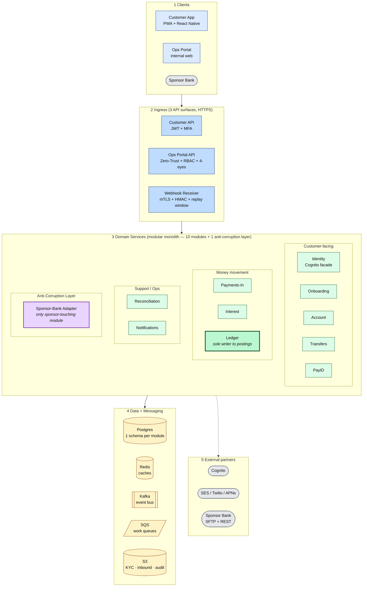
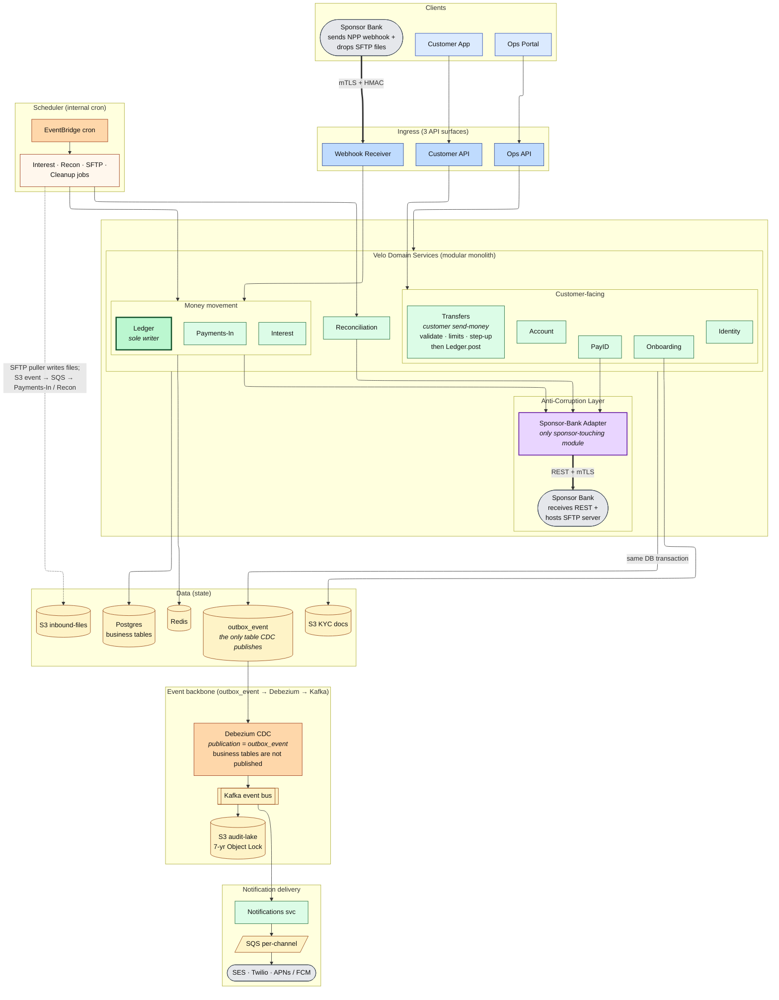
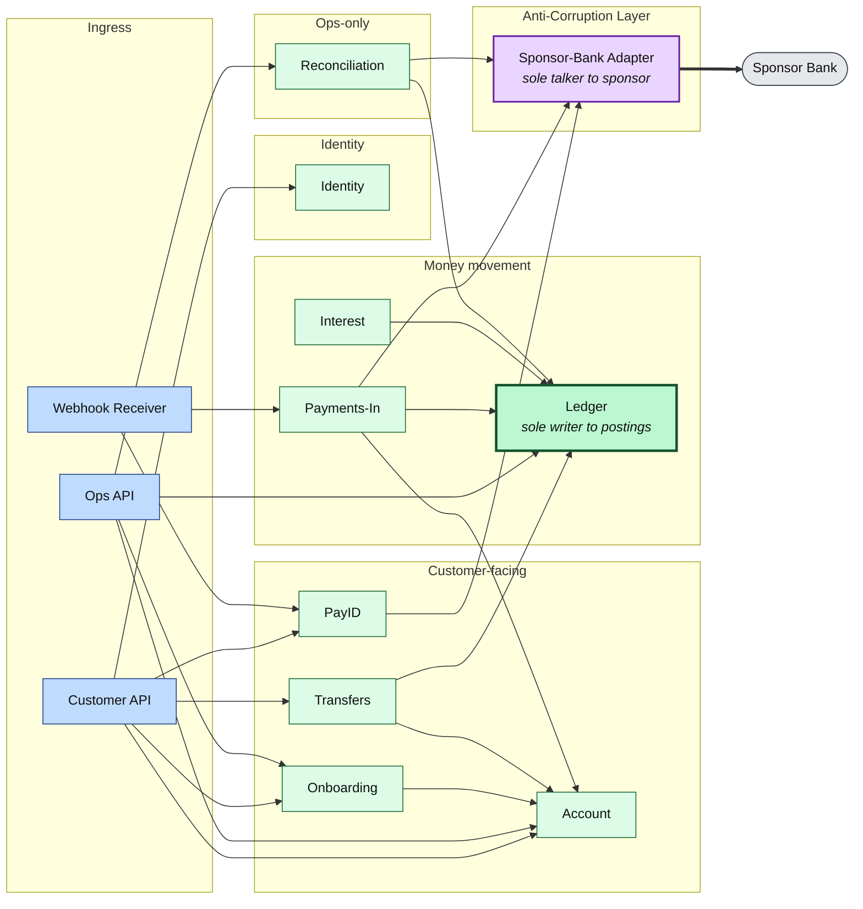
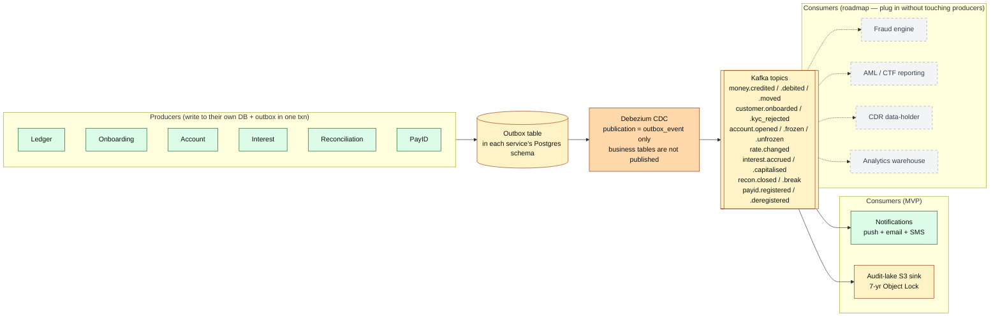
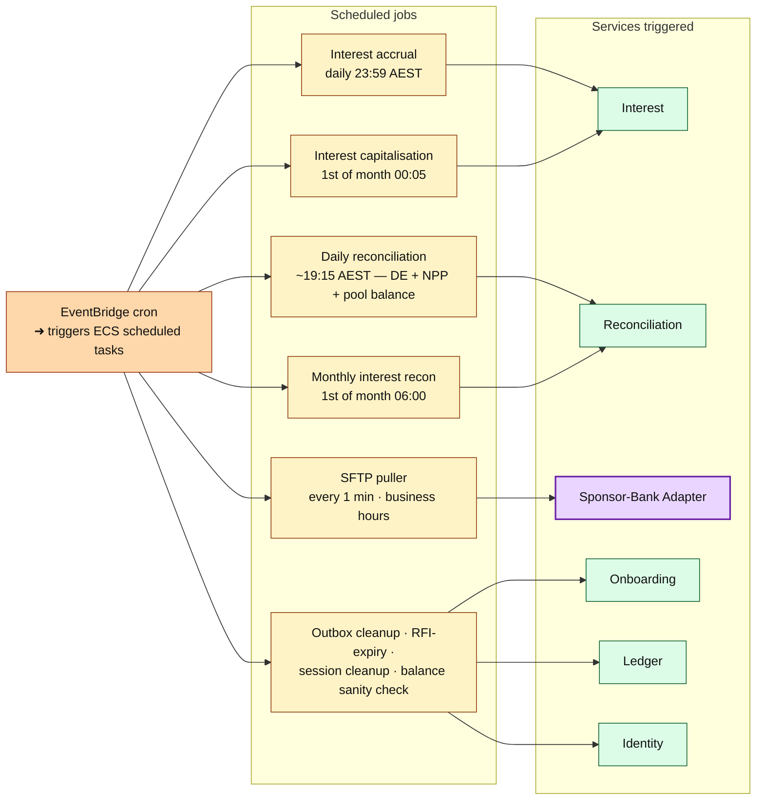
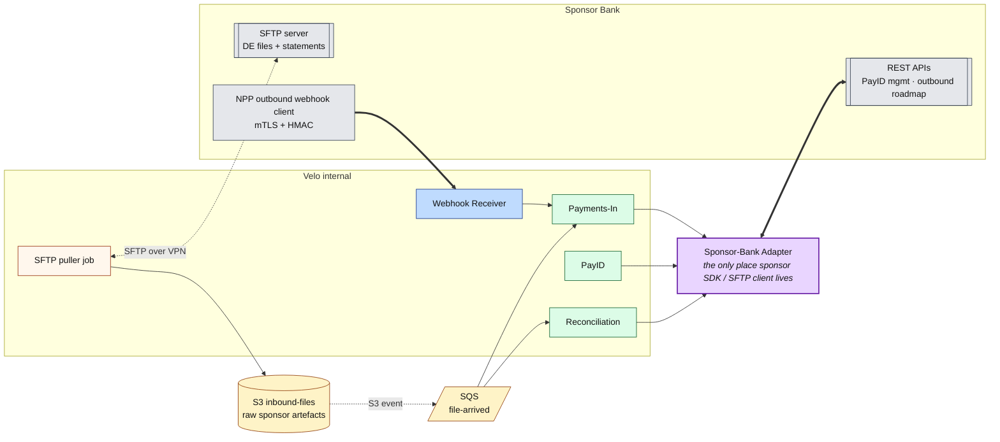

# 09 — Internal System Architecture (Velo application layer)

The **inside** of the Velo backend — how the application code is organised, how modules talk to each other, where data lives, how internal jobs run, and where the boundary to the outside world sits.

Complements `docs/06-cloud-architecture.md`, which is the **outside/deployment** view (AWS regions, VPCs, subnets, edge, DR, CI/CD).

## Scope split with `06-cloud-architecture.md`

| Concern | Lives in | This doc | Cloud arch (06) |
|---|---|---|---|
| Where things run (region, AZ, VPC, subnet) | Infra | — | ✓ |
| Edge, WAF, CDN, DR, cross-region | Infra | — | ✓ |
| CI/CD, testing strategy, deploy topology | DevOps | — | ✓ |
| Which application modules exist and what they own | App | ✓ | brief |
| Internal API contracts between modules | App | ✓ | — |
| Event bus topics + producers + consumers | App | ✓ | brief |
| Postgres schema ownership (who writes which tables) | App | ✓ | — |
| Scheduled jobs (interest, recon, SFTP puller, cleanups) | App | ✓ | — |
| Redis usage patterns (idempotency cache, hot-balance cache) | App | ✓ | — |
| Anti-Corruption Layer to sponsor bank | App | ✓ | brief |
| External integration points (Sponsor, Cognito, SES, ...) | Boundary | mentioned as edges | ✓ full |

**C4 mapping**: doc 06 is the **System Context** + **Container** view. Doc 09 is the **Container (application-focused)** + **Component** view.

---

## Architecture in layers

Rather than one dense diagram, here are **five focused views** that each tell one story. Read them in order — each reuses shape/colour conventions from the previous one.

### Legend (shared across all diagrams)

| Shape / arrow | Meaning |
|---|---|
| **Rectangle** | Application service or module |
| **Cylinder** `(( ))` | Data store (Postgres / Redis / S3) |
| **Trapezoid** `/[ ]/` | Queue (SQS) |
| **Subroutine bar** `[[ ]]` | Event log (Kafka topic) |
| **Rounded** `([ ])` | External system |
| **Solid arrow `-->`** | Synchronous call (HTTP / gRPC / in-process) |
| **Dashed arrow `-.->`** | Asynchronous event / message |
| **Thick arrow `==>`** | External ingress crossing our security boundary |
| Blue fill | Ingress (public-ish entry points) |
| Green fill | Domain services (our code) |
| Yellow fill | Data stores |
| Grey fill | External systems |
| Purple fill | Boundary / anti-corruption layer |

---

### Diagram 1 — The 40,000-foot view (5 layers, services expanded)

Just the layer stack. Answers "**what kinds of things are inside the Velo backend?**" — every service is visible, but there are no cross-arrows so the layout stays readable.



**How to read it.** Every arrow from the outside world lands on layer 2 (Ingress). Ingress calls into layer 3 (Domain Services — now expanded into all 11 modules, grouped by role). Services read/write layer 4 (Data + Messaging). Only a small subset reach out to layer 5 (External partners) — always through the Sponsor-Bank Adapter (for the sponsor) or through Cognito / SES / Twilio / APNs (for identity + notifications).

---

### Diagram 2 — Everything at a glance (single-page comprehensive)

Everything a Velo engineer needs on one page — **every service, every store, every messaging surface visible**, but with cross-arrows kept to the essential story-telling ones. If you had to print one diagram and pin it above your desk, this would be it.

Diagrams 3–6 are the same thing sliced by trigger type (request / event / schedule / boundary). Come back to this one when you want the whole picture at once.



> **Three notational shortcuts to remove overlap** (with no loss of information):
>
> 1. **`SP1` and `SP2` are the same external Sponsor Bank** — shown twice for layout clarity. `SP1` is the sponsor as *sender* (top-right of Clients row); `SP2` is the sponsor as *receiver* (right side of the ACL column). Splitting the node avoids a long backward arrow across the whole canvas.
> 2. **`Notifications`** is a domain service; it's placed in its own **delivery band** at the bottom so the entire event fan-out (`Postgres → CDC → Kafka → Notif → SQS → external`) is a single downward chain with no back-arrows.
> 3. **SFTP inbound chain** collapsed into one dashed arrow with an inline label. The full detail (`SFTP puller → S3 → SQS → Payments-In / Recon`) lives in Diagrams 5 and 6.
>
> The diagram uses **ELK layout** (not Mermaid's default Dagre) for a cleaner routing of the multi-way arrows.

**Reading this diagram top-to-bottom:**
1. **Rows 1–2** — Clients enter through one of the 3 API surfaces. Sponsor Bank (`SP1`) enters via the Webhook Receiver.
2. **Row 3** — Domain services on the left (grouped by role, 10 modules), Anti-Corruption Layer on the right — the *only* module that talks to the sponsor (`SP2`).
3. **Row 4** — State. Every domain service writes into its own Postgres schema **and**, in the same transaction, an `outbox_event` row. Money-movement services also cache in Redis; Onboarding writes uploaded ID docs to S3-KYC.
4. **Rows 5–6** — Async event backbone. Debezium's publication is **`outbox_event` only** — it does not publish `transaction`, `posting`, `ledger_account`, or any other business table. Kafka then fans out to (a) the audit-lake mirror and (b) Notifications → per-channel SQS → external providers.
5. **Left sidebar** — Scheduler triggers money-movement services and pulls SFTP files into S3-inbound.

**Arrow-reduction techniques used** (roughly half the edge count of the original mega-diagram):
- **Group-level arrows** instead of per-service (`Domain → PG` replaces 8 individual arrows; `Ingress → CustGrp` replaces 5).
- **Notifications moved out of Domain visually** so the event chain flows forward without back-arrows.
- **SFTP inbound chain collapsed** into one labelled dashed arrow.
- **Sponsor node split** into `SP1` / `SP2` for clean top-to-bottom flow.

Total: ~22 arrows for ~26 visible nodes, every arrow pointing forward. When you need per-service granularity, jump to Diagrams 3–6.

---

### Diagram 3 — Request-driven flows (who serves each API, and who they call)

Ingress on the left, services in the middle grouped by their primary purpose, boundary on the right. Answers "**when a real HTTP request comes in, which code paths run?**"



**Two invariants to notice:**
- **Only three services write to `Ledger`** — Transfers, Payments-In, Interest. Anyone else touching money is a bug.
- **Only three services call `Sponsor-Bank Adapter`** — Payments-In, PayID, Reconciliation. The adapter is the single choke-point to the outside world.

---

### Diagram 4 — Event-driven flows (async backbone)

Answers "**after a service commits a change, how does the rest of the system find out?**" This is the outbox → Kafka → consumers backbone.



**Key points:**
- **Producers never call Kafka directly.** They insert into a Postgres `outbox_event` row inside their business transaction. Debezium's logical replication publication is **that table only** — a change to `posting` or `customer` does not become a Kafka message unless the service also wrote an outbox row.
- **The same log serves MVP consumers and future consumers** — Fraud, AML, CDR, Analytics can subscribe later without any change to the producers. That's the roadmap-friendly seam the panel is looking for.
- **Kafka retains for 7 days; the audit-lake S3 mirror retains for 7 years** (Object Lock in Compliance mode).

---

### Diagram 5 — Scheduled flows (internal cron jobs)

Answers "**what runs on a timer, not on a request?**"



**Idempotency reminder:** every scheduled job is idempotent on its natural key — `(account_id, date)` for accrual, `(account_id, yyyy-mm)` for capitalisation, `(source, business_date)` for recon. Re-running is safe. See the Scheduled Job Catalog section below for schedules, duration budgets, and failure handling per job.

---

### Diagram 6 — External boundary (Sponsor-Bank Adapter detail)

Answers "**how does Velo's world connect to the sponsor's world?**" This is the anti-corruption layer close-up.



**Three integration surfaces with the sponsor**, all funnelled through Velo-owned components:

| Direction | Mechanism | Velo endpoint | What flows |
|---|---|---|---|
| Sponsor → Velo (real-time) | mTLS + HMAC webhook | **Webhook Receiver** | Inbound NPP messages (`pacs.008`) |
| Sponsor → Velo (batch) | SFTP over VPN, PGP-signed | **SFTP puller job** → S3 → SQS → Payments-In / Recon | DE files, EOD statements, position reports |
| Velo → Sponsor (real-time) | REST + mTLS | **Sponsor-Bank Adapter** | PayID registration, ad-hoc queries, outbound NPP (roadmap), outbound DE (roadmap) |

If the sponsor is swapped tomorrow (say from Cuscal to Indue), the only code that changes is inside the **Sponsor-Bank Adapter** module — every other service continues to work unmodified.

---

## Service inventory

The Velo backend is a **modular monolith** with 10 domain modules + 2 boundary modules. Each has:
- Its **own Postgres schema** (nobody else writes it).
- Its **own package/module** in the repo (`/services/<name>`).
- A well-defined **internal API** (in-process function calls for MVP; the same shape becomes a network API when we later split a service out).

| # | Service | Purpose | Postgres schema (tables owned) | Sync API surface | Events published | Events consumed | Scheduled jobs |
|---|---|---|---|---|---|---|---|
| 1 | **Identity** | Facade over Cognito; JWT verify; MFA orchestration | (none — Cognito is source of truth) | `verifyToken`, `initiateStepUp` | — | — | — |
| 2 | **Onboarding** | Application state machine, KYC docs, 4-eyes decisions | `application`, `application_document`, `application_decision`, `customer`, `customer_address`, `customer_consent` | `createApplication`, `uploadDoc`, `submitDecision`, `confirmDecision`, `getApplication` | `customer.onboarded`, `customer.kyc_rejected`, `application.decided` | — | RFI-expiry sweeper (nightly) |
| 3 | **Account** | Product-level accounts, BSB+account issuance, freeze/unfreeze | `account`, `payee` | `openAccount`, `freezeAccount`, `unfreezeAccount`, `resolveByBSBAcct`, `getAccountsForCustomer` | `account.opened`, `account.frozen`, `account.unfrozen`, `account.closed` | `customer.onboarded` | — |
| 4 | **Ledger** | **Sole writer to postings** — atomic double-entry, idempotency, balance projection | `transaction`, `posting`, `ledger_account`, `outbox_event` | `postTransaction`, `getByIdempotencyKey`, `getBalance`, `getHistory` | `money.credited`, `money.debited`, `money.moved` (via outbox) | — | — |
| 5 | **Transfers** | Customer-initiated internal Velo→Velo transfers | (none — writes go through Ledger) | `createTransfer` | (via Ledger) | — | — |
| 6 | **Payments-In** | Ingest of inbound DE files + NPP webhooks | `inbound_file`, `inbound_message`, `payment_instruction` | `handleWebhook`, `processFile`, `resolveUnmatched` | (via Ledger) + `de.unmatched`, `npp.rejected` | `s3.file_arrived` (SQS) | — |
| 7 | **PayID** | Alias registration/deregistration with sponsor | `payid_registration` | `registerPayID`, `deregisterPayID`, `getPayID` | `payid.registered`, `payid.deregistered` | — | — |
| 8 | **Interest** | Daily accrual + monthly capitalisation + rate registry | `interest_accrual`, `rate_version`, `product` | `accrueForDate`, `capitaliseForMonth`, `proposeRate`, `approveRate` | `interest.accrued.day_closed`, `interest.capitalised.month_closed`, `rate.changed` | — | Accrual (23:59 daily), Capitalisation (1st @ 00:05) |
| 9 | **Reconciliation** | Daily sponsor-vs-Velo recon + monthly interest recon + break management | `recon_run`, `recon_break`, `recon_break_resolution` | `runDailyRecon`, `runMonthlyInterestRecon`, `resolveBreak`, `confirmResolveBreak` | `recon.closed`, `recon.break` | — | Daily EOD recon (~19:15), Monthly interest recon (1st @ 06:00) |
| 10 | **Notifications** | Push/email/SMS delivery, per-channel isolation | `notification_delivery` (audit only) | `sendNotification` | `notification.sent`, `notification.failed` | `money.credited`, `money.debited`, `customer.onboarded`, `application.decided`, `recon.break` | — |
| 11 | **Sponsor-Bank Adapter** *(boundary)* | Only place the sponsor's SDK/SFTP client lives; hides sponsor quirks | (none — stateless client) | `postNPP`, `pullSFTPFiles`, `getStatement`, `registerPayIDWithSponsor` | — | — | SFTP puller (every 1 min business hours) |
| 12 | **Ops Portal API** *(boundary)* | HTTP layer serving Ops web app; wires 4-eyes to underlying services | (none — proxies to owning services) | REST endpoints per capability | (via underlying services) | — | — |
| 13 | *Fraud* | Stub in MVP (`ALLOW` everything); real rules engine in roadmap | (none in MVP) | `scoreTransfer` | (via consumer of `money.moved`) | `money.moved` (roadmap) | — |

### Transfers — what the customer-facing service is actually in charge of

Transfers is the **Send Money** orchestrator. It is the only customer entry point for moving money between two Velo accounts. It does **not** own a balance, a posting, or a Kafka topic.

**It does:**

1. Serve `POST /transfers` behind the Customer API (Cognito JWT).
2. Check the caller **owns the source account**. The `from_account` in the body is not trusted on its own.
3. Ask Identity for **step-up MFA** when the amount crosses the threshold (biometric / TOTP).
4. Ask Account to **resolve the payee** (must be an `ACTIVE` Velo account in MVP; external BSB is rejected).
5. Enforce the rules that are **not** ledger rules: per-transaction limit, per-day limit, cool-off on a newly added payee, source account not `FROZEN` or `CLOSED`.
6. Call the fraud stub (`scoreTransfer`). MVP always returns `ALLOW`. The seam is here so a real scorer can be plugged in later without touching Ledger.
7. Build one idempotent instruction and call `Ledger.postTransaction` — two postings, `DR` payer / `CR` payee, `type=INTERNAL_TRANSFER`, client `idempotency_key`. A retry of the same key cannot send the money twice.
8. Return the new source balance to the app on the same HTTP call (~200 ms).

**It does not:**

- Write `transaction`, `posting`, or `ledger_account`. Ledger is the sole writer. A compromised Transfers process still cannot mutate the books except through Ledger's API.
- Talk to the sponsor, NPP, or DE. An internal transfer does not move the sponsor pool.
- Publish to Kafka. Ledger inserts the `outbox_event` (`money.moved`) in the same transaction as the postings; Notifications hears about it from Kafka afterwards.
- Store the payee address book. That table belongs to Account. Transfers only reads it.

**Ownership rule:** Only the service that owns a table may write to it. Others read via the owning service's API. Enforced by:
- One Postgres role per module; only that role has `INSERT/UPDATE` grants on its own tables.
- Code review — cross-schema queries are a smell.
- Tests: a service's tests must not include another service's tables in their setup.

---

## Ingress paths (three, and only three)

Everything the backend does is triggered by one of these three edges:

| Edge | Auth | Target | Latency SLO |
|---|---|---|---|
| **Customer App API** | Cognito JWT (customer pool) + step-up MFA for sensitive ops | Onboarding, Identity, Account, Transfers, PayID | P99 ≤ 300 ms |
| **Ops Portal API** | Cognito JWT (ops pool) + Zero-Trust (Verified Access) + RBAC + 4-eyes on sensitive actions | Onboarding, Account, Ledger (read-only), Recon, S3 KYC (short-lived presigned URLs) | P99 ≤ 500 ms |
| **Sponsor Webhook Receiver** | mTLS (sponsor cert pinned) + HMAC signature + timestamp replay window | Payments-In, PayID | P99 ≤ 400 ms (sponsor SLA ~5s hard cap) |

Plus **one non-request-driven trigger surface**:

| Trigger | Mechanism | Target |
|---|---|---|
| **Scheduled jobs** | EventBridge cron → ECS scheduled task | Interest, Reconciliation, SFTP puller, cleanup jobs |
| **File-arrived events** | S3 event → SQS → subscriber | Payments-In (DE), Reconciliation (statement files) |
| **Domain events** | Kafka topic → consumer group | Notifications, Audit-lake sink, (roadmap) Fraud/AML/CDR |

Any code path that mutates money or state ultimately traces back to one of these five triggers.

---

## Sync-call rules of thumb

The exact who-calls-whom picture is in **Diagram 3** above. The invariants worth memorising:

- **Only three services call `Ledger`**: Transfers, Payments-In, Interest. Anyone else touching money is a bug.
- **Only three services call `Sponsor-Bank Adapter`**: Payments-In (statement pulls + roadmap outbound), PayID (registration), Reconciliation (position queries). All external side effects are contained in one adapter.
- **`Account.resolveByBSBAcct`** is the hottest read path (called on every inbound payment). Cached in Redis with a 5-minute TTL and invalidated on `account.frozen/unfrozen/closed` events via a Kafka subscriber.
- **`Notifications`** and **(roadmap) `Fraud`** are pure event consumers. They never receive sync calls from other domain services.
- **Ops Portal API** is the only ingress with read access to `Ledger` — no other ingress reads the ledger directly; customer balance/history goes through `Account` (which fronts the balance projection).

---

## Data stores — what lives where, and why

### Postgres (Aurora) — the operational database

- **One logical DB, one schema per module** (`onboarding`, `account`, `ledger`, `transfers`, `payments_in`, `payid`, `interest`, `reconciliation`).
- Each module has its own migration folder and its own Postgres role. Cross-schema `SELECT`s are allowed for read models; cross-schema `INSERT/UPDATE` is forbidden by grants.
- **Ledger schema is special** — it's the only place with `SERIALIZABLE` isolation on writes, and DB-level triggers enforcing double-entry (`SUM(posting.amount * sign) = 0` per transaction per currency). Debezium does **not** publish the ledger tables; it publishes `outbox_event` only.

### Redis (ElastiCache) — the cache tier

Two distinct concerns, kept in separate logical databases for clean invalidation:

| Concern | Key shape | Value | TTL | Populated when |
|---|---|---|---|---|
| **Idempotency cache** (webhook + API) | `idem:npp:<sponsor_msg_id>`, `idem:tx:<client_uuid>` | Cached response body | 24h | Only after **successful** commit in Postgres (never on failure — see Workflow 03 Q14) |
| **Hot balance cache** | `bal:<ledger_account_id>` | `{available_cents, last_posted_at}` | 60s | On read miss; invalidated by a Kafka consumer subscribed to `money.moved` |
| **Account resolution cache** | `acc:<bsb>-<acct>` | `{account_id, ledger_account_id, status}` | 300s | On read miss; invalidated on `account.frozen/unfrozen/closed` events |
| **Rate-limit counters** | `rl:<endpoint>:<ip>` | count | window | Every request |

**Correctness rule:** Redis is a **cache**, never a store. Every value is safely recomputable from Postgres. Redis being down = slower, not wrong.

### S3 — three buckets, three purposes

| Bucket | What's in it | Retention | Encryption | Written by |
|---|---|---|---|---|
| `velo-kyc-docs` | Uploaded ID docs, selfies | 7-year Object Lock | KMS-CMK `kms/velo/data-kyc` | Onboarding (write); Ops Portal API (short-lived read via presigned URL) |
| `velo-inbound-files` | Raw DE files, raw sponsor statements, in original format (`.cemtex.pgp`, `.camt053.xml`) | 7-year Object Lock | KMS-CMK `kms/velo/data-general` | SFTP puller (write); Payments-In (read); Reconciliation (read) |
| `velo-audit-lake` | Domain events (JSON, partitioned by topic/date/hour) + raw external artefacts snapshotted for evidence | 7-year Object Lock (Compliance mode) + CRR to Melbourne | KMS-CMK `kms/velo/data-audit` (separate CMK, none of the ledger service roles can decrypt this key) | MSK S3 Sink Connector; snapshot jobs |

---

## Messaging — outbox, Kafka, and SQS

Three distinct messaging surfaces used for different jobs. Confusing them is the number-one MVP anti-pattern to avoid.

### 1. Outbox table + Debezium → Kafka (for domain events)

**Pattern:** every service that publishes an event inserts an `outbox_event` row inside the **same DB transaction** as its business write. Debezium (MSK Connect) uses a Postgres publication that includes **`outbox_event` and nothing else**, and publishes each new row to the Kafka topic named in that row. The service never calls Kafka directly. Postgres still uses the WAL as the transport for logical replication — that is how Debezium reads — but the connector filter drops every change that is not an outbox insert. Renaming a column on `posting` does not change the event contract.

```
BEGIN;
  INSERT/UPDATE business rows;
  INSERT INTO outbox_event (id, topic, payload, status='PENDING');
COMMIT;   -- both or neither
```

**Why:** exactly-once effect. Killing the "dual-write" problem where DB commits but Kafka publish fails and downstream never learns.

**Topics** (see Event Catalog below):
- `money.credited`, `money.debited`, `money.moved`
- `customer.onboarded`, `customer.kyc_rejected`, `application.decided`
- `account.opened`, `account.frozen`, `account.unfrozen`, `account.closed`
- `rate.changed`
- `interest.accrued.day_closed`, `interest.capitalised.month_closed`
- `recon.closed`, `recon.break`
- `payid.registered`, `payid.deregistered`

### 2. SQS (for point-to-point work queues)

**Pattern:** producer writes a message, exactly one consumer processes it.

| Queue | Producer | Consumer | Retry policy |
|---|---|---|---|
| `sqs-inbound-file-arrived` | S3 event on `velo-inbound-files` | Payments-In (DE parser), Reconciliation (statement parser — different prefix) | 5 attempts w/ exponential backoff → DLQ |
| `sqs-notif-email` | Notifications Service | SES sender | 5 attempts → DLQ |
| `sqs-notif-sms` | Notifications Service | Twilio sender | 5 attempts → DLQ |
| `sqs-notif-push` | Notifications Service | APNs/FCM sender | 3 attempts → DLQ |
| `sqs-webhook-replay-dlq` | Payments-In on persistent failure | On-call engineer | manual |
| `sqs-file-replay-dlq` | Payments-In on persistent failure | On-call engineer | manual |

### 3. Kafka (for durable, multi-consumer, replayable event stream)

Same events as (1), but treated as a **log** rather than a queue. Consumers:
- **Notifications** — subscribes to money + status events.
- **S3 Sink Connector** — mirrors every event to the audit lake for compliance retention + Athena queries.
- **(Roadmap) Fraud** — subscribes to `money.moved`, `account.*`, `customer.onboarded`.
- **(Roadmap) AML/CTF** — subscribes to `money.*` and `customer.*`.
- **(Roadmap) CDR data-holder** — subscribes to `customer.onboarded`, `customer.consent.*`.
- **(Roadmap) Analytics warehouse** — subscribes to everything, batch-sinked to a data lake.

**Retention:** 7 days on Kafka itself (buffer for consumer downtime), 7 years in the S3 audit-lake mirror (compliance).

---

## Domain event catalog (v1)

Common envelope on every event:

```json
{
  "event_id": "01HXYZ...",              
  "event_type": "money.credited",
  "event_version": "1.0",
  "occurred_at": "2026-09-27T09:15:23.421Z",
  "producer":  {"service":"payments-in","version":"2.14.3"},
  "actor":     {"type":"system"} ,      
  "aggregate": {"type":"account","id":"acc_..."} ,
  "correlation_id":"req_...",
  "causation_id":"tx_...",
  "payload":   { ... event-specific ... }
}
```

| Topic | Producer | Payload keys | Consumers |
|---|---|---|---|
| `money.credited` | Ledger (via outbox) | `transaction_id`, `amount_cents`, `currency`, `rail`, `customer_id`, `external_ref`, `posted_at` | Notifications, S3 sink, Fraud (roadmap), AML (roadmap) |
| `money.debited` | Ledger | `transaction_id`, `amount_cents`, `currency`, `rail`, `customer_id`, `external_ref`, `posted_at` | Notifications, S3 sink, Fraud, AML |
| `money.moved` | Ledger | full transaction summary | S3 sink, CDR, Analytics |
| `customer.onboarded` | Onboarding | `customer_id`, `application_id`, `onboarded_at` | Account (creates the account), Notifications, S3 sink |
| `customer.kyc_rejected` | Onboarding | `customer_id`, `application_id`, `reason_code` | Notifications, S3 sink |
| `application.decided` | Onboarding | `application_id`, `decision`, `is_confirmation`, `reviewer_id` | S3 sink, Ops metrics |
| `account.opened` | Account | `account_id`, `customer_id`, `bsb`, `account_number` | Notifications, S3 sink |
| `account.frozen` / `.unfrozen` | Account | `account_id`, `reason_code`, `by_user_id` | Payments-In (invalidates resolution cache; starts routing to HOLD), Notifications, S3 sink |
| `rate.changed` | Interest | `product_code`, `rate_version_id`, `rate_pa`, `effective_from` | Interest job (picks new version), S3 sink |
| `interest.accrued.day_closed` | Interest | `date`, `accrual_count`, `sum_cents` | Recon, S3 sink |
| `interest.capitalised.month_closed` | Interest | `month`, `capitalisation_count`, `sum_cents` | Recon, Reporting, S3 sink |
| `recon.closed` / `.break` | Reconciliation | `source`, `business_date`, `status`, `break_details?` | On-call pager (on `.break`), S3 sink |
| `payid.registered` / `.deregistered` | PayID | `account_id`, `alias_type`, `alias_value` | Notifications, S3 sink |

**Versioning discipline:** additive fields = same major version; removals or renames = bump major (`money.credited.v2`) and run both topics in parallel until all consumers migrate.

---

## Scheduled job catalog

All jobs are **idempotent** on their inputs (accrual: `(account_id, date)`; capitalisation: `(account_id, yyyy-mm)`; recon: `(source, business_date)`). Re-running is safe.

| Job | Schedule (AEST) | Owner service | Duration budget | On failure |
|---|---|---|---|---|
| **Interest accrual** | 23:59 daily | Interest | ≤ 10 min at 100k accounts | Retry at 04:00; page on-call if second failure |
| **Interest capitalisation** | 00:05, 1st of month | Interest | ≤ 30 min | Retry at 04:00; page treasury on-call on second failure |
| **Daily reconciliation** (DE, NPP, pool balance) | ~19:15 daily (after sponsor EOD file) | Reconciliation | ≤ 5 min | Retry every 30 min for 2 h; page on-call if still broken; block outbound (roadmap) |
| **Monthly interest recon** | 06:00, 1st of month | Reconciliation | ≤ 15 min | Page treasury; block rate changes until resolved |
| **SFTP puller** | every 1 min, business hours 07:00–20:00 | Sponsor-Bank Adapter | ≤ 30s per run | Alert if backlog grows > 5 files or run takes > 90s |
| **Outbox cleanup** (delete rows `SENT` older than 7 days) | 02:00 daily | Ledger | ≤ 2 min | Best-effort; a stuck outbox row is a bigger problem than a big table |
| **RFI-expiry sweeper** (auto-expire onboarding applications idle > 14 days) | 03:00 daily | Onboarding | ≤ 2 min | Retry next day |
| **Session cleanup** (Cognito refresh-token revocation for inactive) | 04:00 daily | Identity | ≤ 5 min | Retry |
| **Balance projection sanity check** (assert `available_balance == SUM(postings)`) | 05:00 daily | Ledger | ≤ 15 min | On mismatch: alert P1, freeze rate changes, page on-call |
| **CDC health probe** (assert Debezium lag < threshold) | every 5 min | Ledger | seconds | Page on-call if lag > 60s |

---

## Data ownership — the "one-writer" table

Encoded as Postgres roles + grants, so a compromised service literally cannot write another module's tables.

| Owner service | Schema | Writable tables | Read-only from |
|---|---|---|---|
| Onboarding | `onboarding` | `application`, `application_document`, `application_decision`, `customer`, `customer_address`, `customer_consent` | Ops Portal API (via service call) |
| Account | `account` | `account`, `payee` | Payments-In, Transfers, Ops Portal API |
| Ledger | `ledger` | `transaction`, `posting`, `ledger_account`, `outbox_event` | Nobody writes; Reconciliation and Ops Portal read via API |
| Payments-In | `payments_in` | `inbound_file`, `inbound_message`, `payment_instruction` | Ops Portal API (unmatched queue) |
| PayID | `payid` | `payid_registration` | Ops Portal API |
| Interest | `interest` | `interest_accrual`, `rate_version`, `product` | Reconciliation |
| Reconciliation | `reconciliation` | `recon_run`, `recon_break`, `recon_break_resolution` | Ops Portal API |
| Notifications | `notifications` | `notification_delivery` (append-only audit) | — |
| Identity | (none in Postgres) | — | — |

---

## Cross-cutting patterns (in one place)

### Idempotency (3-layer defence)

Every money-moving path has **three independent idempotency checks**:

1. **Source-level** — the sponsor's `sponsor_msg_id` / `sponsor_file_id + record_index` / client-generated UUID for internal transfers.
2. **Ledger-level** — `TRANSACTION.idempotency_key UNIQUE` in Postgres, computed deterministically from source (never `NOW()`).
3. **Redis-level** — cached response for successful posts, TTL 24 h. Speed only; correctness is on (2).

### Outbox pattern (already explained above)

Never dual-write. Always outbox + CDC.

### Serialisable-with-retry (for the ledger)

Ledger writes run in `REPEATABLE READ` with row-level `SELECT ... FOR UPDATE` on the balance projection as the primary concurrency control, and `SERIALIZABLE` as the fallback for any transaction that recomputes from `SUM(postings)`. On `40001`, retry with jitter up to 3 times.

### 4-eyes for all Ops mutations of money or reference data

One row-per-decision model (introduced by `APPLICATION_DECISION`) reused everywhere:
- Onboarding approve/reject
- Rate change proposal/approval
- Recon-break resolution
- Account freeze/unfreeze
- Manual reversal
- KMS-CMK key rotation (via infra pipeline, but same pattern)

### Presigned URLs for KYC document access

Ops never receives raw document bytes. Ops Portal API mints a **≤ 5-minute presigned S3 URL** scoped to a single object. Cognito group + application-review gate must both pass.

### Circuit breakers on external calls

Every call to the Sponsor-Bank Adapter is behind a circuit breaker (Hystrix-style: 50% error rate over 20 requests → open for 30s → half-open probe). Prevents thundering-herd retries when sponsor is degraded.

### Rate limits on customer-facing endpoints

At the API Gateway (WAF layer, see cloud arch doc) *and* in-app at the service (belt-and-braces):
- Login: 5/min/IP
- OTP resend: 2/min/user
- Create transfer: 10/min/user + a per-day amount cap
- KYC upload: 20/hour/application

---

## Repository layout (single-repo, modular monolith)

```
velo-backend/
├── package.json                       # single build, single test suite
├── infrastructure/                    # Terraform / CDK (deploys 06-cloud-architecture)
│
├── services/                          # each folder = a bounded context
│   ├── identity/
│   │   ├── api/                       # HTTP handlers exposed at the API gateway
│   │   ├── domain/                    # pure domain logic (no I/O)
│   │   ├── infra/                     # Cognito clients, repositories
│   │   └── __tests__/
│   ├── onboarding/
│   ├── account/
│   ├── ledger/
│   ├── transfers/
│   ├── payments-in/
│   ├── payid/
│   ├── interest/
│   ├── reconciliation/
│   ├── notifications/
│   └── sponsor-bank-adapter/          # the ONLY module that imports sponsor SDK
│
├── platform/                          # shared infra concerns (no domain logic)
│   ├── db/                            # Postgres pool, migration runner, per-role connection helper
│   ├── cache/                         # Redis clients
│   ├── outbox/                        # generic outbox writer + Debezium config
│   ├── events/                        # envelope, versioning, schema registry
│   ├── auth/                          # JWT verification, RBAC, 4-eyes primitives
│   ├── telemetry/                     # OpenTelemetry setup, structured logging
│   └── errors/                        # standard error taxonomy
│
├── apps/                              # deployable entrypoints (thin process shells)
│   ├── api-customer/                  # customer app HTTP entrypoint
│   ├── api-ops/                       # ops portal HTTP entrypoint
│   ├── api-webhook/                   # sponsor webhook HTTP entrypoint
│   └── scheduled/                     # scheduled-task entrypoints (interest, recon, sftp, cleanup)
│
└── contracts/                         # shared type + schema definitions across services
    ├── events/                        # event schemas (JSON Schema / Avro)
    └── api/                           # OpenAPI specs
```

**Why this shape:**
- **`apps/` are thin.** They wire configuration + start an HTTP or scheduled process; they don't contain business logic. This is what lets us later spin out an app (e.g. `apps/api-webhook`) onto its own binary + service without touching domain code.
- **`services/*/domain/` is pure.** No DB, no HTTP, no Kafka. Testable with a stopwatch. This is where 80% of correctness lives.
- **`services/*/infra/` is the adapter layer.** Postgres repositories, Redis clients, Kafka producers/consumers. Swap for tests.
- **`platform/` is not a service** — it's shared plumbing every service can depend on.
- **`contracts/`** is versioned separately; breaking a contract requires a bumped version + parallel run.

---

## Runtime shape today vs future

**Today (MVP):** the whole backend runs as **~4 deployable binaries**, all built from the same repo:

| Deployable | Contains | Why grouped |
|---|---|---|
| `api-customer` | Identity, Onboarding, Account, Transfers, PayID, (Ledger via calls) | Customer-facing latency profile |
| `api-webhook` | Payments-In webhook handler, PayID sponsor-callback handler | Different security posture (mTLS); different scaling profile (sponsor bursts) |
| `api-ops` | Ops Portal API surface | Different auth (Zero-Trust); different SLA |
| `scheduled` | Interest, Reconciliation, SFTP puller, Cleanups | Batch, non-request-driven |

**Split-later map** (what we spin out first as the business grows):

1. **Ledger** (highest correctness sensitivity + throughput ceiling) → its own binary + hardened deployment.
2. **Payments-In** (highest external-facing burst load + security posture) → already separate; grows autoscaling independently.
3. **Sponsor-Bank Adapter** → its own binary once we introduce a second sponsor.
4. **Notifications** → its own binary once we onboard partners that push notification traffic through it.

Because everything already goes through internal APIs and events, splitting a service = extracting an already-clean interface, wiring an HTTP or gRPC transport, and pointing DNS. Not a rewrite.

---

## What this doc deliberately does not show

- **VPC subnets, IAM roles, KMS keys, ALB, ECS Fargate, WAF, CloudFront** — see `06-cloud-architecture.md`.
- **CI/CD pipeline, testing strategy** — see `06-cloud-architecture.md`.
- **DR / RPO / RTO / cross-region** — see `06-cloud-architecture.md`.
- **Individual UX flows** — see `docs/workflows/`.
- **Data schema in full field detail** — see `docs/05-erd-consolidated.md`.

The reason this doc is small enough to hold in your head: it deliberately stops at "how the application is organised" and lets the other docs answer "how it's deployed" and "what it does step-by-step".
