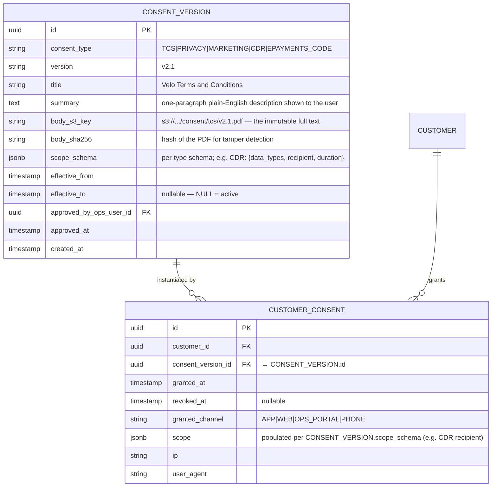
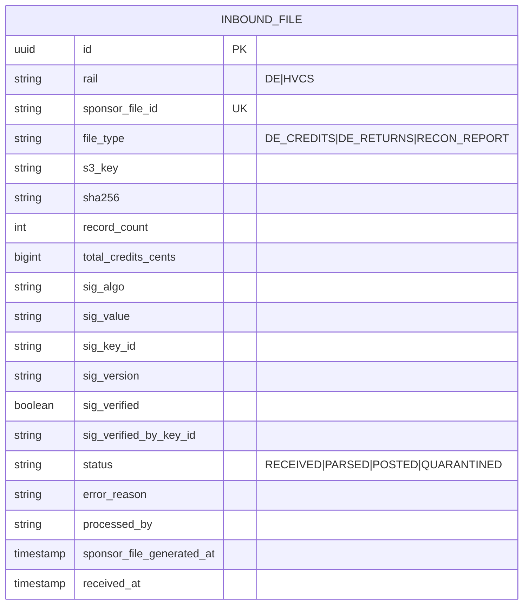
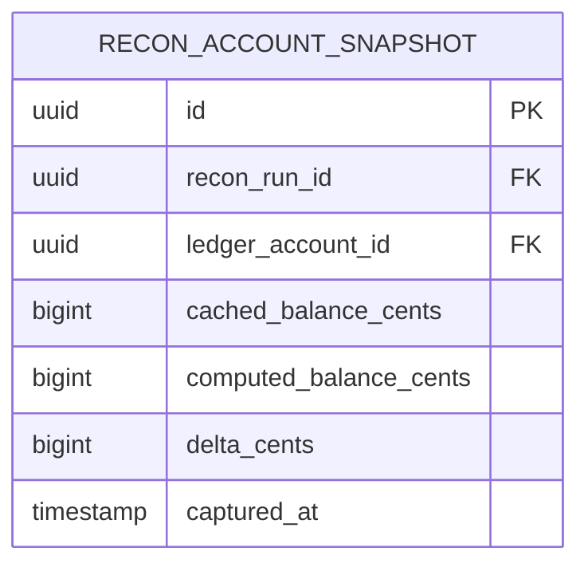

# 10 — ERD Q&A (follow-ups on `docs/05-erd-consolidated.md`)

Follow-up clarifications on the consolidated ERD. Continues numbering from `docs/08-workflow-qa.md` (last question there was Q32) so every Q&A across the pack is globally unique. Range: **Q33–Q50**.

Any doc bugs surfaced by these questions are collected in the **Doc corrections to apply** section at the bottom — proposed, not yet applied to the ERD, so they can be reviewed first (same pattern as the workflow-qa doc).

**Contents**

- [`TRANSACTION` and `POSTING`](#transaction-and-posting)
  - [Q33. `TRANSACTION.device_context` — what actually goes in it?](#q33-transactiondevice_context--what-actually-goes-in-it)
- [`CUSTOMER`, `CUSTOMER_CONSENT`, `APPLICATION`, `APPLICATION_DOCUMENT`](#customer-customer_consent-application-application_document)
  - [Q34. `CUSTOMER.aml_status` — what are all the statuses, really?](#q34-customeraml_status--what-are-all-the-statuses-really)
  - [Q36. Do we really need `CUSTOMER_CONSENT` — why not a boolean?](#q36-do-we-really-need-customer_consent--why-not-a-boolean)
  - [Q37. `APPLICATION.submitted_snapshot`, statuses, and the two `APPLICATION_DECISION` rows](#q37-applicationsubmitted_snapshot-statuses-and-the-two-application_decision-rows)
  - [Q38. `APPLICATION_DOCUMENT.sha256` and `.kms_key_id` — what do they buy us?](#q38-application_documentsha256-and-kms_key_id--what-do-they-buy-us)
  - [Q42. What does `CUSTOMER.cognito_sub` actually join to?](#q42-what-does-customercognito_sub-actually-join-to)
- [`ACCOUNT`, `PRODUCT`, `RATE_VERSION`](#account-product-rate_version)
  - [Q35. `ACCOUNT.product_code` → `PRODUCT` — what is a "product" here?](#q35-accountproduct_code--product--what-is-a-product-here)
  - [Q41. `RATE_VERSION.day_count` values and `.effective_to` nullability](#q41-rate_versionday_count-values-and-effective_to-nullability)
- [`LEDGER_ACCOUNT`](#ledger_account)
  - [Q45. Is `LEDGER_ACCOUNT.pending_balance_cents` redundant if we already model held funds as a separate row?](#q45-is-ledger_accountpending_balance_cents-redundant-if-we-already-model-held-funds-as-a-separate-row)
- [`PAYEE`, `PAYID_REGISTRATION`](#payee-payid_registration)
  - [Q39. `PAYEE` — how does the internal vs external split actually work?](#q39-payee--how-does-the-internal-vs-external-split-actually-work)
  - [Q40. `PAYID_REGISTRATION` — walk through every field](#q40-payid_registration--walk-through-every-field)
- [`INBOUND_FILE`, `INBOUND_MESSAGE`, `PAYMENT_INSTRUCTION`](#inbound_file-inbound_message-payment_instruction)
  - [Q46. `INBOUND_FILE.source` vs `INBOUND_MESSAGE.rail` — inconsistent naming?](#q46-inbound_filesource-vs-inbound_messagerail--inconsistent-naming)
  - [Q47. Was `INBOUND_MESSAGE` ever updated with the sig-audit fields from Q27?](#q47-was-inbound_message-ever-updated-with-the-sig-audit-fields-from-q27)
  - [Q48. `INBOUND_FILE` — walk through every field, plus what's missing](#q48-inbound_file--walk-through-every-field-plus-whats-missing)
  - [Q49. Should `PAYMENT_INSTRUCTION.end_to_end_ref` be renamed to something more AU-native?](#q49-should-payment_instructionend_to_end_ref-be-renamed-to-something-more-au-native)
- [`RECON_RUN`, `AUDIT_LOG`](#recon_run-audit_log)
  - [Q43. `AUDIT_LOG` — walk through every field, and how is it different from `OUTBOX_EVENT`?](#q43-audit_log--walk-through-every-field-and-how-is-it-different-from-outbox_event)
  - [Q44. `RECON_RUN` only supports Case A (aggregate external movements) — how do we extend it for B / C / D?](#q44-recon_run-only-supports-case-a-aggregate-external-movements--how-do-we-extend-it-for-b--c--d)
- [`INTEREST_ACCRUAL`](#interest_accrual)
  - [Q50. `INTEREST_ACCRUAL` scale, `eod_balance_cents`, and `capitalisation_tx_id`](#q50-interest_accrual-scale-eod_balance_cents-and-capitalisation_tx_id)
- [Doc corrections to apply](#doc-corrections-to-apply)

---

## `TRANSACTION` and `POSTING`

### Q33. `TRANSACTION.device_context` — what actually goes in it?

**Short answer:** a JSONB blob captured only for **customer-initiated** transactions (today: `INTERNAL_TRANSFER`; roadmap: outbound NPP / DE, card-not-present, mobile top-up). It's the raw evidence you'd hand to a fraud analyst, a dispute investigator, or a court under the **ePayments Code**. For system-driven transactions (`DE_INBOUND`, `NPP_INBOUND`, `INTEREST`, `REVERSAL`) it's `NULL`.

**Concrete shape (worked example, internal transfer initiated from the mobile app):**

```json
{
  "channel": "MOBILE_APP",
  "app_version": "velo-ios/1.4.2 (build 1421)",
  "os": "iOS 18.2",
  "device_id": "A9C41E52-...-9F3A",
  "device_fingerprint_hash": "sha256:...",
  "user_agent": "VeloApp/1.4.2 CFNetwork/...",
  "ip": "203.0.113.42",
  "ip_asn": "AS4804 Microplex PTY LTD",
  "geo": { "country": "AU", "region": "NSW", "city": "Sydney", "lat_lng_approx": "-33.87, 151.21" },
  "session_id": "sess_01H8Z9V0T4M9K...",
  "auth": {
    "authn_method": "BIOMETRIC_FACE",
    "mfa_verified_at": "2026-09-27T13:03:59Z",
    "mfa_challenge_id": "cog-mfa-01H8..."
  },
  "correlation": { "trace_id": "otel-...", "request_id": "req-01H8..." }
}
```

**Why JSONB and not first-class columns:**

1. **Sparse.** ~95% of transactions are `DE_INBOUND` / `NPP_INBOUND` / `INTEREST` (no customer device). Making these first-class columns would be mostly NULL, wasting page space at ledger scale (see Q50 — accruals alone are ~36 M rows/year).
2. **Schema evolves.** We add new fraud signals frequently (behavioural biometrics, device attestation, WebAuthn attester bundle, browser TLS fingerprint). A schema migration per signal is a bad trade at this scale.
3. **Read for edge cases only.** Fraud investigations, chargeback disputes, AUSTRAC SMR/TTR queries — measured in thousands per year, not millions per second. JSONB `GIN` indexes on specific paths (`ip`, `device_id`) cover those needs.

**Why we bother storing it at all** (AU-specific):

- The **ePayments Code** (ASIC-administered) puts the burden of proof on the ADI to show the customer authorised the transaction — you need the device + auth evidence.
- **AUSTRAC AML/CTF Act** requires transaction records retained for 7 years, including the "means used" — that's device context.
- **Chargeback/dispute** flows (once we have cards) need IP + geo to defend "was this really the cardholder?".

**PII posture:**

- IP address is PII under the Privacy Act 1988 (APP 3). `device_context` is inside the `TRANSACTION` schema which has RLS + KMS envelope encryption at rest.
- Retention: 7 years (aligned with AML/CTF); older transactions get their `device_context` **redacted to a summary** (channel + country + auth_method), not full deletion, so we can still answer "was this a mobile-app transaction?" without holding the IP.

---

## `CUSTOMER`, `CUSTOMER_CONSENT`, `APPLICATION`, `APPLICATION_DOCUMENT`

### Q34. `CUSTOMER.aml_status` — what are all the statuses, really?

The ERD lists three (`CLEAR|WATCH|HOLD`) which is the MVP minimum. The **real production enum** you'd defend to the panel is bigger, because AML is a lifecycle, not a boolean.

**Full lifecycle:**

| Status | Meaning | Effect on account | How you exit it |
|---|---|---|---|
| `CLEAR` | Passed sanctions + PEP screening at onboarding; nothing suspicious since. | Normal. | Only re-screening can push you out. |
| `SANCTIONS_CHECK_PENDING` | Onboarding is done but the periodic re-screen against DFAT / OFAC / UN lists hasn't returned yet. | Normal for existing balance; new transactions above a threshold are held for review. | Auto → `CLEAR` when the screen returns clean. |
| `WATCH` | Something's off — a fuzzy sanctions match, a PEP relationship, unusual pattern the transaction-monitoring engine flagged. **Not a decision that the customer is guilty of anything.** | Normal customer-facing behaviour; every transaction generates an ops signal for review. | Ops reviewer investigates and either drops back to `CLEAR` (false positive) or escalates to `ENHANCED_DUE_DILIGENCE`. |
| `ENHANCED_DUE_DILIGENCE` (EDD) | AUSTRAC Rules 15 — we've decided this customer needs additional information (source of funds, source of wealth, updated ID). | Inbound is still credited (we're not seizing funds); outbound / balance access can be throttled per policy. | Customer supplies the info; ops re-decides → `CLEAR` or `HOLD`. |
| `HOLD` | Account is frozen — no inbound posts, no outbound, no balance-changing operations. Inbound gets returned to sender. | See Workflow 02, `CUSTOMER_HELD_AML` sub-account. | Only ops via 4-eyes can lift. |
| `SANCTIONS_MATCH` | Positive hit on a sanctions list. Distinct from `HOLD` because it triggers a DFAT reporting obligation, not just an internal freeze. | Everything frozen; funds escrowed under legal advice. | Legal + compliance workflow, not ops. |
| `SAR_FILED` | We've filed a Suspicious Matter Report to AUSTRAC. The customer **must not be tipped off** ("tipping off" is a criminal offence under AML/CTF Act s.123). | Normal customer-facing behaviour to avoid tip-off; ops has full visibility. | Depends on AUSTRAC guidance. |
| `OFFBOARDED` | We've exited the relationship (with 30-day notice per T&Cs). Balance returned via a sponsor-driven outbound payment; account closed. | Terminal. | N/A — a new relationship would be a new `CUSTOMER` row. |
| `DECEASED` | Notified of death; deceased-estate handling kicks in. | Frozen pending grant of probate. | Terminal (funds move to estate). |

**Why this matters for the ERD:** `aml_status` is an **operational** state (drives behaviour today). We separately keep the **history** in `AUDIT_LOG` (see Q43) because AUSTRAC audits ask "when did they move from CLEAR to WATCH, why, and who decided?".

**Doc correction proposed:** widen the enum in the ERD to the full 9-value list above.

---

### Q36. Do we really need `CUSTOMER_CONSENT` — shouldn't the consent text live in its own catalog table, and `CUSTOMER_CONSENT` just store `consent_id`?

**Yes to both — and you're right that the current single-table shape is under-normalised.** Let me answer this in two layers, because there are two claims wrapped in the question:

**Layer 1 — "do we need a table at all vs a boolean?" — Yes.**

A boolean fails every real question compliance will ask:

| Question compliance / regulator / customer will ask | Boolean answer |
|---|---|
| "Which version of the T&Cs did the customer accept?" | ❌ |
| "When exactly did they consent?" | ❌ (or a single `consented_at` column that gets overwritten) |
| "Did they revoke marketing consent last Thursday?" | ❌ (overwritten) |
| "Did they consent to CDR data-sharing to Bank X, and is that consent current?" | ❌ |
| "We updated the Privacy Policy in March — who's still on the old version?" | ❌ |

Legal drivers behind those questions: **Privacy Act 1988** (informed consent must be demonstrable), **SPAM Act 2003** (marketing opt-in is separate + revocable), **Consumer Data Right (CDR)** (versioned + revocable per recipient), **ePayments Code** (electronic-communications acceptance).

**Layer 2 — "shouldn't consent type/version/description live in its own catalog?" — Yes, and this is a real doc bug.**

The current design duplicates the consent **definition** (type, version, body, effective dates) on every customer row. With 100k customers × 4 consent types × N versions, that's 400k+ rows all repeating the same 4-value `consent_type` enum and the same version strings. Same anti-pattern we'd never accept for `PRODUCT` or `RATE_VERSION`.

**Better shape — split into a catalog + a join:**



**What moves where:**

| Field | Was | Now | Why |
|---|---|---|---|
| `consent_type` | `CUSTOMER_CONSENT` | `CONSENT_VERSION` | It's a property of the consent definition, not the customer's acceptance. |
| `version` | `CUSTOMER_CONSENT` | `CONSENT_VERSION` | Same. |
| Body text / PDF pointer | (missing) | `CONSENT_VERSION.body_s3_key + body_sha256` | Single source of truth for "the text customer X agreed to". Immutable via Object Lock + hash. |
| `granted_at`, `revoked_at` | `CUSTOMER_CONSENT` | `CUSTOMER_CONSENT` | Per-customer facts stay per-customer. |
| `granted_channel`, `ip`, `user_agent` | (missing) | `CUSTOMER_CONSENT` | Evidence of **how** this particular customer consented — per-customer fact. |
| `scope jsonb` | (missing) | Both — `scope_schema` on `CONSENT_VERSION`, actual `scope` on `CUSTOMER_CONSENT` | CDR: template declares "you must record data_types + recipient + duration"; customer row carries the specific values. |

**Why this shape is right (and consistent with what we already do):**

1. **Same pattern as `PRODUCT` → `ACCOUNT`.** `PRODUCT` is the catalog; `ACCOUNT.product_code` is the FK. Nobody would suggest inlining `PRODUCT.name` into every `ACCOUNT` row.
2. **Same pattern as `RATE_VERSION` → `INTEREST_ACCRUAL`.** `RATE_VERSION` is the catalog with rate + day_count + effective window; `INTEREST_ACCRUAL.rate_version_id` is the FK. Same shape we're proposing here.
3. **Single source of truth for the text.** Legal amends the T&Cs → one INSERT into `CONSENT_VERSION` → done. Today it would require agreeing "what version string do we use?" and hoping every service uses it consistently.
4. **Approval workflow for new consent versions is first-class.** `CONSENT_VERSION.approved_by_ops_user_id` + `approved_at` gives Legal + Compliance a real 4-eyes surface. Today this is nowhere.
5. **Analytics is one join, not a bespoke aggregation.**
   ```sql
   -- Who's still on old T&Cs?
   SELECT cc.customer_id
     FROM customer_consent cc
     JOIN consent_version cv ON cv.id = cc.consent_version_id
    WHERE cv.consent_type = 'TCS'
      AND cv.version = 'v2.0'
      AND cc.revoked_at IS NULL;
   ```
6. **Storage.** Instead of "TCS|v2.0" repeated 100k times, one FK column. Small win at 100k customers; large win at 10M.

**Design principles preserved:**

- `CUSTOMER_CONSENT` remains **append-only** — no UPDATE. Revoking marketing means INSERT a new row for the same `consent_version_id` with `granted_at=NULL, revoked_at=now()`. Current state per (customer, consent_type) is `latest(created_at)` grouped over the join.
- Constraint enforcing "only one active version per consent_type at a time" belongs on `CONSENT_VERSION`:
  ```sql
  CREATE UNIQUE INDEX consent_version_active_per_type
    ON consent_version (consent_type)
    WHERE effective_to IS NULL;
  ```
  (Same partial-unique-index trick we proposed for `RATE_VERSION` in Q41.)

**Trade-offs (honesty):**

- **Extra JOIN on every consent read.** Negligible — `CONSENT_VERSION` will have ~20 rows, fully cached; JOIN is essentially free.
- **Catalog now needs its own lifecycle** (draft → approved → active → superseded → retired). That's actually a **feature**, not a cost — it makes "Legal approved v2.1 of the T&Cs and it goes live at midnight" a modeled transition rather than "someone changed a string in the app."
- **Data migration** from current shape: distinct `(consent_type, version)` pairs → seed `CONSENT_VERSION` rows → backfill `CUSTOMER_CONSENT.consent_version_id`. Straightforward, well-known pattern.

**Doc correction proposed** (supersedes original item 12): split `CUSTOMER_CONSENT` into `CONSENT_VERSION` (catalog) + `CUSTOMER_CONSENT` (customer×consent join), per the ERD above. The former holds the type/version/body/scope_schema; the latter holds the per-customer grant with `consent_version_id FK` and the "how did they consent" evidence (channel/ip/UA).

---

### Q37. `APPLICATION.submitted_snapshot`, statuses, and the two `APPLICATION_DECISION` rows

Three sub-questions in one; let me take each.

**(a) `submitted_snapshot jsonb` — why is a snapshot needed?**

The customer's `CUSTOMER` row mutates over time (they update address, phone, occupation). The question compliance asks is:

> "What did the customer tell us **at the moment they submitted this application**?"

If we relied on the current `CUSTOMER` row, that answer would drift as the customer edits their profile — worse, it would let a fraud pattern (submit clean → decision made → mutate to real → make transfer → mutate back) hide behind the same row.

`submitted_snapshot` freezes the exact payload the customer sent at hit-submit:

```json
{
  "personal": { "full_name": "Alice Nguyen", "dob": "1996-07-14",
                 "occupation": "Software Engineer" },
  "identity": { "primary_doc_type": "DRIVERS_LICENCE",
                 "primary_doc_number": "REDACTED_BUT_HASHED",
                 "secondary_doc_type": "MEDICARE" },
  "contact":  { "email": "alice@example.com", "mobile": "+61412345678" },
  "address":  { "line1": "1 Kent St", "suburb": "Sydney",
                 "state": "NSW", "postcode": "2000" },
  "declarations": { "tfn_supplied": true, "au_tax_resident": true,
                     "pep": false, "us_person": false },
  "consents_version": { "TCS": "v2.0", "PRIVACY": "v2.1" },
  "submitted_at": "2026-09-27T13:04:07Z"
}
```

**Immutable.** Never UPDATE. If the customer resubmits, they file a new `APPLICATION` row.

**(b) `APPLICATION.status` — the full state machine**

```
DRAFT ─────► PENDING_REVIEW ─────► APPROVED (opens ACCOUNT)
   ▲               │
   │               ├──► INFO_REQUESTED ──► PENDING_REVIEW  (loop)
   │               │
   │               └──► REJECTED (final; reason_code on the DECISION row)
   │
   └── EXPIRED (30 days idle in DRAFT or INFO_REQUESTED)
```

State transitions:
- `DRAFT → PENDING_REVIEW`: customer hits Submit; `submitted_snapshot` populated.
- `PENDING_REVIEW → INFO_REQUESTED`: reviewer needs more (e.g. selfie retake); an `APPLICATION_DECISION` row is inserted with `decision='RFI'`.
- `INFO_REQUESTED → PENDING_REVIEW`: customer replies; queue re-entered.
- `PENDING_REVIEW → APPROVED / REJECTED`: after the 4-eyes cycle (below).
- `* → EXPIRED`: swept nightly; releases KMS grants on the S3 docs.

**(c) The two `APPLICATION_DECISION` rows and `is_confirmation`**

Already answered in [`docs/08-workflow-qa.md § Q2`](08-workflow-qa.md#q2-does-4-eyes-work-by-is_confirmationfalse-for-the-first-reviewer-then-true-for-the-second). Short version: one row with `is_confirmation=false` (the proposer), one with `is_confirmation=true` (the confirmer, different `reviewer_ops_user_id`), and `APPLICATION.status` only moves to `APPROVED/REJECTED` when the confirming row lands (transactional guard).

The reason **two rows** and not "one row with two reviewer ids" is that a disagreement (Bob rejects Alice's proposal) becomes a **third row** — you keep the story of the disagreement, which is a compliance signal.

---

### Q38. `APPLICATION_DOCUMENT.sha256` and `.kms_key_id` — what do they buy us?

Two independent security properties.

**`sha256` — integrity / tamper detection**

Captured **before** the upload to S3, stored on the row. On every read:

```
1. Ops requests doc: Ops Portal calls Onboarding.getDocumentUrl(doc_id).
2. Onboarding downloads from S3 (server-side), computes sha256 in-memory.
3. Compare with APPLICATION_DOCUMENT.sha256:
   - Match → mint short-lived signed URL → return.
   - Mismatch → hard fail, page security on-call, freeze the application.
```

**What this defends against:**

- Someone with S3 write access (compromised IAM role, misconfigured bucket policy) swapping the object body but leaving the metadata (`kms_key_id`) intact. KMS decryption would still succeed on the swapped body, but the sha256 changes.
- Object corruption (rare on S3, but non-zero — the SLA is 11 nines, not infinite).
- Insider threat: an ops engineer with S3 access but no application access can't quietly swap a KYC doc — the sha256 pinned by Onboarding at upload time is the anchor.

**Note:** the S3 object ETag also gives you a corruption signal, but ETag semantics depend on multipart upload sizes and are not deterministic across re-uploads. `sha256` is the deterministic signal we control.

**`kms_key_id` — which KMS key version encrypted this document**

The row of interest is the specific **KMS key version** (KMS keys rotate — annual auto or manual). At encrypt time we record which key version was used.

**Why we need this:**

1. **Key rotation audit.** If we rotate `kms/velo/data-kyc` from v3 → v4 for compliance (CPS 234 requires periodic rotation), we need to answer: "How many documents are still encrypted under v3? When do we finish re-encrypting?".
2. **Compromise blast-radius query.** Say v3 material is suspected leaked (unlikely, KMS is HSM-backed, but the security paranoia question compliance asks). Query: `WHERE kms_key_id LIKE 'arn:aws:kms:...:key/uuid/v3'`. That's the exposed set. Bulk re-encrypt.
3. **KMS grant lifecycle.** KMS grants (fine-grained temporary access) target specific key versions. Deleting v3 requires knowing nothing depends on it any more.
4. **Multi-region key sets** (roadmap: DR in `ap-southeast-4`). Different key ARNs per region; the doc's `kms_key_id` tells you which region's KMS this decrypts under.

**Note on what KMS.Decrypt actually needs:** you don't have to pass the key ID to `KMS.Decrypt` — KMS reads the key metadata from the ciphertext blob. So `kms_key_id` on our row is **not needed for the decrypt call** — it's needed for the **operational** questions above.

---

### Q42. What does `CUSTOMER.cognito_sub` actually join to?

Already answered in depth in [`docs/08-workflow-qa.md § Q1`](08-workflow-qa.md#q1-how-does-cognito-work-here-and-why-do-we-store-cognito_sub) — here I'll answer the specifically ERD-shaped version: **which system owns what fields, and what does the join give us across that boundary?**

**Two owners, one linking column:**

```
  ┌─────────────────────────┐              ┌───────────────────────┐
  │      COGNITO USER       │              │        CUSTOMER       │
  │      (identity)         │              │        (banking)      │
  ├─────────────────────────┤              ├───────────────────────┤
  │ sub  (UUID, immutable)  │──── join ────│ cognito_sub (UK)      │
  │ email, mobile (mutable) │              │ email, mobile         │
  │ password_hash           │              │ full_name             │
  │ mfa_config (TOTP/SMS/   │              │ dob, occupation       │
  │   WebAuthn)             │              │ kyc_status            │
  │ session_tokens          │              │ aml_status            │
  │ account_lockout_state   │              │ ...                   │
  │ brute_force_counters    │              │                       │
  └─────────────────────────┘              └───────────────────────┘
     Owned by Cognito                        Owned by Velo (Aurora)
     No visibility into balance/KYC          No visibility into password
```

**What the join gives us at request time:**

```
1. Client presents JWT (signed by Cognito).
2. Velo API GW verifies JWT signature against Cognito JWKS
   (public keys — no callback to Cognito needed).
3. Extract `sub` from the claims.
4. Onboarding / Accounts / Ledger:
     SELECT * FROM customer WHERE cognito_sub = :sub;
5. That row is the entry point to everything customer-owned (accounts,
   ledger_accounts, payees, applications, ...).
```

**Why `sub` and not `email`:**

- `sub` is Cognito's stable opaque identifier — **immutable** even if the user changes their email or mobile.
- Email / mobile are mutable and can be reassigned (recycled phone numbers exist).
- One indexed lookup on `cognito_sub UK` regardless of how the user identifies today.

**Why we compartmentalise it this way** (security):

- Velo can be fully breached and the attacker still can't log in as customers — no passwords, no MFA secrets, no session tokens on our side.
- Cognito can be misconfigured and the attacker still can't see balances or KYC docs — those live in our Aurora + S3 behind separate IAM.
- If we ever migrate off Cognito, `cognito_sub` is the single column to swap. The blast radius is one migration table.

**Ops-user variant:** `OPS_USER.cognito_sub` points to a **separate** Cognito user pool (different pool, mandatory hardware-key MFA, no self-service sign-up). Two isolated identity domains. This is the same pattern as the customer join, just against a hardened pool.

---

## `ACCOUNT`, `PRODUCT`, `RATE_VERSION`

### Q35. `ACCOUNT.product_code` → `PRODUCT` — what is a "product" here?

A **product** is a **product line** — a template for what an account is, how it behaves, what rate it earns, what T&Cs apply. **Not a card**, not a payment method.

**MVP product set (`PRODUCT.code`):**

| Code | Name | Description | Notes |
|---|---|---|---|
| `TXN` | Zero-fee transaction account | The MVP product from the brief. No fees, no interest, pays in via DE + NPP. | Only product live at launch. |
| `SAV` | High-interest savings | Roadmap. Bonus interest tiers based on balance / no-withdraw. | Product exists in enum; no active `RATE_VERSION` at MVP. |
| `TERM` | Term deposit | Roadmap. Fixed term, fixed rate, no partial withdrawals. | Would need `TERM_DEPOSIT_CONTRACT` child table. |
| `JOINT_TXN` | Joint transaction account | Roadmap. Multi-owner (needs `ACCOUNT_OWNER` many-to-many table). | Interview mention, not delivered in MVP. |
| `BIZ_TXN` | Business transaction account | Roadmap. Requires KYB (know-your-business) not KYC. | Reserved. |

**What "of type PRODUCT" actually controls per account:**

- **Which `RATE_VERSION` applies** (only `SAV` / `TERM` have non-zero rates; `TXN` has a zero-rate row for symmetry with the accrual job).
- **Fee schedule** (all zero for `TXN` — that's the marketing hook — but the schema supports non-zero for future products).
- **T&Cs pointer** (which S3-versioned T&Cs document was active when the account was opened; joined via `CUSTOMER_CONSENT` at onboarding time).
- **Allowed operations** — `TERM` disallows outbound before maturity, `SAV` might rate-limit large withdrawals, etc.
- **RADI cap accounting** (see [`docs/07-explainers.md`](07-explainers.md)) — deposits count toward the $2M per-depositor / $100M aggregate cap, differently by product.

**Why FK to `PRODUCT`, not an inline enum on `ACCOUNT`:**

1. Products have **config that lives elsewhere** — rate versions, fee schedules, T&Cs versions, feature flags. `PRODUCT` is the join anchor.
2. Adding a new product should be a **data change** (INSERT into `PRODUCT`), not a schema migration.
3. `RATE_VERSION.product_code FK → PRODUCT.code` is the correct place to hang pricing history; that only works if `product_code` is a real key, not an inline enum.
4. Product retirement is a **soft** operation (`is_active=false` on `PRODUCT`, existing `ACCOUNT` rows keep their FK). An enum would either allow orphans or need a coordinated multi-table cleanup.

**Note on card products:** cards are a **feature** attached to an account, not a product. In the roadmap: `CARD` table with `card_id, account_id FK, pan_token, brand, status, ...` and multiple cards per account. Product line stays `TXN`.

---

### Q41. `RATE_VERSION.day_count` values and `.effective_to` nullability

**Day-count conventions** — the market-standard names for "how do we divide the annual rate into a daily rate?":

| Code | Formula | Where used |
|---|---|---|
| `ACT_365` (aka `ACT/365F`) | daily = rate_pa × 1 / 365 (fixed) | **AU retail savings + term deposits** — the standard. This is our default. |
| `ACT_365L` | daily = rate_pa × 1 / (365 or 366) depending on whether Feb 29 falls in the year | Rare; some older UK/AU legacy products. |
| `ACT_360` | daily = rate_pa × 1 / 360 | US money markets, LIBOR/SOFR-derived products. **Not** AU retail. |
| `30_360` | Assumes every month is 30 days, year is 360 | Bond markets, some commercial loans. Not deposits. |
| `ACT_ACT` | daily varies to always sum exactly to the nominal rate over a period | AU government bonds. Not retail. |

**For MVP, we only need `ACT_365`.** The enum is written wide because the schema will outlive the MVP product set — when the treasury team lands `TERM` deposits with a US-dollar leg (unlikely but possible), they'll use `ACT_360`.

**`effective_to` nullability — a real doc bug:**

The current ERD shows `date effective_to` with no nullable annotation. That's wrong for the active rate.

**What should be true:**

- The **currently active** `RATE_VERSION` per product has `effective_to = NULL` — it's open-ended until someone approves a successor.
- When Treasurer + 4-eyes approve a new rate `v(n+1)`, in one transaction:
  ```sql
  BEGIN;
    UPDATE rate_version
       SET effective_to = :new_from
     WHERE product_code = 'SAV'
       AND effective_to IS NULL;
    INSERT INTO rate_version (product_code, rate_pa, day_count,
                              effective_from, effective_to, ...)
    VALUES ('SAV', 0.0525, 'ACT_365', :new_from, NULL, ...);
  COMMIT;
  ```
- A partial unique constraint enforces the "one active rate per product" invariant:
  ```sql
  CREATE UNIQUE INDEX rate_version_active_per_product
    ON rate_version (product_code)
    WHERE effective_to IS NULL;
  ```

**Doc correction proposed:** change ERD to `date effective_to "nullable — NULL means active"` and add the partial unique index to the constraint table.

---

## `LEDGER_ACCOUNT`

### Q45. Is `LEDGER_ACCOUNT.pending_balance_cents` redundant if we already model held funds as a separate row?

**Short answer:** yes — with the Q5 model where we spun up `CUSTOMER_HELD_AML` as a separate `LEDGER_ACCOUNT`, `pending_balance_cents` on the customer's `CUSTOMER_AVAILABLE` row is duplicative and creates a correctness footgun. Drop it.

**Why it's redundant now:**

Before Q5 the model was:

```
CUSTOMER_AVAILABLE
  available_balance_cents = 100_000
  pending_balance_cents   =  10_000   ← "money that's ours but not spendable"
```

After Q5 (which is the model we shipped) it is:

```
CUSTOMER_AVAILABLE   available_balance_cents = 100_000
CUSTOMER_PENDING     available_balance_cents =  10_000   ← same fact, different row
CUSTOMER_HELD_AML    available_balance_cents =       0
```

The "pending" concept is now first-class as its own `LEDGER_ACCOUNT` — which is the right shape because it lets us apply the same posting / audit / reconciliation machinery to pending funds as to available funds. Keeping `pending_balance_cents` on the row means we now have **two sources of truth** for the same value, which will inevitably drift.

**What can go wrong if we keep it:**

- Some update path bumps `pending_balance_cents` on `CUSTOMER_AVAILABLE` and forgets the `CUSTOMER_PENDING` row (or vice versa). Now the two disagree.
- The daily per-account reconciler (Case D — see Q44) has to decide which balance to compare against — the row-level cache or the sum of postings. Two caches to reconcile instead of one.
- Analytics queries pick the wrong column and produce inconsistent numbers across dashboards.

**Recommendation:**

1. **Drop `pending_balance_cents` from `LEDGER_ACCOUNT`.** One `balance_cents` per row.
2. Keep the "available across all buckets for this account" concept as a **computed query**:
   ```sql
   SELECT SUM(balance_cents) AS spendable
     FROM ledger_account
    WHERE account_id = :acct
      AND account_class = 'CUSTOMER_AVAILABLE';
   ```
   For the "total including pending":
   ```sql
   SELECT SUM(balance_cents) AS total_owned
     FROM ledger_account
    WHERE account_id = :acct
      AND account_class IN ('CUSTOMER_AVAILABLE','CUSTOMER_PENDING');
   ```
3. Add a projected view `v_account_positions` that exposes both, so consumers don't have to remember which classes to sum.

**If keeping it is politically easier for MVP** (single row = fewer joins for the mobile app's balance query), then at minimum:
- Add a CHECK constraint: `pending_balance_cents >= 0`.
- Add a scheduled invariant check: for each `CUSTOMER_AVAILABLE` row, `pending_balance_cents` must equal `SUM(balance_cents) OVER CUSTOMER_PENDING rows for same account_id`.
- Log any drift as a `RECON_BREAK`.

**Doc correction proposed:** drop `pending_balance_cents` from `LEDGER_ACCOUNT` in the ERD; rename `available_balance_cents` to `balance_cents` (it's just "the balance of this position"); add a view exposing `spendable` and `total_owned`.

---

## `PAYEE`, `PAYID_REGISTRATION`

### Q39. `PAYEE` — how does the internal vs external split actually work?

`PAYEE` is a **customer-owned address book entry**. It has to model both "another Velo customer" (MVP internal transfers) and "someone at CBA" (roadmap outbound) with **one** schema so we don't rebuild it later.

**The design:**

```
PAYEE {
  id                 uuid PK
  customer_id        uuid FK "the owner of the address book entry"
  alias              string  "customer nickname — 'Mum' / 'Rent - James'"
  is_internal        boolean

  # Populated when is_internal = true
  payee_account_id   uuid FK   "→ ACCOUNT.id (target inside Velo)"

  # Populated when is_internal = false  (roadmap: outbound NPP/DE)
  external_bsb       string
  external_account   string
  external_name      string    "as returned by NPP addressing service"
  external_payid     string    "nullable — if the customer addressed by PayID"

  added_at           timestamp
  last_used_at       timestamp "for 'Frequent payees' UX"
  status             string    "ACTIVE|BLOCKED_BY_FRAUD|REMOVED"
}
```

**Invariant enforced at the app layer + as a CHECK:**

```sql
CHECK (
  (is_internal = true  AND payee_account_id IS NOT NULL
     AND external_bsb IS NULL AND external_account IS NULL)
  OR
  (is_internal = false AND payee_account_id IS NULL
     AND external_bsb IS NOT NULL AND external_account IS NOT NULL)
);
```

**Why the symmetric design (MVP-usable + roadmap-usable):**

1. **Same UX on the mobile app.** The "Send money" flow shows one address book, whether the target lives at Velo or elsewhere.
2. **Same audit/fraud model.** `PAYEE.last_used_at` + a fraud table (`PAYEE_FRAUD_SIGNAL`) applies to both internal and external.
3. **Adding outbound is a value change, not a schema change** — as noted in the ERD's "roadmap" section for `PAYMENT_INSTRUCTION` (which also carries `direction='OUTBOUND'`). `PAYEE` was written the same way on purpose.
4. **Blocked payee** is a real fraud-mitigation state — once we detect the same payee target across many customers' scam reports, we block it globally. That flag has to sit somewhere; `PAYEE.status` is the natural home.

**MVP-only shortcut we're accepting:** we're not tracking `external_bsb` / `external_account` in real customer traffic yet. The columns exist so the roadmap doesn't require a schema migration. That's the trade-off — some NULLs today, no rewrite tomorrow.

**A note on "why not two tables (`INTERNAL_PAYEE`, `EXTERNAL_PAYEE`)":**

Because they share **90% of the columns and 100% of the operations** (list, search by alias, mark blocked, "last used", delete). Two tables means duplicate indexes, duplicate audit hooks, and a UNION in every query that shows the address book. The `is_internal` discriminator + CHECK constraint is the right shape here.

---

### Q40. `PAYID_REGISTRATION` — walk through every field

Context: PayID is Australia's NPP-native alias service. Instead of "BSB + account number", the payer types the payee's email or mobile and NPP Australia's addressing service returns the underlying account. See [`docs/07-explainers.md § PayID`](07-explainers.md#payid) for background. From our side, we don't run the addressing service — the sponsor bank does, and we own the registration lifecycle.

**Field-by-field:**

| Field | Meaning | Notes |
|---|---|---|
| `id` | UUIDv7 PK. | Standard. |
| `account_id` FK | Which `ACCOUNT` this PayID resolves to. | One customer can have PayIDs across multiple accounts (email → savings, mobile → txn), so FK to `ACCOUNT`, not `CUSTOMER`. |
| `alias_type` | `EMAIL \| MOBILE \| ABN \| ORG_ID` | All four are real NPP alias types. `ABN` = Australian Business Number (11 digits). `ORG_ID` = Australian Organisation Identifier (rare, used for large govt/enterprise). |
| `alias_value` | The email / mobile / ABN string. | Stored normalised (lower-case email, E.164 mobile). `UK` enforces "one owner per alias globally, across Velo customers". |
| `status` | Lifecycle state, see below. | The core of the design. |
| `sponsor_ref` | Sponsor's internal registration ID at the NPP addressing service. | We need this to update/close/dispute the registration via the sponsor's API. |
| `registered_at` | When status first became `ACTIVE`. | Immutable audit. |

**Full `status` lifecycle** (the ERD lists `PENDING|ACTIVE|SUSPENDED|CLOSED`; production wants more):

| Status | Meaning | How you exit |
|---|---|---|
| `PENDING` | We asked the sponsor to register; awaiting sponsor's confirmation from NPP addressing service. | Auto → `ACTIVE` when sponsor confirms; auto → `CONFLICT` if the addressing service says another ADI already owns this alias. |
| `ACTIVE` | Live; payments to this alias credit our customer's account. | Any status below. |
| `SUSPENDED` | Temporary hold (customer disputed, fraud investigation, alias re-verification needed). Inbound to this alias returns to sender. | Ops flips back to `ACTIVE` after investigation, or to `CLOSED` / `PORTED_OUT`. |
| `CLOSED` | Customer or ops explicitly closed. Alias can be re-registered later. | Terminal for this row. |
| `PORTED_OUT` | Customer moved their PayID to another ADI (NPP supports portability). | Terminal for this row; a new row would appear at the other ADI. |
| `CONFLICT` | Addressing service rejected our registration because the alias is already claimed elsewhere. | Ops investigates + reaches out to the customer to resolve. |

**Constraints (the important ones):**

- `UNIQUE(alias_type, alias_value) WHERE status = 'ACTIVE'` — the "one owner per alias" invariant, enforced by a partial unique index. Without the `WHERE` clause you'd block re-registration after a `CLOSED`.
- `UNIQUE(sponsor_ref) WHERE sponsor_ref IS NOT NULL` — idempotency against sponsor callbacks.

**Doc correction proposed:** extend the status enum to include `PORTED_OUT` and `CONFLICT`; make the unique constraint partial on `status='ACTIVE'`.

---

## `INBOUND_FILE`, `INBOUND_MESSAGE`, `PAYMENT_INSTRUCTION`

### Q46. `INBOUND_FILE.source` vs `INBOUND_MESSAGE.rail` — inconsistent naming?

**Yes.** They mean the same concept and should have the same column name. Today:

- `INBOUND_FILE.source "DE"`
- `INBOUND_MESSAGE.rail "NPP"`

Both are answering "which payment rail delivered this?". `source` is ambiguous (could also mean "which sponsor?", "which S3 bucket?", "which region?"). `rail` is unambiguous — it names the AU payment scheme (DE = BECS Direct Entry, NPP = New Payments Platform).

**Doc correction proposed:** rename `INBOUND_FILE.source → INBOUND_FILE.rail` and widen the ERD's enum to `"DE"` (today) with room for `"HVCS"` (High-Value Clearing System, roadmap for large-value files, wire-style).

**While we're there:** apply the same discipline to `RECON_RUN.source "DE|NPP|SPONSOR_POOL"`. `SPONSOR_POOL` is not a rail — it's a **recon-check subject**. That column is currently overloaded; see Q44 for the fix (splitting `check_type` from `rail`).

---

### Q47. Was `INBOUND_MESSAGE` ever updated with the sig-audit fields from Q27?

**No — the Q27 correction is still proposed, not applied.** Both `INBOUND_FILE` and `INBOUND_MESSAGE` still carry only `sig_verified boolean` (in fact `INBOUND_FILE` doesn't even carry that — it has no sig field at all today).

**Recap of what Q27 proposed:**

- Add to **both** entities:
  - `sig_algo` — e.g. `RSA-PSS-SHA256`, `ECDSA-P256-SHA256`, `HMAC-SHA256`.
  - `sig_value` — the signature bytes (base64).
  - `sig_key_id` — the key ID the sponsor claims signed it (from their JWKS or key registry).
  - `sig_version` — sponsor's signing scheme version (for graceful key rotation).
  - `sig_verified_by_key_id` — which key **we** used to verify (populated on successful verify; can differ from `sig_key_id` during rotation windows).
- Keep `sig_verified boolean` as the summary indicator (fast index for "any failed sigs recently?").
- Add a `SPONSOR_SIGNING_KEY` registry table:
  ```
  SPONSOR_SIGNING_KEY {
    key_id       string PK    "matches sig_key_id claimed by sponsor"
    key_pem      text         "or reference to KMS"
    algo         string
    valid_from   timestamp
    valid_to     timestamp    "nullable"
    revoked_at   timestamp    "nullable — accelerated revocation"
    rotated_by_ops_user_id uuid FK
  }
  ```

**Why the audit fields matter more than the boolean:**

A `sig_verified = true` today with no captured signature is **unauditable**. If a year from now an investigator asks "prove that this NPP message was signed by the sponsor", we can't — we threw away the evidence. The audit fields let us re-verify any historical message at any time, and give us the forensic trail if a key is later revoked.

**Status:** these fields still need to land in the ERD. Same "proposed correction" bucket as the others.

---

### Q48. `INBOUND_FILE` — walk through every field, plus what's missing

**Current fields (per ERD):**

| Field | Meaning | Notes |
|---|---|---|
| `id` | UUIDv7 PK. | Standard. |
| `source` | The rail — `DE` today. | See Q46 — should be renamed `rail`. |
| `sponsor_file_id` UK | The sponsor's own ID for this file. | The dedup key. Sponsor may resend the "same" file after a comms glitch — we detect via this UK and skip. |
| `s3_key` | Full S3 path (bucket + key) to the immutable copy. | Bucket has Object Lock (Compliance mode, 7-year retention). |
| `sha256` | Hash of the file bytes computed at ingest. | Rehash on any read; mismatch = tamper alarm. Same discipline as `APPLICATION_DOCUMENT.sha256` (see Q38). |
| `record_count` | Number of payment records the file declares in its header. | Cross-check: count of `PAYMENT_INSTRUCTION` rows with `inbound_file_id = :id` must equal `record_count`. Break otherwise. |
| `total_credits_cents` | Sum of credit amounts declared in the file header. | Case-A reconciliation input (see Q44) — must equal `SUM(amount_cents)` across the PIs. |
| `status` | `RECEIVED \| PARSED \| POSTED \| QUARANTINED` | RECEIVED = downloaded from sponsor SFTP; PARSED = decomposed into PIs; POSTED = every PI landed in ledger; QUARANTINED = something failed and it's parked for ops. |
| `received_at` | When we downloaded/ingested the file. | Along with `sponsor.file_generated_at` (missing today) forms the latency SLA measurement. |

**What's missing (should be added):**

1. **Signature-audit fields** (per Q47): `sig_algo`, `sig_value`, `sig_key_id`, `sig_version`, `sig_verified`, `sig_verified_by_key_id`. Today the file's authenticity is implied by "it came off the sponsor's SFTP box we're authorised against", but no forensic trail is captured.
2. **`sponsor_file_generated_at`** — when the sponsor declares they generated the file (from the header). Different from `received_at`. Latency measurement + a signal for stale files.
3. **`file_type`** — `DE_CREDITS`, `DE_RETURNS`, `RECON_REPORT`. Today implicit; making it explicit lets the ingest job route to different processors without inspecting file contents.
4. **`processed_by`** — the service instance / worker ID that consumed it. Debugging aid.
5. **`error_reason`** — populated on `QUARANTINED`. Enum-ish (`SCHEMA_INVALID`, `SIG_INVALID`, `HEADER_MISMATCH`, `DUPLICATE_SPONSOR_FILE_ID`, `UNKNOWN`).

**Recommended target shape:**



**Doc correction proposed:** apply the above shape; symmetric changes to `INBOUND_MESSAGE`.

---

### Q49. Should `PAYMENT_INSTRUCTION.end_to_end_ref` be renamed to something more AU-native?

`end_to_end_ref` is **ISO 20022** terminology — specifically the `EndToEndId` field carried on `pacs.008` / `pain.001` messages (NPP is ISO 20022 top to bottom). It's a payer-supplied reference that the scheme guarantees to carry unchanged from originator to beneficiary.

**In AU customer-facing language**, the same concept goes by:

- **Remittance reference** — bank UI copy in most Big-Four apps.
- **Payment description** — retail-facing UI wording.
- **Narration** — legacy term, still common on transaction listings.

**The recommendation depends on who reads the column:**

**Option A — keep `end_to_end_ref`** (engineer-facing, ISO-precise).
- Pros: matches the wire format 1:1; anyone reading the ISO spec knows exactly what this is.
- Cons: not a phrase an AU banker would use in a business meeting; can drift as we add customer-supplied notes that aren't ISO fields.

**Option B — rename to `remittance_reference`** (AU-native, single field).
- Pros: matches CBA / NAB / Westpac transaction-listing wording customers see.
- Cons: loses the direct link to the ISO spec — an engineer reading the PI has to remember "this is the EndToEndId under the hood".

**Option C (recommended) — keep BOTH.** They actually carry different information.

```
PAYMENT_INSTRUCTION {
  ...
  end_to_end_ref        string  "ISO 20022 EndToEndId — from the wire message"
  remittance_reference  string  "customer-facing narration displayed in-app"
  ...
}
```

For inbound-only MVP they'd be equal 99% of the time, but as soon as we add outbound, the two diverge:

- **Outbound**: `end_to_end_ref` is generated by us (`velo-out-<uuid>`) for reconciliation with the sponsor; `remittance_reference` is what the customer typed in the "What's this for?" box and wants the recipient to see.
- **Inbound**: they're the same on the wire but if we ever massage the copy for display (truncation, PII scrubbing), the massage lives on `remittance_reference` and `end_to_end_ref` stays pristine.

**Doc correction proposed:** add `remittance_reference` alongside `end_to_end_ref`; document semantics in the constraints table.

---

## `RECON_RUN`, `AUDIT_LOG`

### Q43. `AUDIT_LOG` — walk through every field, and how is it different from `OUTBOX_EVENT`?

**Field-by-field:**

| Field | Meaning | Notes |
|---|---|---|
| `id` | UUIDv7 PK. | Standard. |
| `actor_id` | Whoever did the thing (`OPS_USER.id` or `CUSTOMER.id`). | Nullable when `actor_type='SYSTEM'` (e.g. scheduler-triggered accrual). |
| `actor_type` | `OPS \| CUSTOMER \| SYSTEM`. | Enables three visibility bands in the audit UI. |
| `action` | The verb — e.g. `APPLICATION_DECISION`, `RATE_CHANGE`, `ACCOUNT_FREEZE`, `PAYID_CLOSED`, `CUSTOMER_AML_STATUS_CHANGE`. | Enum-ish; string for extensibility. |
| `before_state` | JSONB snapshot of the affected entity before the action. | Enables diffing in ops UI + regulator queries. |
| `after_state` | JSONB snapshot after the action. | Same. |
| `ip` | Actor's IP address. | PII — protected under APP. |
| `user_agent` | Actor's UA string (ops browser, admin CLI, mobile app). | For "did an ops user do this from a work laptop or a personal device?". |
| `at` | Timestamp of the action. | Immutable. |

**Missing fields worth adding:**

- `correlation_id` — join to the request that triggered the action; ties audit rows to log traces and OTel spans.
- `service_name` — which Velo service wrote the row (Onboarding, Ledger, Ops-Portal-BFF, ...). Helps forensic scoping.
- `resource_type` + `resource_id` — the entity that was mutated (`CUSTOMER`, `APPLICATION`, `RATE_VERSION`, `PAYID_REGISTRATION`, ...). Today implicit in `action`; making it explicit enables "show me everything ever done to customer X".
- `reason` — short human string, per action. Currently only present on decisions; should be universal.

**How `AUDIT_LOG` is different from `OUTBOX_EVENT`:**

They're solving **different problems** at different layers of the stack. Very easy to confuse.

| Dimension | `OUTBOX_EVENT` | `AUDIT_LOG` |
|---|---|---|
| **Purpose** | Reliably publish domain events to Kafka (dual-write problem). | Capture administrative / mutating actions for compliance & forensics. |
| **Producer** | Any service that mutates its state and needs downstream consumers to know. | Any service that performs an auditable action. |
| **Consumer** | Debezium → Kafka → other services + the audit lake. | Ops UI, regulators, compliance queries, internal reviews. |
| **Lifecycle** | Short-lived — `status: PENDING → SENT`, and can be purged after N days. | Long-lived — 7-year retention (AML/CTF Act), typically append-only forever. |
| **Content** | Domain event payload (e.g. `money.credited`, `application.approved`) — the fact. | Snapshot of what changed and who did it — the diff. |
| **Whose lens** | Downstream services need to react to this. | Regulators / auditors need to prove what happened. |
| **Volume** | Millions/day (every state change). | Thousands/day (mutating admin actions). |
| **Schema** | Free-form `payload jsonb` keyed by `topic`. | Structured `before_state` / `after_state`. |

**Concrete example — a Treasurer approves a new savings rate:**

- `AUDIT_LOG` row: `actor_type='OPS'`, `action='RATE_CHANGE'`, `before_state={rate_pa:0.045, ...}`, `after_state={rate_pa:0.0525, ...}`, `reason='Sep RBA hike pass-through'`.
- `OUTBOX_EVENT` row: `topic='pricing.rate_changed'`, `payload={product:'SAV', new_rate:0.0525, effective_from:'2026-10-01'}`.
- Consumers of the outbox event: Notifications (emails to opted-in customers), Interest-Accrual (picks up the new `RATE_VERSION` on next run), Ops dashboard.
- Consumers of the audit log: Ops UI ("Rate history" tab), regulator's periodic sample query, internal 4-eyes verification tool.

**One row, two responsibilities?** No — we deliberately keep them separate because their retention, access, and consumers are different. Merging would compromise both.

---

### Q44. `RECON_RUN` only supports Case A (aggregate external movements) — how do we extend it for B / C / D?

Current shape:

```
RECON_RUN {
  source              "DE|NPP|SPONSOR_POOL"
  business_date
  sponsor_total_cents
  velo_total_cents
  status              "GREEN|BREAK"
}
```

This only fits **Case A** (sum of external movements per rail per day). The other three checks the daily recon suite needs (per Q28 in workflow-qa) don't fit:

**The four checks recap:**

| Check | Question it answers | What it compares |
|---|---|---|
| **A. External movements** | "Did every credit the sponsor says settled match every credit we posted?" | Sponsor rail movements ↔ Velo `PAYMENT_INSTRUCTION`s posted |
| **B. External balance** | "Does the sponsor's closing balance for our pool equal what our books say the pool holds?" | Sponsor pool closing balance ↔ Velo `SPONSOR_POOL` ledger account balance |
| **C. Internal aggregate identity** | "Do our books balance? DR = CR across all postings for the day?" | `SUM(POSTING WHERE dr_cr='DR') == SUM(POSTING WHERE dr_cr='CR')` |
| **D. Per-account projection** | "For every customer ledger account, does the cached balance equal the sum of its postings?" | `LEDGER_ACCOUNT.balance_cents ↔ SUM(POSTING WHERE ledger_account_id=...)` |

**What the model needs:**

**(1) Widen `RECON_RUN` to name the check:**

```mermaid
erDiagram
    RECON_RUN {
        uuid id PK
        string check_type "A_MOVEMENTS|B_BALANCE|C_INTERNAL_IDENTITY|D_PER_ACCOUNT"
        string rail "DE|NPP" "nullable — only relevant for A & B"
        date business_date
        bigint expected_cents "e.g. sponsor total for A; sponsor pool closing balance for B; 0 for C; per-account expected for D"
        bigint actual_cents "e.g. velo total for A; velo pool balance for B; DR-CR net for C; cached balance for D"
        bigint delta_cents
        int accounts_checked "populated for D"
        int accounts_with_break "populated for D"
        string status "GREEN|BREAK|IN_PROGRESS"
        timestamp ran_at
    }
```

**(2) Add a child table for Case D so each per-account discrepancy is a first-class row:**



Case D generates one `RECON_ACCOUNT_SNAPSHOT` row per account checked; any row with `delta_cents != 0` becomes a `RECON_BREAK` for follow-up.

**(3) Reuse `RECON_BREAK` for all four check types:**

`RECON_BREAK.type` widens to `MISSING|EXTRA|AMOUNT_MISMATCH|BALANCE_MISMATCH|DR_CR_NET_NONZERO|PER_ACCOUNT_DRIFT`. The `details jsonb` carries the specifics for each type.

**(4) One `RECON_RUN` per (check_type, rail?, business_date):**

- Case A: 2 runs/day (`A_MOVEMENTS × DE`, `A_MOVEMENTS × NPP`).
- Case B: 1 run/day (`B_BALANCE × SPONSOR_POOL`).
- Case C: 1 run/day (`C_INTERNAL_IDENTITY`, no rail).
- Case D: 1 run/day (`D_PER_ACCOUNT`, no rail) — but it fans out into ~N snapshots where N = active `LEDGER_ACCOUNT` count.

**Doc correction proposed:** rewrite `RECON_RUN` per the above; add `RECON_ACCOUNT_SNAPSHOT`; widen `RECON_BREAK.type`. This is the last piece of the "daily recon as 4 checks" story we owe from Q28.

---

## `INTEREST_ACCRUAL`

### Q50. `INTEREST_ACCRUAL` scale, `eod_balance_cents`, and `capitalisation_tx_id`

**(a) Scale — why partitioning matters here more than for any other table**

Napkin math (using the brief's business case + AML/CTF 7-year retention):

```
active accounts:           100,000
days per year:                 365
accruals per account/day:        1     (unique (account_id, accrual_date))

  = 36.5 M rows / year
  × 7 (retention)
  = ~255 M rows total
```

Row size ~180–220 bytes (7 UUIDs, 2 bigints, 1 date, 1 status, 1 timestamp, indexes/toast). Call it 200 B:

```
  255 M × 200 B ≈ 51 GB (heap) + ~15 GB indexes ≈ 65 GB total
```

That's manageable on a single Aurora PG instance, but the **operational** properties get bad:
- Full vacuum on a 51 GB table blocks weekend maintenance windows.
- The monthly capitalisation job reads a month's worth (3 M rows) — you don't want that scanning the whole table.
- Regulator asks for accruals for account X between Jan 2024 and Dec 2026 — you want that scan to touch 3 partitions, not 51 GB.

**Partitioning strategy — RANGE (accrual_date) monthly:**

```sql
CREATE TABLE interest_accrual (
    id                    uuid,
    account_id            uuid NOT NULL,
    accrual_date          date NOT NULL,
    rate_version_id       uuid NOT NULL,
    eod_balance_cents     bigint NOT NULL,
    accrued_cents         bigint NOT NULL,
    status                text NOT NULL,
    capitalisation_tx_id  uuid,
    created_at            timestamptz NOT NULL,
    PRIMARY KEY (accrual_date, id),
    UNIQUE (account_id, accrual_date)
) PARTITION BY RANGE (accrual_date);

CREATE TABLE interest_accrual_2026_09 PARTITION OF interest_accrual
    FOR VALUES FROM ('2026-09-01') TO ('2026-10-01');
```

**Data lifecycle:**

| Age | Where it lives | Access pattern |
|---|---|---|
| ≤ 1 month | Hot partition on Aurora | Interest-accrual + capitalisation jobs read/write it heavily. |
| 1–13 months | Warm partitions on Aurora | Customer statements + tax reports. Read-only. |
| 13 months – 7 years | Aurora `pg_partman` detaches → S3 Parquet via `aws_s3` extension | Athena queries for auditors + tax reports. Rare. |
| > 7 years | Purged (FCS / AML retention window met) | Nothing. |

**(b) `eod_balance_cents` — proof of the accrual math**

The regulator (and, eventually, a customer complaint) will ask:

> "This month you paid me $5.42 interest. Show me exactly how you computed each day's contribution."

`eod_balance_cents` is that proof, per day. The invariant is:

```
accrued_cents  =  round_half_even(
                     eod_balance_cents × (rate_version.rate_pa / day_count_divisor)
                 )
```

Without `eod_balance_cents` on the row, we'd have to re-derive the account's balance-at-close-of-business for every historical day from the posting history — a heavy scan, and vulnerable to "wait, what was the balance at 23:59:59.999 vs 00:00:00?" edge cases (which we already committed to a definition at accrual time).

So `eod_balance_cents` is **captured** at accrual time, from the source-of-truth balance projection, and preserved forever alongside the resulting `accrued_cents`. Any audit is then a one-row check.

**Bonus:** if we ever discover the accrual job used a stale `rate_version`, `eod_balance_cents` + the correct rate lets us compute the corrective adjustment cleanly.

**(c) `capitalisation_tx_id` (FK to `TRANSACTION`) — why it's separate from the accrual row**

The lifecycle is intentionally two-phase:

```
Day 1..N :  INSERT INTO interest_accrual (accrual_date=D, status='ACCRUED',
                accrued_cents=X, capitalisation_tx_id=NULL);

Month-end:  BEGIN;
              INSERT INTO transaction (type='INTEREST', ...)
                RETURNING id;    -- :cap_tx_id
              INSERT INTO posting (transaction_id=:cap_tx_id,
                ledger_account_id=<INTEREST_EXPENSE control>,
                dr_cr='DR', amount_cents=SUM_ACCRUALS_MONTH);
              INSERT INTO posting (transaction_id=:cap_tx_id,
                ledger_account_id=<CUSTOMER_AVAILABLE for this account>,
                dr_cr='CR', amount_cents=SUM_ACCRUALS_MONTH - WHT);
              INSERT INTO posting (transaction_id=:cap_tx_id,
                ledger_account_id=<ATO_WITHHOLDING_PAYABLE>,
                dr_cr='CR', amount_cents=WHT);         -- if applicable
              UPDATE interest_accrual
                 SET status='CAPITALISED',
                     capitalisation_tx_id=:cap_tx_id
               WHERE account_id=:acct
                 AND accrual_date BETWEEN <month_start> AND <month_end>
                 AND status='ACCRUED';
            COMMIT;
```

**What `capitalisation_tx_id` buys us:**

1. **Reversal audit trail.** If a capitalisation TX is reversed (rare — data-quality incident, sponsor recall), we need to know **which accrual rows** contributed. `WHERE capitalisation_tx_id = :reversed_tx_id → UPDATE status='ACCRUED', capitalisation_tx_id=NULL`. Now they're eligible for the next month's re-capitalisation.
2. **Regulator explainability.** "This $100 interest transaction on 2026-10-01 came from these 30 accrual rows for September 2026." Direct join.
3. **Tax reporting.** Withholding tax (TFN not supplied → 47% WHT) is computed on the **capitalised** amount, not the accrued. `capitalisation_tx_id` is what ties an accrual line to the taxed event.

**Why it can't just be inferred from date + account:**

- Accruals can be capitalised in **non-standard cycles** — a customer closing their account triggers mid-month capitalisation; a customer switching from SAV to TXN triggers a partial month. In these cases the "cycle boundary" is not the month boundary.
- Multiple `TRANSACTION` rows for the same account in the same month is possible during data-quality fixes.

Making the linkage explicit via FK is cheap (one nullable UUID column) and pays for itself the first time you have to answer a "which accruals fed this interest transaction?" query.

**Doc correction proposed:** none for `INTEREST_ACCRUAL` per se; add a note to the constraints table documenting the `PARTITION BY RANGE (accrual_date) MONTHLY` strategy so it's on the record for the panel.

---

## Doc corrections to apply

Collected here so they're easy to review. **Not yet applied to `docs/05-erd-consolidated.md`** — awaiting sign-off, same pattern as the pending items in `docs/08-workflow-qa.md`.

| # | Correction | Source Q | Table(s) |
|---|---|---|---|
| 1 | Widen `CUSTOMER.aml_status` enum from `CLEAR\|WATCH\|HOLD` to `CLEAR\|SANCTIONS_CHECK_PENDING\|WATCH\|ENHANCED_DUE_DILIGENCE\|HOLD\|SANCTIONS_MATCH\|SAR_FILED\|OFFBOARDED\|DECEASED`. | Q34 | `CUSTOMER` |
| 2 | Make `RATE_VERSION.effective_to` explicitly `nullable — NULL means active`. Add partial unique index `WHERE effective_to IS NULL`. | Q41 | `RATE_VERSION` |
| 3 | Drop `LEDGER_ACCOUNT.pending_balance_cents`; rename `available_balance_cents` → `balance_cents`; add `v_account_positions` view exposing `spendable` and `total_owned`. | Q45 | `LEDGER_ACCOUNT` |
| 4 | Extend `PAYID_REGISTRATION.status` enum with `PORTED_OUT` and `CONFLICT`. Make `UNIQUE(alias_type, alias_value)` partial on `status='ACTIVE'`. | Q40 | `PAYID_REGISTRATION` |
| 5 | Rename `INBOUND_FILE.source` → `INBOUND_FILE.rail`. Widen values with room for `HVCS`. | Q46 | `INBOUND_FILE` |
| 6 | Add signature-audit fields (`sig_algo`, `sig_value`, `sig_key_id`, `sig_version`, `sig_verified`, `sig_verified_by_key_id`) to **both** `INBOUND_FILE` and `INBOUND_MESSAGE`. Add `SPONSOR_SIGNING_KEY` registry table. (This is the Q27 item, still pending.) | Q27, Q47, Q48 | `INBOUND_FILE`, `INBOUND_MESSAGE`, new `SPONSOR_SIGNING_KEY` |
| 7 | Add `INBOUND_FILE.file_type`, `sponsor_file_generated_at`, `processed_by`, `error_reason`. | Q48 | `INBOUND_FILE` |
| 8 | Add `PAYMENT_INSTRUCTION.remittance_reference` alongside `end_to_end_ref` (keep both — different semantics for outbound). | Q49 | `PAYMENT_INSTRUCTION` |
| 9 | Add `AUDIT_LOG.correlation_id`, `service_name`, `resource_type`, `resource_id`, `reason`. | Q43 | `AUDIT_LOG` |
| 10 | Rewrite `RECON_RUN` for four checks (`check_type`, `rail` nullable, `expected_cents`, `actual_cents`, `delta_cents`, `accounts_checked`, `accounts_with_break`). Add `RECON_ACCOUNT_SNAPSHOT` child table. Widen `RECON_BREAK.type` for Cases B, C, D. | Q44 | `RECON_RUN`, new `RECON_ACCOUNT_SNAPSHOT`, `RECON_BREAK` |
| 11 | Document `INTEREST_ACCRUAL` partitioning strategy (`RANGE (accrual_date) MONTHLY`) in the constraints/indexes table. | Q50 | `INTEREST_ACCRUAL` |
| 12 | Split `CUSTOMER_CONSENT` into `CONSENT_VERSION` (catalog: type, version, title, summary, body_s3_key + body_sha256, scope_schema, effective_from/to, approval fields) + `CUSTOMER_CONSENT` (join: `customer_id` + `consent_version_id` FK, granted_at, revoked_at, granted_channel, scope, ip, user_agent). Add partial unique index `WHERE effective_to IS NULL` on `CONSENT_VERSION(consent_type)`. | Q36 | `CUSTOMER_CONSENT`, new `CONSENT_VERSION` |

Items 6, 7, 10 are the biggest schema changes and should probably land as one commit each with the associated workflow-doc updates.
