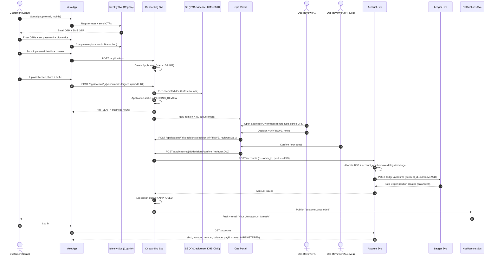
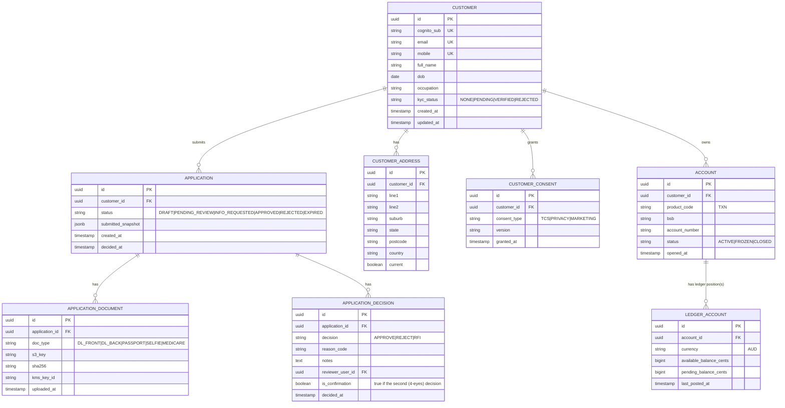

# Workflow 01 — Customer Onboarding (offline / manual KYC)

**MVP requirement:** R2 — Simple customer registration with **offline ID verification carried out manually by the Operations Team**. Automated KYC is roadmap.

## Sample case

> **Sarah**, 29, Sydney, wants to open a Velo account. She downloads the app, taps "Get started", enters her email + mobile, verifies both with one-time codes, sets a password + biometrics, enters her personal details (full name, DOB, residential address, occupation), consents to the T&Cs + Privacy Collection Notice, and uploads a photo of her driver's licence + a live selfie. The app tells her *"We're verifying your details. This usually takes under 4 business hours."*
>
> **Nick** on Velo's Ops team receives a new item in his "KYC Queue" in the internal portal. He opens Sarah's case, reviews the ID document (visible via a signed short-lived URL from S3), cross-checks the details, and clicks **Approve** with a note ("licence verified, address matches"). A second Ops user (four-eyes) confirms.
>
> Sarah's account is **created** — Velo allocates her a BSB + account number from the sponsor bank's delegated range, initialises her ledger balance at zero, records the KYC decision in the audit log, and pushes her a notification: *"Your Velo account is ready 🎉"*. She logs back in and sees her Receive details (BSB, account number, and her PayID which she can now register).

## Actors

- **Customer** (Sarah) — via mobile app / PWA.
- **Velo Customer App** — Next.js + shadcn.
- **Velo Identity Service** — Cognito-backed, handles AuthN / MFA.
- **Velo Onboarding Service** — orchestrates the KYC state machine.
- **Velo Ops Portal** — internal web app for the Ops team.
- **Velo Account Service** — issues BSB + account number, initialises ledger position.
- **Sponsor Bank** — supplies the BSB + account-number range delegation (no per-account API call needed for issuance in MVP; issuance is deterministic within the delegated range and reconciled).
- **Velo Notifications Service** — sends push / email / SMS.

## Sequence diagram



## Alternative flows to be ready to discuss

- **Reject** — Application.status = REJECTED, reason code recorded, customer notified with next-steps.
- **Request more info (RFI)** — Application.status = INFO_REQUESTED, customer re-uploads.
- **Duplicate applicant** (same DOB + name already onboarded) — auto-flag for enhanced review.
- **Under 18 / not Australian resident** — auto-reject at submission.
- **Deposit-cap breach at RADI level** (aggregate approaching $100M or per-depositor $2M) — block issuance; escalate.
- **Timeout** — Application older than 14 days without customer action is auto-expired.

## ERD delta (models this workflow introduces / touches)



**Relations recap**
- One `CUSTOMER` has 0..* `APPLICATION`s (they can re-apply); once approved, exactly one `ACCOUNT` in MVP.
- One `APPLICATION` has many `APPLICATION_DOCUMENT`s and many `APPLICATION_DECISION`s (submit + confirm).
- One `ACCOUNT` has one **primary** `LEDGER_ACCOUNT` (`CUSTOMER_AVAILABLE`) plus 0..N additional positions for holds/pending (e.g. `CUSTOMER_HELD_AML`). The ledger is the source of truth for balance; `ACCOUNT` holds the "product" view. On issuance we open only the `CUSTOMER_AVAILABLE` position.
- `CUSTOMER_ADDRESS` / `CUSTOMER_CONSENT` are versioned lists, never mutated in place, for audit.

## How our services interact at the cloud level

```mermaid
flowchart LR
    subgraph Edge
      CF[CloudFront + WAF + Shield]
    end
    subgraph AppTier[VPC private subnets - Sydney ap-southeast-2]
      APIGW[API Gateway / ALB]
      Onb[Onboarding Svc\nECS Fargate]
      Id[Identity Svc\nCognito]
      Acc[Account Svc\nECS Fargate]
      Led[Ledger Svc\nECS Fargate]
      Notif[Notifications Svc\nECS Fargate]
      OpsAPI[Ops Portal API\nECS Fargate]
    end
    subgraph Data
      PG[(Aurora PostgreSQL\nMulti-AZ)]
      S3[(S3 KYC bucket\nKMS-CMK, Object Lock)]
      MSK[[Kafka MSK\ndomain events]]
      Sec[Secrets Mgr]
      KMS[KMS CMK]
    end
    subgraph Comms
      SES[SES email]
      Twilio[Twilio SMS]
      APNs[APNs / FCM]
    end
    subgraph SponsorRail[Sponsor Bank]
      SPBSB[BSB + acct # range delegation]
    end

    CustomerApp[Customer App - PWA/Next.js] --> CF --> APIGW
    OpsWebApp[Ops Portal - Next.js] --> CF --> APIGW

    APIGW --> Onb
    APIGW --> Id
    APIGW --> Acc
    APIGW --> OpsAPI

    Onb --> PG
    Onb --> S3
    Onb --> MSK
    Onb --> Id

    OpsAPI --> Onb
    OpsAPI --> S3

    Onb -->|customer.onboarded| MSK
    Acc --> PG
    Acc --> Led
    Led --> PG
    Acc -.consumes range.-> SPBSB

    Notif <-- customer.onboarded --- MSK
    Notif --> SES
    Notif --> Twilio
    Notif --> APNs

    PG <-. envelope-encrypted .-> KMS
    S3 <-. SSE-KMS .-> KMS
    Onb -.secrets.-> Sec
```

### Cloud-level interaction narrative
1. Customer traffic terminates at **CloudFront + AWS WAF** (Sydney PoPs), forwarded to **API Gateway / ALB** inside the VPC. Only public subnet is the ALB; every service runs in **private subnets** across at least 2 AZs.
2. **Cognito** is the identity provider. The Onboarding Service never stores passwords. Sessions are short-lived JWTs; refresh happens through Cognito.
3. **Onboarding Service** persists application state in **Aurora PostgreSQL** (Multi-AZ, in `ap-southeast-2`) and writes uploaded documents to a **dedicated KYC S3 bucket** encrypted with a customer-managed **KMS key**, `PutObject` restricted by IAM + bucket policy, **Object Lock** in compliance mode for retention. Docs are served to Ops via **short-lived (≤ 5 min) presigned URLs** — never public.
4. On approval, Onboarding publishes `customer.onboarded` to a **Kafka topic on MSK**. Downstream consumers subscribe without coupling:
   - **Account Service** creates the account and calls **Ledger Service** to open the sub-ledger position.
   - **Notifications Service** dispatches push (APNs/FCM), email (SES), SMS (Twilio).
   - Future: **AML consumer**, **CDR consumer**, **fraud consumer** all subscribe to the same topic — architectural seam.
5. **Ops Portal API** is a distinct service (same repo, separate binary) reachable **only via VPN / Zero-Trust proxy (e.g. Cloudflare Access or AWS Verified Access)** — never on the public internet. RBAC roles are Cognito user-pool groups (`OPS_REVIEWER`, `OPS_APPROVER`, `OPS_ADMIN`), enforced at the API and in the DB via row-level security where feasible.
6. **Sponsor bank** is not called in real time during onboarding in MVP. The BSB and the delegated account-number range are configuration; issuance is local + deterministic (sequence + checksum). The sponsor is informed via the daily reconciliation file that these numbers are now live.
7. **Observability**: every service emits **OpenTelemetry** spans → CloudWatch / Datadog; onboarding events are tagged `pii=true` and scrubbed in logs.
8. **Auditability**: every write is emitted as an event to Kafka and archived to an **immutable "audit lake" S3 bucket** with 7-year Object Lock — this is what satisfies AUSTRAC's records-retention requirement.

## Trade-offs worth flagging on the day

- We are **not** integrating with an automated KYC vendor now. Cost/scope trade — but the onboarding state machine has a `verification_provider` slot so plugging in Frankie/GreenID later is a config change plus a new consumer.
- Four-eyes approval is enforced at the **application layer**, not the DB layer. Simpler; sufficient at MVP scale. A stronger control would be a DB-level workflow engine (Camunda etc.), which we defer.
- BSB + account-number issuance is local. Fastest UX. Risk: local range must be reconciled daily with the sponsor to detect drift.
