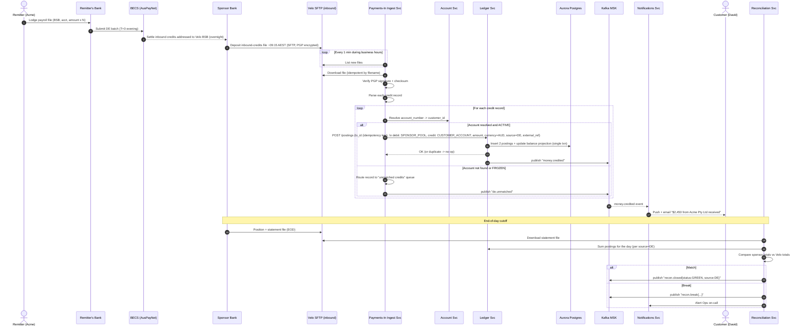
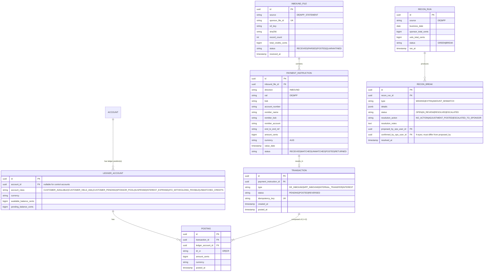

# Workflow 02 — Inbound Direct Entry (DE / BECS) credit

**MVP requirement:** R3 — Support for inbound **Direct Entry (DE) credits** via the sponsor bank.

**Rail context (Australian):** BECS (Bulk Electronic Clearing System, managed by AusPayNet) is the legacy batch payments rail. Files (colloquially "DE files") settle in batches; funds are typically available same business day. As a **Restricted ADI**, Velo does not itself submit files to BECS — the sponsor bank does. The sponsor bank sends Velo the credits addressed to Velo's BSB (or sub-BSB) as an inbound feed, and Velo credits the appropriate customer.

## Sample case

> **David's employer** in Melbourne runs payroll on a Thursday. Their bank (ANZ) lodges a DE file into BECS containing dozens of payroll credits, one of which is: **BSB 802-985, Account 100 234 567, Amount $2,450.00, Reference "PAYROLL W38", Remitter "Acme Pty Ltd"**. That BSB is in the range delegated to Velo by the sponsor bank; the account number belongs to David.
>
> Overnight, BECS settles. The next business day at ~09:15 AEST, the **sponsor bank's SFTP** drops an inbound-credits file into Velo's inbound bucket. Velo's **Payments-In ingest job** picks it up, parses each record, matches the account number to David, posts a **CREDIT to David's ledger** and a matching **DEBIT to the sponsor-pool control account**, marks the transaction settled, and fires an event. David receives a push notification within seconds: *"$2,450.00 from Acme Pty Ltd received."*.
>
> At 11:00 AEST the **Reconciliation job** compares the sponsor's end-of-file totals against Velo's postings for that file. It matches. Recon closes green.

## Actors

- **Remitter's Bank** (any Australian ADI) — originates the DE payment.
- **BECS** (AusPayNet) — batch clearing rail.
- **Sponsor Bank** — Velo's direct clearer; receives inbound DE credits for Velo's BSB; produces an inbound-credits file.
- **Velo Payments-In Ingest** — SFTP puller + parser.
- **Velo Ledger** — double-entry postings.
- **Velo Account Service** — resolves account number to customer.
- **Velo Notifications Service** — push/email.
- **Velo Reconciliation** — end-of-day match.

## Sequence diagram



## Alternative flows

- **Account not found / typo in account number** → record moves to an **"unmatched credits"** queue in the Ops portal. Ops has 2 business days to resolve; otherwise a **return DE** is initiated (this uses the outbound path which is roadmap, so in MVP we settle it manually via the sponsor's ops channel).
- **Account frozen** (AML hold) → credit is accepted into the ledger but posted to a **`CUSTOMER_HELD_AML` ledger position** owned by the same customer account (`ACCOUNT ||--o{ LEDGER_ACCOUNT`). The customer's `CUSTOMER_AVAILABLE` balance does not move. Ops releases the funds via a follow-up `INTERNAL_TRANSFER` transaction from `CUSTOMER_HELD_AML` → `CUSTOMER_AVAILABLE`. See [`docs/08-workflow-qa.md § Q5`](../08-workflow-qa.md#q5-account-frozen-aml-hold--posted-to-a-hold-sub-account-owned-by-the-customer--does-that-mean-the-customer-has-2-accounts-contradicting-1-customer-1-account-1-ledger).
- **Duplicate file** (sponsor re-sends) → the ingest job dedupes by `file_id`; postings dedupe by `external_ref` acting as an idempotency key at the ledger level.
- **Partial file parse failure** → the whole file is quarantined; Ops paged; a manual re-ingest is possible once fixed. Never partial-apply a DE file.
- **Recon break** → automatic re-run at T+30 min; if still broken, block outbound DE (roadmap) and escalate.

## ERD delta



**Key modelling choices**
- **`TRANSACTION` is the atomic unit of business meaning**; **`POSTING` is the double-entry line**. A transaction has ≥ 2 postings whose amounts sum to zero per currency.
- **`LEDGER_ACCOUNT.account_class`** distinguishes customer accounts from **control accounts** (SPONSOR_POOL, SUSPENSE, HOLD, INTEREST_EXPENSE, UNMATCHED_CREDITS). Only customer accounts have a customer-facing `ACCOUNT` row.
- **`idempotency_key`** on transactions uses `rail + external_ref + amount + value_date`. This is what makes replayed DE files safe.
- **`INBOUND_FILE`** is the audit anchor for BECS ingestion; recon joins here.

## How our services interact at the cloud level

```mermaid
flowchart LR
    subgraph SponsorNet[Sponsor Bank network]
      SponSFTP[[SFTP server]]
      SponAPI[REST/webhooks - NPP only]
    end

    subgraph VeloVPC[Velo VPC ap-southeast-2]
      subgraph Ingress
        NAT[NAT GW]
        SFTPClient[SFTP puller\nECS scheduled task]
      end
      subgraph Services
        Ing[Payments-In Svc\nECS Fargate]
        Acc[Account Svc]
        Led[Ledger Svc]
        Recon[Recon Svc]
        Notif[Notifications Svc]
        OpsAPI[Ops Portal API]
      end
      subgraph Data
        S3In[(S3 inbound-files\nSSE-KMS, Object Lock)]
        S3Audit[(S3 audit-lake\n7yr Object Lock)]
        PG[(Aurora Postgres)]
        MSK[[Kafka MSK]]
        KMS[KMS CMK]
      end
    end

    SponSFTP <-. SFTP over VPN/AWS DirectConnect .-> SFTPClient
    SFTPClient --> S3In
    S3In -- S3 Event --> Ing
    Ing --> Acc
    Ing --> Led
    Ing --> MSK
    Ing -->|unmatched| OpsAPI
    Led --> PG
    Led --> MSK
    MSK --> Notif
    Recon <-- schedule EventBridge --- Recon
    Recon --> S3In
    Recon --> PG
    Recon --> MSK
    S3In -.-> KMS
    S3Audit -.-> KMS
    MSK -->|events| S3Audit
```

### Cloud-level interaction narrative
1. Sponsor bank SFTP is reached over **AWS Site-to-Site VPN** or **Direct Connect** — never over the public internet. Only outbound egress from the SFTP puller is allowed via a **security-group + NAT** with an allow-list to the sponsor's SFTP endpoint.
2. **SFTP puller** is a scheduled **ECS task** (EventBridge cron every minute in business hours). It pulls, verifies **PGP** signature, and writes to the **inbound-files S3 bucket**, keyed by `source/date/sponsor_file_id`. The bucket has **versioning + Object Lock in compliance mode** and **SSE-KMS**.
3. **S3 event notification** fans out to Kafka (via MSK Connect / Lambda) or directly to the **Payments-In service** via SQS. Choice: SQS for simplicity, MSK for downstream fan-out. In MVP: **S3 → SQS → Payments-In**; Payments-In then publishes domain events onto MSK.
4. **Payments-In service** validates the file, iterates records, and for each record:
   - Calls **Account Service** to resolve BSB + account number → customer + ledger_account.
   - Calls **Ledger Service** to post the transaction with an **idempotency key**. Ledger uses a **serialisable Postgres transaction** to write both postings and increment the balance projection atomically.
   - Publishes `money.credited` to **MSK** for downstream fan-out.
5. **Notifications Service** consumes `money.credited` and dispatches (SES / Twilio / APNs). Backed by SQS-per-channel to isolate provider outages.
6. **Reconciliation Service** runs on an **EventBridge cron** at the sponsor's cutoff time. It downloads the sponsor statement file, sums Velo's postings for the same business date + source, and either closes green or opens a **RECON_BREAK** and pages the Ops on-call via PagerDuty.
7. **Ops Portal** exposes the **unmatched credits queue** and the **recon break queue**. All Ops actions on money movement go through **four-eyes** and are written to the audit lake.
8. **Backpressure / DR**: SQS + MSK give us backpressure if downstream is slow; if the ledger is down we retry indefinitely — DE credits *cannot* be lost. A **Multi-AZ** Aurora with automated failover keeps ledger writes within RTO.
9. **Blast-radius controls**: the Payments-In service runs in its own AWS account (Control Tower multi-account) so a compromise there cannot reach the customer app database.

## Trade-offs

- **Batch, not streaming, on the DE side** — BECS is fundamentally batch; there's no benefit trying to make it "real-time" beyond fast file pickup.
- **SFTP + PGP is legacy** but universally supported by sponsor banks; the alternative (custom REST) shifts effort onto the sponsor with no MVP payoff.
- **Idempotency at the ledger, not at the file level.** We deliberately allow the same file to be re-ingested; the ledger deduplicates. Simpler recovery story.
- **Single sponsor pool account.** In future we might have per-currency or per-product pools. Not needed for MVP (AUD-only, one product).
