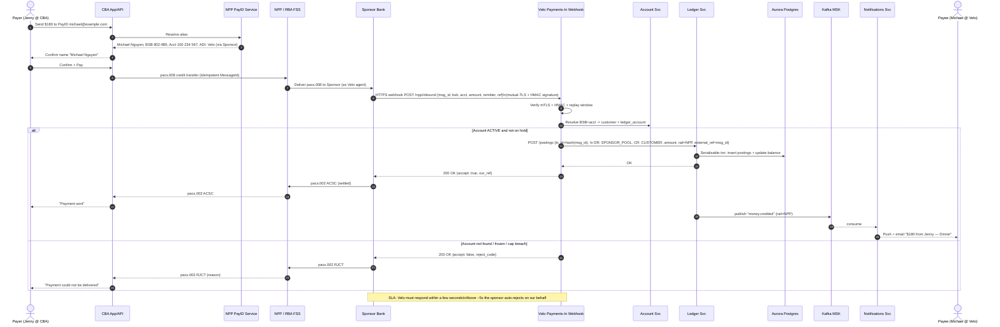
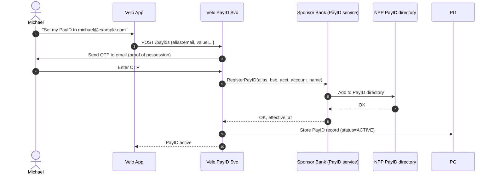
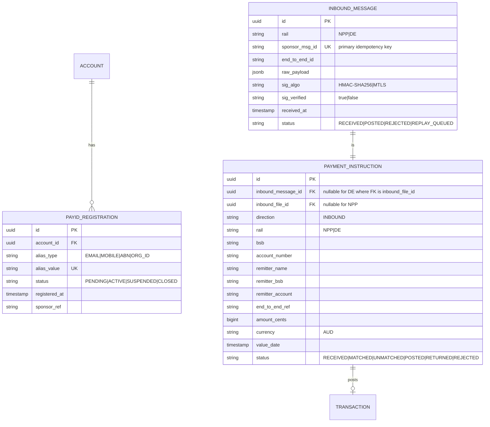

# Workflow 03 — Inbound NPP / PayID credit

**MVP requirement:** R4 — Support for **NPP / PayID incoming payments** via the sponsor bank.

**Rail context (Australian):** NPP (New Payments Platform, operated by NPPA and settled on RBA's Fast Settlement Service) is a **24×7, real-time** rail. Messages use **ISO 20022** (`pacs.008` for credit transfer, `pacs.002` for status). **PayID** is an alias service on NPP that maps a memorable identifier (mobile, email, ABN, ORG ID) to a BSB + account number. **Osko** is an overlay service on NPP for real-time consumer payments (settled the same way, added metadata).

Velo is not a direct NPP participant; the **sponsor bank is the NPP participant** and exposes the NPP flow to Velo via REST + webhooks.

## Sample case

> **Jenny** (Commonwealth Bank customer) wants to Venmo-style send $180 to her friend **Michael** at Velo. She opens the CBA app, chooses PayID, types `michael@example.com` — CBA's app calls NPP's PayID service, which returns "**Michael Nguyen — Velo Bank**". Jenny sees the confirmation name (**name resolution**), enters $180 and "Dinner", taps Pay.
>
> CBA constructs a `pacs.008` payment message and settles it on the RBA's FSS in seconds. The sponsor bank receives the incoming NPP message addressed to Velo's BSB + Michael's account, immediately calls Velo's **inbound webhook** with the payload, and awaits a synchronous accept/reject within a few seconds.
>
> Velo's **Payments-In service** validates the message, resolves the account, and posts the credit to Michael's ledger in a single Postgres transaction. It responds `ACCEPTED` to the sponsor within the NPP SLA. The sponsor sends a `pacs.002` `ACSC` (settled) back through NPP; Jenny's app updates to "Sent". Simultaneously, Velo publishes `money.credited`; Michael's phone buzzes: *"$180.00 from Jenny — Dinner."*.

## Actors

- **Jenny** — payer, CBA customer.
- **CBA** — payer's ADI, NPP participant.
- **NPPA / RBA FSS** — the rail + settlement layer.
- **PayID service (NPP addressing)** — resolves alias to BSB + account.
- **Sponsor Bank** — Velo's NPP participant; calls Velo webhook.
- **Velo Payments-In** — real-time webhook receiver.
- **Velo PayID Service** — manages Velo customers' PayID registrations with the sponsor (owner-facing).
- **Velo Ledger + Account + Notifications** — same as before.

## Sequence diagram

Rendered copy for the submission email: [`docs/exports/npp-inbound-sequence.png`](../exports/npp-inbound-sequence.png).



## PayID registration sub-flow (Velo owner-facing)

Michael has to have his PayID registered against his Velo account first.



## Alternative flows

- **Name resolution mismatch** — MVP: we return the registered `account_name` verbatim; the payer's bank shows it; the risk-based decision to proceed is on the payer.
- **Amount limits** — MVP: no outbound limits from Velo (no outbound feature). Inbound: no per-transaction limit beyond scheme limits. Per-account cap: enforce RADI $2M-per-depositor pre-issuance rejection.
- **Hold / freeze** — if the account is on an AML hold, we still accept (per ePayments code we can't drop funds), but post to a `HOLD` sub-account and notify Ops.
- **Duplicate webhook** — dedup by `msg_id`; ledger idempotency key ensures single posting even if the sponsor retries.
- **Timeout / degraded ledger** — Velo must respond within seconds; if unable, respond `202 ACCEPTED_PROVISIONAL` (if the sponsor supports it) or `RJCT_TECHNICAL`. Failed webhooks are pushed to a **replay queue** for post-recovery reconciliation.
- **Return payment** — Osko allows returns within ~30 days. In MVP we surface it via ops portal (manual sponsor coordination); outbound return automation is roadmap.
- **Mistaken payment** — customer contacts us; Ops raise a mistaken-internet-payment claim with the sponsor per ePayments Code Ch B.

## ERD delta

Reuses `INBOUND_FILE` model conceptually as `INBOUND_MESSAGE` for real-time. Adds `PAYID_REGISTRATION`.



`TRANSACTION` and `POSTING` are the same models introduced in workflow 02. The unifying `PAYMENT_INSTRUCTION` model lets both rails share one settlement / posting pipeline downstream.

## How our services interact at the cloud level

```mermaid
flowchart LR
    subgraph SponsorNet[Sponsor Bank]
      SBWH[NPP outbound webhook client\n(mTLS)]
      SBPayID[PayID registration API]
    end

    subgraph Edge
      CF[CloudFront]
      APIGW[API Gateway - dedicated webhook stage\nmTLS + WAF + rate limit]
    end

    subgraph VeloVPC
      Ing[Payments-In webhook Svc\nECS Fargate autoscale]
      PSvc[PayID Svc]
      Acc[Account Svc]
      Led[Ledger Svc]
      Notif[Notifications Svc]
      PG[(Aurora Postgres\nMulti-AZ, r/w splitter)]
      MSK[[Kafka MSK]]
      SQSReplay[[SQS webhook-replay DLQ]]
      Sec[Secrets Mgr - HMAC keys]
      KMS[KMS CMK]
      Cache[(ElastiCache Redis\nidempotency + hot balance cache)]
    end

    SBWH == mTLS ==> APIGW
    APIGW --> Ing
    Ing --> Cache
    Ing --> Acc
    Ing --> Led
    Ing --> MSK
    Ing -.-> Sec
    Ing --> SQSReplay
    Led --> PG
    Led --> MSK
    MSK --> Notif
    PSvc --> SBPayID
    PSvc --> PG
    APIGW --> PSvc
```

### Cloud-level interaction narrative
1. The sponsor's NPP webhook client calls a **dedicated API Gateway stage** (e.g. `webhook.velo.com.au/npp/inbound`) enforcing **mutual TLS** (sponsor's certificate pinned) and **WAF** with a **per-source rate limit**. Response SLA is a few seconds — anything slower and the sponsor rejects.
2. The **Payments-In webhook service** is horizontally scaled on ECS Fargate behind an internal ALB. It's **stateless per request**. On receipt:
   - Verifies **mTLS** cert (edge) and **HMAC** signature (app) using a key from **Secrets Manager**; keys rotate quarterly.
   - Checks an **idempotency cache in Redis** keyed on `sponsor_msg_id` (TTL 24 h); if seen, replies with the cached response — no ledger touch.
   - Resolves the account via **Account Service** (cached in Redis).
   - Calls **Ledger Service** which executes a **serialisable Postgres transaction**: insert 2 postings + update balance projection. Ledger enforces its own idempotency via `unique(transaction.idempotency_key)`.
3. If the ledger call succeeds, Payments-In returns `200 OK` `{accept:true}` **synchronously**. Only then is the `money.credited` event published to **MSK** (post-commit) for downstream Notifications / audit consumers.
4. If Postgres is momentarily unavailable, Payments-In returns `503` or `202` (per sponsor contract) — sponsor retries, our idempotency ensures no double credit. Persistently failing messages land on **SQS DLQ (webhook-replay)** for engineer-in-the-loop resolution.
5. **PayID Service** talks to the sponsor's REST API for registration/deregistration. Sponsor pushes any deregistration notifications back to our webhook endpoint (e.g. `/npp/payid/status`).
6. The sponsor's daily **NPP statement file** flows in via the SFTP path (workflow 02) and drives the **NPP reconciliation** — the same recon engine, different `source`.
7. **Latency budget** for the webhook end-to-end (edge → ledger commit → response):
   | Hop | Budget |
   |---|---|
   | TLS + mTLS handshake (reused) | ~10 ms |
   | WAF + APIGW | ~20 ms |
   | Webhook service processing | ~30 ms |
   | Redis idempotency lookup | ~2 ms |
   | Account resolve (cache hit) | ~2 ms |
   | Ledger Postgres commit (Multi-AZ) | ~40 ms |
   | Response back to sponsor | ~15 ms |
   | **Total** | **~120 ms P50, ~400 ms P99** |
8. **Blast radius**: Payments-In runs in its own subnet + security group; only outbound access is to Aurora, Redis, Kafka, Secrets Manager. No egress to the internet.
9. **DR**: Aurora **Multi-AZ** in `ap-southeast-2` + **cross-region read replica** in `ap-southeast-4`. In a full-region loss, we fail over — the webhook will error a few minutes; the sponsor retries; nothing is lost.

## Trade-offs

- **Synchronous accept/reject** matches the NPP mental model but couples our uptime to inbound money flow. We accept this — the alternative (accept everything then post asynchronously) risks accepting money we cannot post to any account (unmatched), which becomes a compliance headache.
- **Redis for idempotency** speeds the hot path; the ledger's DB uniqueness constraint is the source of truth. Redis is a cache, not the store — safe if it flushes.
- **Kafka is post-commit only** — we never publish "money.credited" before the DB commit. This avoids customers seeing a notification for a payment that got rolled back.
- **We store the raw NPP payload** — bigger DB footprint but priceless for disputes / AML / recovery.
