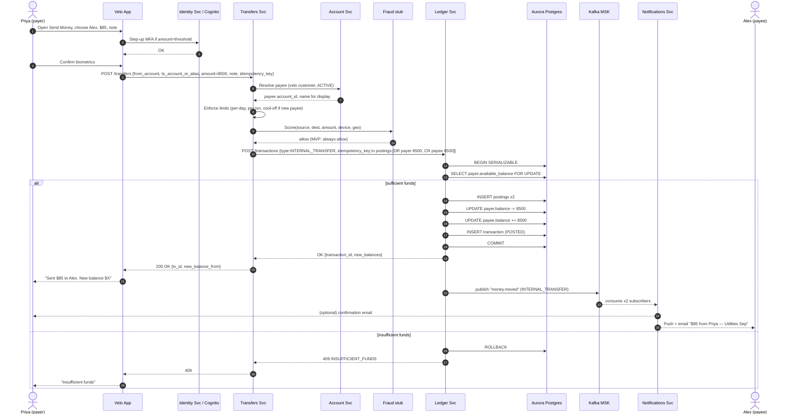
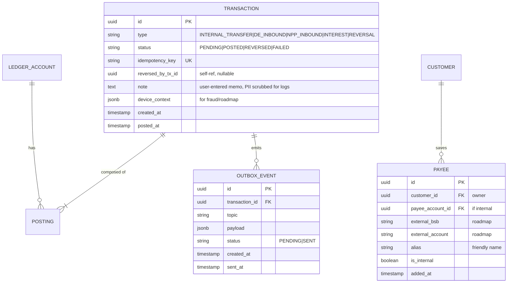

# Workflow 04 — Real-time Internal (Velo → Velo) Transfer

**MVP requirement:** R5 — Real-time intra-platform transfers between Velo customers with **immediate funds availability**.

**Rail context:** No external rail. Both sides of the transfer are on Velo's ledger. Settlement is purely intra-ledger; the sponsor bank sees nothing (the pool position doesn't change). This is the simplest external picture and the most interesting *internal* picture — it's the first place your ledger design gets stress-tested.

## Sample case

> **Priya** owes her flatmate **Alex** $85 for utilities. Both banked at Velo. Priya opens the Velo app, taps **Send Money**, chooses Alex (already in her Velo contacts because they're both Velo customers), enters $85, notes "Utilities Sep", and confirms with biometrics.
>
> Velo's **Transfers Service** validates the instruction, calls the **Ledger** to execute a single atomic transaction: **DEBIT Priya's customer account, CREDIT Alex's customer account**, both in AUD, both immediately available. The ledger commits in a single serialisable Postgres transaction. Priya's app updates within ~200ms to show the new balance; Alex's phone buzzes ~500ms later with a push notification. Done.
>
> **No sponsor bank involvement, no NPP, no BECS.** Just a book transfer on the sub-ledger.

## Actors

- **Priya** (payer) and **Alex** (payee) — both Velo customers.
- **Velo App** — customer surface.
- **Velo Transfers Service** — validates, enforces limits, orchestrates.
- **Velo Ledger** — atomic double-entry.
- **Velo Account Service** — resolves recipient (name, ability to receive).
- **Fraud hook (stub in MVP)** — a pass-through in MVP; the seam exists for roadmap.
- **Notifications Service** — push/email to both parties.

## Sequence diagram



## Alternative flows

- **Payee not on Velo** — MVP: block ("recipient not found"). Roadmap: fall through to outbound NPP/PayID.
- **Frozen payee account** — reject (`RECIPIENT_UNAVAILABLE`).
- **Frozen payer account** — reject.
- **Amount above per-txn or per-day limit** — soft reject with reason; require step-up.
- **New payee cool-off** — if payee added in last 24 h, cap to $500 first day (fraud control seam).
- **Idempotent retry** — client sends same `idempotency_key`; Ledger returns the previously committed result unchanged.
- **Deadlock / serialisation conflict** — Ledger retries on `40001` up to 3 times with jitter; if all fail, `503` and client re-tries.
- **Reversal** (Ops-initiated) — a new transaction of type `REVERSAL` posts the mirror; original is marked `REVERSED`. Original is **never** deleted; the ledger is append-only.

## Concurrency correctness — the interview-friendly explanation

The internal transfer is a nice bite-sized case to demo your understanding of ledger correctness. Bring up:

1. **Two postings must be atomic.** They live in the same DB transaction. Kafka publish happens **after** commit (outbox pattern).
2. **Sufficient-funds check** uses `SELECT ... FOR UPDATE` on the payer's balance row to prevent race between two concurrent transfers from the same account. Or better: apply the delta with a conditional `UPDATE ... WHERE available_balance >= X` and check `affected rows`.
3. **Serialisable isolation** avoids phantom-read hazards on `SUM(postings)` if you ever recompute the balance from the ledger inside the same transaction.
4. **Balance projection vs ledger truth.** The balance row is a *cache/projection*. If it disagrees with `SUM(postings)`, we trust the postings and repair. The daily recon job asserts equality.
5. **Idempotency key** is client-generated (`UUIDv4` per user tap), unique-indexed on the transactions table. Prevents double-spend on retries.
6. **Kafka outbox.** Ledger writes an `outbox` row in the same DB txn; a Debezium/CDC connector publishes to Kafka. Guarantees exactly-once effect on the ledger with at-least-once delivery downstream.

## ERD delta

No new tables — this workflow exercises the **existing** `TRANSACTION` + `POSTING` + `LEDGER_ACCOUNT`. We add a couple of columns and one auxiliary table:



## How our services interact at the cloud level

```mermaid
flowchart LR
    App[Velo App PWA/Mobile] --> CF[CloudFront + WAF]
    CF --> APIGW[API Gateway / ALB]
    APIGW --> Tx[Transfers Svc\nECS Fargate]
    Tx --> Acc[Account Svc]
    Tx --> FR[Fraud stub\n(future: rules engine)]
    Tx --> Led[Ledger Svc]
    Led --> PG[(Aurora Postgres Multi-AZ)]
    PG -- outbox rows --> CDC[Debezium on MSK Connect]
    CDC --> MSK[[Kafka MSK: money.moved]]
    MSK --> Notif[Notifications Svc]
    Notif --> SES
    Notif --> APNs
    Tx -.-> Redis[(ElastiCache: hot balances + limits)]
```

### Cloud-level interaction narrative
1. **Transfers Service** is a normal HTTP service behind API Gateway; it does not talk to the sponsor bank at all.
2. **Ledger Service** owns the database. All writes go through it. It exposes an internal-only gRPC/HTTP surface, no direct DB access from any other service.
3. **Outbox pattern** on Aurora: the ledger commits `transaction`, `posting`s, and an `outbox_event` row in one transaction. A **Debezium** source connector running on **MSK Connect** tails the WAL and publishes to the `money.moved` topic. Downstream `Notifications` consumer sends push/email/SMS.
4. **Redis** caches the current balance for a customer for fast reads (< 1 ms). Cache is invalidated by the same outbox pipeline. The **ledger** never trusts the cache for correctness — only for reads to the app.
5. **Step-up auth** for higher-value transfers routes back through **Cognito** for a fresh MFA token.
6. **RBAC + segregation of duties** for Ops-initiated **reversals** — always four-eyes, always audited, always via the Ops Portal (never the customer app).
7. **Blast radius**: Transfers Service is stateless and horizontally scaled; a compromise cannot mutate the ledger without a signed request through the Ledger Service's internal API.
8. **DR**: internal transfers are the workflow that must never be down; Aurora Multi-AZ + Ledger Service Multi-AZ + Redis Multi-AZ; app failover is seamless within region.

## Trade-offs

- **We chose Postgres serialisable + row-lock, not an event-sourced ledger** (e.g. Axon, EventStoreDB). Postgres is boring, understood, and fast enough for MVP throughput. Event-sourcing gives replayability but is overkill at seed stage and harder to hire for.
- **Kafka outbox instead of dual-write**. We accept ~sub-second delay between commit and downstream notification in exchange for exactly-once correctness. Fine for UX.
- **Fraud is a stub in MVP.** Interface exists (`FraudService.score(tx)`); default is `ALLOW`. Roadmap plugs in a real engine without touching Transfers or Ledger.
- **Notes/memos are stored in the ledger.** Simpler than a side-table; but we scrub them from logs (PII).
