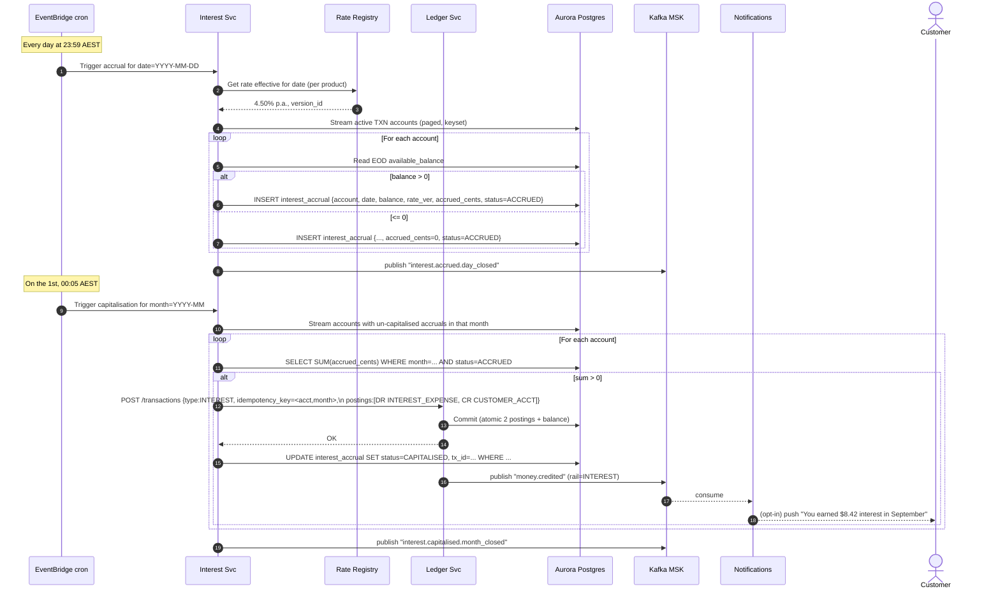
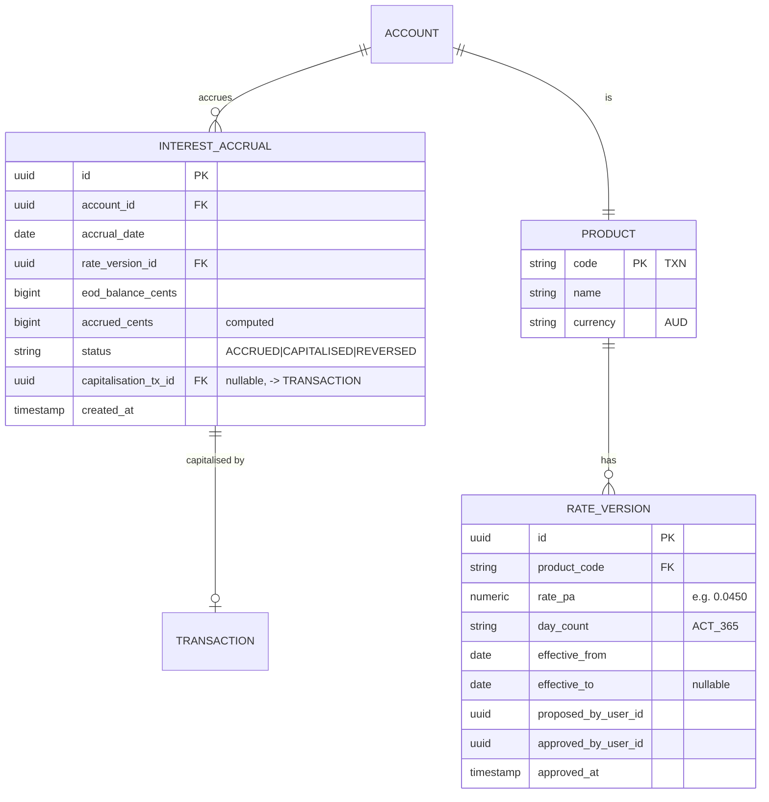
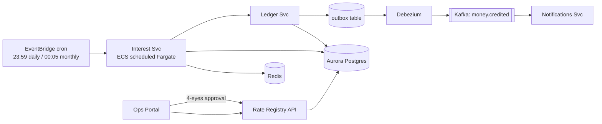

# Workflow 05 — Interest Accrual & Monthly Capitalisation

**MVP requirement:** R13 (implicit from R1 — "**competitive interest on positive balances**").

The brief spends one sentence on interest, but a bank that ships a "high-interest" account without an accrual and capitalisation engine is not shipping a real product. This is the least glamorous but most audit-heavy workflow in the MVP.

## Sample case

> Velo's published rate for the Transaction Account is **4.50% p.a.**, accrued daily on end-of-day cleared balance (ACT/365), capitalised on the **1st of each month**, gross of any tax (customer's Tax File Number handling is roadmap).
>
> On **30 September**, at 23:59 AEST, the **Interest Accrual job** wakes up. For every active account with a positive EOD balance, it computes `accrued_today = balance * rate / 365`, stored to a satellite `interest_accrual` table. **No customer-visible balance change.**
>
> On the **1st of October**, at 00:05 AEST, the **Interest Capitalisation job** runs. For each account, it sums the accruals for September, posts a single `INTEREST` credit transaction to the customer's ledger and a matching debit to the **INTEREST_EXPENSE** GL account, and marks those accrual rows as capitalised. The customer sees `+ $8.42 Interest — September` in their app and receives a push notification if they've opted in.

## Actors

- **Cron** — EventBridge schedule.
- **Interest Service** — the accrual + capitalisation logic.
- **Ledger** — same as everywhere.
- **Rate Registry** — versioned rate configuration owned by Ops.
- **Ops Portal** — where a treasurer changes the rate (with four-eyes + audit).

## Sequence diagram

## Alternative flows

- **Rate change mid-month** — new `rate_version` becomes effective on a specific date; the accrual job picks the version whose validity window covers the accrual date. Ops must approve rate changes via four-eyes.
- **Account closed mid-month** — capitalisation runs on account close and settles pro-rata (post final interest and close).
- **Account frozen** — accrual continues (customer's money still earns); capitalisation still posts to the customer account (frozen just means outflow blocked).
- **Failed capitalisation for a subset of accounts** — the un-processed accruals stay `ACCRUED`; a retry job re-runs at 04:00 AEST. Idempotency key `(account_id, month)` prevents double-capitalisation.
- **Reversal** — never negate an interest posting; post a `REVERSAL` transaction and mark original `REVERSED`.
- **Withholding tax (TFN not supplied)** — MVP: single-jurisdiction (AU), no withholding applied. Roadmap: add `withholding_tax_cents` split posting.

## ERD delta

**Notes**
- Store the **rate version** alongside every accrual row so a historical accrual is fully reconstructable from data alone.
- Store the **EOD balance snapshot** (not just the accrued amount) — this is what auditors want.
- **`(account_id, accrual_date)` unique** — one row per account per day.
- **`(account_id, month)` unique on capitalisation transaction** via `idempotency_key = "INT|" + account_id + "|" + yyyy-mm`.

## How our services interact at the cloud level

### Cloud-level interaction narrative
1. Interest runs on **EventBridge cron** into a **Fargate scheduled task** — one task type for accrual, another for capitalisation. Sized to run the entire book in ~10 min at MVP scale (100k accounts).
2. **Accrual is idempotent per `(account_id, accrual_date)`**; re-runs are safe.
3. **Capitalisation** is also idempotent per `(account_id, month)`. The idempotency key extends the same design used across the ledger.
4. The **Ledger** is the same service used by transfers/DE/NPP — same postings, same table, same audit lake. This is a deliberate choice: interest is just another kind of money-in event, so it uses the same infrastructure.
5. **Rate changes** are proposed in the Ops Portal, require **four-eyes** approval, and are stored versioned. The Interest Service reads the effective version at run-time, not deployment-time — so a rate change never requires a code deploy.
6. **Observability**: emit metrics `accruals.count`, `accruals.sum_cents`, `capitalisations.count`, `capitalisations.sum_cents` per day/month; page on-call if today's accrual count differs from yesterday's by > 5%.
7. **Audit**: every accrual + capitalisation event lands in the audit lake with the rate version, EOD balance, and computed amount. Recreate any customer's interest history at will.

## Trade-offs

- **We accrue daily, capitalise monthly** — matches the market norm for high-interest transaction accounts and simplifies statements. Alternative: accrue and capitalise continuously (would surprise customers watching their balance).
- **We do not apply tax withholding in MVP** — Australia's rules on TFN and non-resident withholding are non-trivial; roadmap item; safer to defer than half-do.
- **Balance-based accrual on EOD, not on tiered / intraday minimum** — simpler product, honest with customers; upgrades later without schema change.
- **Interest expense is booked to a single GL account** in MVP — sufficient for the small chart of accounts a RADI runs. Full CoA / branch-level segmentation is roadmap.
